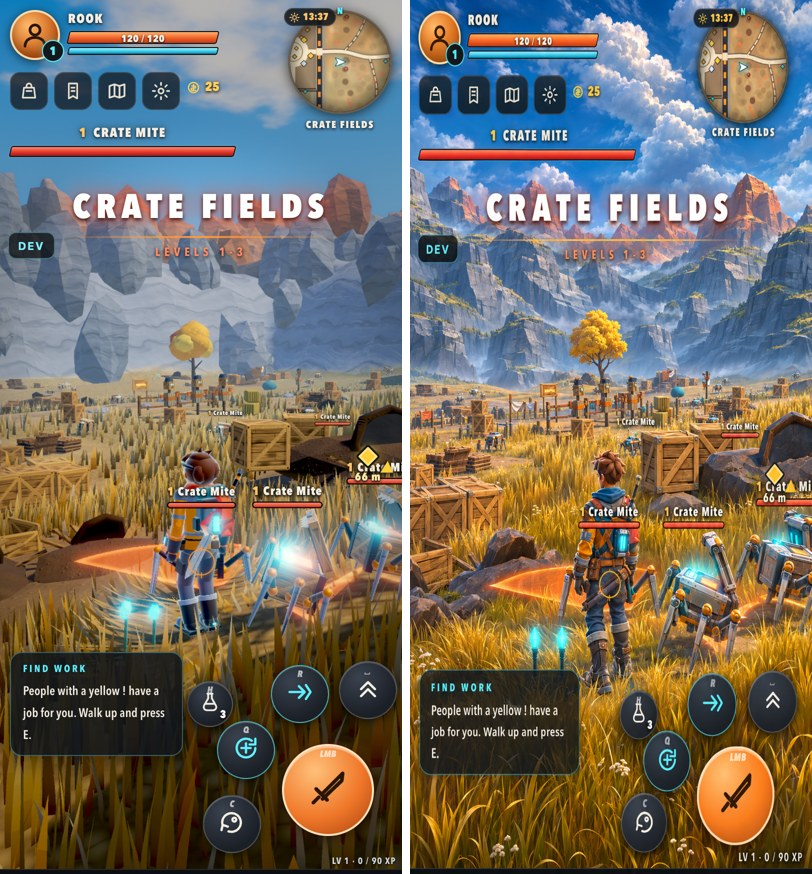

# CRATEFALL: the AAA+++ plan

Written 2026-11-25 against commit `81c7fdd` (the one-shot build, live at
https://raynos.github.io/showcase-zone-clean-room/).

This plan comes from an audit of that build: three independent reviews
(rendering and performance, moment-to-moment feel, spec and content), a
16-view screenshot tour on the phone quality tier at 402×874, and the owner's
own phone playtest. Evidence is cited as `file:line` or as a measurement.
Unless a line says "reproduced", bugs were read from code, not triggered in
play.

## 1. Verdict

The one-shot delivered breadth. Every place, system and fight in
`ZONE-DESCRIPTION.md` exists (71 of 78 requirements done, 7 partial, none
missing) and the game runs at 60 fps on desktop. It does not yet look or play
like a shipped console game. It reads as a responsive, well-instrumented
prototype with a strong UI.

| Area | Today | The gap |
|---|---|---|
| UI panels, HUD art | Strong | Button meaning, tracking, chat |
| Hit feedback | Good | Keep; trail too big |
| Town composition | Good | Flat light, plain surfaces |
| Lighting | Weak | No AO, no local lights |
| Surfaces | Weak | 256² tiling, no wear or decals |
| Characters | Weak | Rigid toy bodies, no face |
| Sky, backdrop, scale | Weak | Faceted cliffs wall in the view |
| Combat depth | Weak | Light combo and two skills |
| Combat camera | Weak | Stares at enemies; boss shows shins |
| Being hit, weight | Weak | No stagger, no inertia |
| Living world | Missing | No other adventurers, chat, events |
| Endgame | Missing | Nothing after the Titan |
| Phone headroom | Poor | 1.1–1.75M triangles per frame |

The owner's playtest agrees: it runs fine, it looks flat (lighting, surfaces,
characters and world drama all named), the combat camera locks onto enemies
even when running away, the buttons work but do not say what they do, and
combat is too simple.

## 2. Decisions already made

These came from the owner on 2026-11-25 and are settled unless reopened.

- **Standing of this game (added later the same day):** CRATEFALL stays free
  as its own standalone game. It does not have to match any other design it
  was derived from: the third-person hero, the dodge roll, the skills and
  the names all stay. From here it is steered toward experiments the owner
  names, which take priority over the long tail of this plan.
- **Rulings of 2026-11-25, evening:**
  - Characters: accept the chunkier stylised look and move on. Fix defects
    (wood-grain cloth, Rook's back view), stop chasing the painted targets.
  - Grind: the pacing table in phase 9 stands; `?boost=<n>` stays.
  - Sword against guns: the measured balance stands.
  - Aiming down sights always goes to first person, from either view. On
    desktop, right-click toggles it.
  - The HUD is rejected as button spam. It is redesigned from first
    principles, from a study of the leading mobile action games and PC
    MMOs (`docs/HUD-STUDY.md`, `docs/HUD.md`).
  - Work on `main`; push early and often, as with commits.
- **Audience:** a short clip, a full playthrough, and a game that keeps being
  built. All three count.
- **Art inputs:** code, AI-generated images (via `codex`), and Blender
  (5.3 is installed at `/opt/homebrew/bin/blender`).
- **Art direction:** keep the current stylised look, polish it to the top of
  its class, and push the stylisation harder. Not realism.
- **Characters:** heroic stylised proportions. The hero stays the fixed
  character Rook; no character creator.
- **Levelling:** honour the spec. Fighting is the main source of XP and 1–20
  is a long grind. The one-shot's quest-XP boost (`78cb4a0`) gets reverted.
- **Other adventurers:** simulated players in the open world and as ambient
  life. They never join the player's party and never touch the player's
  fights or loot. The vault, gauntlet and Titan stay solo.
- **Beyond the spec:** new systems and content may be added freely. The spec
  is the floor.
- **Download:** tens of megabytes are acceptable if staged, with a polished,
  informative, interactive loading screen and PWA caching.
- **Work mode:** long autonomous runs, up to five subagents in parallel, no
  workflows, commit early and often.
- **Renderer:** stays three.js on WebGL2. (Plan decision, not the owner's;
  a WebGPU port would mean rewriting every custom shader.)

## 3. Method: golden frames and remaster targets

The owner's suggestion, adopted as the backbone of the plan.

1. **Capture up to 24 golden frames.** Fixed camera, time of day, weather and
   scene state, scripted so each one can be re-shot exactly
   (`tools/golden.sh <name>` writing `docs/golden/now/<name>.png`), on the
   phone tier at 402×874.
2. **Generate a remaster target for each.** Feed the frame to `codex` image
   generation with one shared brief: same camera, composition, palette and
   HUD; only the rendering quality rises, as if it were a PS5 remaster.
   Save to `docs/golden/target/<name>.png`.
3. **Write the look bible.** One page (`docs/LOOK.md`) that turns what the
   targets have in common into rules: light direction and contrast, shadow
   colour, material language, character proportions, sky, fog, VFX, UI.
4. **Work toward the targets.** At the end of every visual work item,
   re-shoot the affected frames, build a side-by-side sheet, and write down
   the three largest remaining differences per frame. Those become the next
   items.
5. **Judge without anchoring.** A fresh subagent that has seen nothing else
   is shown each pair and asked which is the remaster and why. The answers
   are the gap list.

Targets are direction, not specification. An image model will paint detail a
phone cannot render, so the budgets in section 4 win any conflict.

### Pilot: it works

One frame (Crate Fields, midday, mid-fight) went through the pipeline on
2026-11-25. The result kept the camera, composition, hero position, enemies
and the whole HUD, and changed only the rendering. Both images, the
side-by-side and the prompt are in `docs/golden/pilot/`.



What the target has that the game does not, in the order the eye finds it:

1. **A sky with weight.** Tall cumulus with lit tops and shaded bases, where
   the game has a gradient and a few wisps.
2. **Mountains with structure.** Layered rock strata, snow, and three depth
   bands fading to blue, where the game has faceted grey and orange blocks.
3. **Fine, dense grass** with seed heads and small flowers, lit warm on top
   and dark at the roots, where the game has large spiky shards.
4. **A hero with a body.** Athletic proportions, visible neck and shoulders,
   layered straps and plates, where the game has a short boxy toy.
5. **Robots with engineering.** Jointed legs, panel seams and lit sensors
   on the mites.
6. **Grounding.** Every crate, rock and foot sits in a soft dark contact
   shadow.
7. **Rocks and clutter** breaking up the ground between the grass.

The command, for reuse (the prompt must come from stdin, because `-i` takes
every following argument as an image):

```sh
codex exec --skip-git-repo-check -s workspace-write -C <dir> \
  -i golden.png - < prompt.txt
```

One image took about four minutes.

### The 24 frames

| # | Frame | What it tests |
|---|---|---|
| 1 | Title screen | First impression |
| 2 | First frame after Start | The brief's "wow" |
| 3 | Town square, morning | Architecture, light |
| 4 | Market street and stalls | Surfaces, props |
| 5 | Dialogue close-up | Faces, cloth |
| 6 | Town at night | Local lights |
| 7 | Blast Wall gate, looking east | Scale, vista |
| 8 | Crate Fields fight, midday | Grass, robots |
| 9 | Sword finisher, impact frame | VFX, weight |
| 10 | Pallet Docks landmark | Hard surfaces |
| 11 | Plumb Heights vista | Depth, backdrop |
| 12 | Slagworks at dusk | Emissive, heat |
| 13 | Rivet Row | Industrial detail |
| 14 | Arc Field | Energy VFX |
| 15 | Gate elite fight | Enemy design |
| 16 | Night shift in the fields | Night readability |
| 17 | Storm hour at a beacon | Weather drama |
| 18 | Rock lookout bench | The big vista |
| 19 | Riding course, on horseback | Mount, motion |
| 20 | Zipline into town | Speed, composition |
| 21 | Training Vault, Warden | Interior light |
| 22 | Gauntlet court, mid-wave | Crowd combat |
| 23 | Crate Titan, phase 2 | Boss scale |
| 24 | HUD and bag panel | UI and controls |

## 4. Budgets and guard rails

Targets for the phone tier ("medium"), to be confirmed on the owner's device.

| Budget | Today | Target |
|---|---|---|
| Triangles per frame, worst view | 1.75M | 900k |
| Draw calls, worst view | 442 | 280 |
| Grass triangles | 570k, constant | 150k in view |
| Shadow pass share of frame | about half | about a quarter |
| JS heap, steady | 270 MB | 200 MB |
| Download before town is playable | 1.9 MB | 10 MB |
| Total download, cached | 1.9 MB | about 50 MB |

"Today" figures were measured in headless desktop Chrome on the phone tier.
Nothing has been measured on a phone.

Guard rails, built in phase 0 and run after every phase:

- **`?perf` overlay** for the owner's phone: frame time, resolution scale,
  draw calls, triangles, heap.
- **Playthrough bot** that plays level 1 to the Titan without cheats and
  reports deaths, time per band and any stall.
- **Golden re-shoot** with side-by-side sheets.
- **Auto-deploy** so the live URL always matches the branch.

## 5. Phases

Effort marks: **S** under an hour of agent work, **M** a few hours, **L** a
day or more. A "run" is one autonomous session with up to five subagents.
Run counts are guesses; the one-shot took about two and a half hours.

### Phase 0: unblock and instrument (half a run)

Goal: nothing can trap the player, and every later change is measurable.

- **Gauntlet soft-lock (S).** Courts II and III are sealed on every boot
  (`src/world/east.ts:279`). Quitting inside one after a win reloads the
  player behind closed doors with no mobs. Leave doors open when idle,
  relocate on load, and add "Return to Brasswick" to Settings.
- **Main quest dead end (S).** The gauntlet can be cleared before its quest
  is accepted; the flag fires once (`east.ts:405`) and `accept()` only
  pre-credits `reach:` objectives (`src/systems/quests.ts:74`). That locks
  the final quest. Pre-credit flags and kills on accept. Checked in code.
- **Storm Hour stalls night (S).** The clock is pinned at 19.4, before night
  begins at 20.2 (`east.ts:342`). The storm should also end at the fourth
  beacon, as its banner says, not at turn-in.
- **Aggro never drops (S).** Mobs stay in combat 48 m away, which blocks
  health regen and holds combat music (`src/systems/mobs.ts:167`).
  Reproduced by the feel review.
- **Autosave ignores position (S).** Only page-hide saves it
  (`src/game.ts:249`).
- **Dead content (S).** `beacon_fuse` does nothing; Pack Expansion buys
  nothing because 14 item kinds fit 16 slots; the buff row is never fed
  (`src/ui/hud.ts:222`); seven of 14 audio loops and the gauntlet track are
  built but never played.
- **Physics-yard lock-up (S).** May trap the same way as the gauntlet
  (`src/world/west/physics.ts:309`). Unconfirmed; check and fix.
- **Arena fall-through (S).** Seen once during the build; a safety net
  exists. Find the cause.
- **Guard rails (M).** The four tools listed in section 4. Auto-deploy is a
  GitHub Actions workflow that builds and publishes Pages on push.

Done when: the bot reaches the Titan with no stall, and a push updates the
live URL without anyone running a command.

### Phase 1: golden frames and look bible (half a run)

Goal: an agreed picture of "done".

- Script and capture the 24 frames (M).
- Generate the 24 remaster targets (M). The pilot in section 3 took about
  four minutes for one frame, so run them in parallel.
- Write `docs/LOOK.md` (S).
- **Owner checkpoint:** look at the targets and reject any that go the wrong
  way. This is the one human decision that steers every visual phase.

Done when: targets and look bible are committed and the owner has seen them.

### Phase 2: performance headroom (one run)

Goal: buy the budget that light, surfaces and denser characters will spend.

1. **Grass ignores the frustum (M).** 840k vertices run a costly shader,
   centred on the camera with culling off (`src/world/grass.ts:75,97,130`).
   Portrait horizontal view is 32°, so about nine tenths is clipped. Cull by
   sector and shorten the trample loop. About 450k fewer triangles.
2. **Shadow pass is half the frame (M).** 105–258 calls and 340–780k
   triangles. Stop terrain casting, use a finer caster grid without small
   flora, update the far cascade at half rate, drop to 1536² on medium.
3. **Draw order is backwards (S).** Sky and terrain are shaded first and then
   covered. Order props and grass first, terrain next, sky last with a depth
   test.
4. **Two idle point lights in every lit shader (S–M)**
   (`src/gfx/fx.ts:302`). Replace with a uniform flash term.
5. **No LOD or distance cull on the static world (M–L).** 1.13M triangles in
   123 meshes; `viewDist` is never read and the far plane is 1400. Finer
   grid, far-LOD trees, far plane matched to fog.
6. **Memory (M).** 115 MB of vertex data is kept on the CPU after upload
   (`src/gfx/geo.ts:324`). Drop it and quantise. Lowers the risk of iOS
   killing the tab.
7. **Sharpen pass (S).** The image is upscaled from 1.75× on a 3× screen and
   looks soft. Contrast-adaptive sharpening in the final pass, which also
   makes 1.5× viable.
8. **Rapier wasm (S–M).** 4.1 MB of the 4.6 MB entry chunk is base64 wasm.
   Switch to a streamed `.wasm` fetched in parallel.

Done when: the section 4 triangle, draw-call and heap targets are met in the
measured views, and the owner's phone shows a steady frame time in `?perf`.

### Phase 3: controls, camera and weight (one run)

Goal: fix what the owner felt in the hand.

Camera:
- **It stares at enemies while the player flees (S).** Target framing runs
  whenever a target exists (`src/core/camera.ts:88`). Frame the target only
  while engaged: attacking, strafing or closing. Release it when the player
  runs away for more than about 0.4 s or sprints, and hand back to the
  follow assist. Drop the target entirely after a few seconds of fleeing.
- **Boss framing (M).** At 4.6 m the Titan fills the screen with its shins
  and the arm wind-up is off-screen (`src/world/arena.ts:426`). Add a
  large-target mode: pivot moved toward the boss chest, camera pitched up,
  pulled back and widened.
- **Clipping (S).** Collision is one centre ray (`camera.ts:110`). Use a
  sphere cast and collide the shoulder offset. Fade small props near the
  lens.

Buttons (the owner: "confusing what the buttons do"):
- **Redesign the action cluster (M).** Each button shows a weapon-specific
  icon, a short label until the player has used it a few times, a cooldown
  sweep, and a dimmed state when energy is short. Lay them along the right
  thumb's arc with the most-used nearest. Golden frame 24 is the test.
- **Target button and aim-while-firing (S–M).** Touch has no lock or cycle
  control, and a held bow or rifle cannot be steered because the attack
  button captures the pointer (`src/ui/hud.ts:113`). Let a drag on the
  button steer the aim.
- **Tips out of the stick zone (S).** The tip card sits on the left thumb's
  rest position.
- **Press feedback (S–M).** Visible press states and sound. Haptics need a
  device check: iOS Safari has no `navigator.vibrate`
  (`src/game.ts:234`); a switch-input tick is the known workaround.

Weight:
- **Being hit means nothing (M).** Add a short stagger on big hits, a
  knockdown with get-up on the heaviest, and a directional damage arc.
- **Telegraphs rely on a floor decal (M).** Every attack shares one wind-up
  pose and grass hides the decal. Give each attack its own pose, draw decals
  over grass, add screen-edge arrows for off-screen wind-ups.
- **Lunge is a warp (S–M).** Up to 5.5 m in 0.13 s
  (`src/systems/combat.ts:427`), and the feet slide. Cap distance and speed
  and hold a planted stance.
- **Input buffer (S).** Early attack presses, and all dodge and skill
  presses, are dropped. One shared 200 ms buffer.
- **Locomotion inertia (M).** Keep the fast velocity response; add visual
  weight with a pivot-plant on reversals, a stop-settle, a take-off crouch
  and separate apex and fall poses.
- **Sword trail (S).** It covers a third of the screen and hides the enemy.

Leave alone: the hit-feedback stack, sword and roll poses, mite animation,
jump tuning, perfect dodge, the floating stick, button sizes, Titan intro
staging, and the horse.

Done when: the owner replays on the phone and neither the camera nor the
buttons come up as complaints.

### Phase 4: combat depth (one to two runs)

Goal: answer "there's not much, just two skills and a light attack". A long
grind is only acceptable if the fighting stays interesting for hours.

- **Light and heavy (M).** Tap for light, hold for a charged heavy. Branching
  strings per weapon (for example light-light-heavy launches, light-heavy
  sweeps) with real anticipation on the heavy.
- **Weapons that feel different (M).** Sword and spear currently differ by
  0.02 s. Spear: fast pokes, reach, slow recovery. Bow: draw and weak-point
  shots. Crossbow: burst and status bolts. Rifle: charged pierce.
- **More skills, chosen by the player (M–L).** Four skills per weapon,
  unlocked across levels, two or three slotted at a time. A third slot opens
  with level. One ultimate charged by fighting.
- **Swap attacks (M).** Swapping weapons mid-combo fires a swap strike, so
  carrying two weapons is a combat choice.
- **Counter (S–M).** A perfect dodge already slows time; let an attack press
  in that window fire a counter.
- **Enemy states (M).** A visible stagger meter; robots expose a core when
  broken; a finisher on staggered elites.
- **Status effects (M).** Shock, burn and disable from bolt types and
  skills, with interactions: shocked robots chain in rain, slag burns.
- **A perk point per level (M–L).** Three short trees. Gives each of the 19
  level-ups something to choose, which the grind needs.
- **Gear with traits (M).** Weapons of a kind currently differ only in
  power. Add a trait per tier and random traits on rare drops.

Done when: a fresh reviewer can describe at least three distinct ways to
fight the same camp, and the bot's kill time varies by build.

### Phase 5: light, surfaces and sky (two runs)

Goal: remove "flat". Prove it on a vertical slice first (Brasswick and Crate
Fields, golden frames 2–9), then roll the same recipe across the zone.

- **Local light (M).** Lamps, windows and slag only glow; at night the
  ground is flat. Bake a top-down lamp lightmap sampled by world and terrain
  shaders, plus a few nearest real point lights.
- **Ambient occlusion (M).** None today. Vertex AO and contact darkening at
  build time; half-resolution depth AO on the high tier.
- **Materials (M–L).** 24 tiling layers at 256²
  (`src/gfx/textures.ts:12`), no macro variation, wear or decals; brass
  reads as plastic. Painted textures generated with `codex` at 512² or
  1024² for key surfaces, edge wear from bevels, decals (stains, stencils,
  cracks, leaves), stronger specular with a better probe.
- **Ground (M).** Blend terrain layers with painted transitions, add path
  edges, puddles after rain, scattered small debris.
- **Grass and trees (M).** Blades are large spiky shards; canopies are
  lumpy icospheres (`src/world/flora.ts:31`). Finer, denser, softer grass
  within the new budget; leaf-card canopies with backlight.
- **Sky (M).** A painted cloudscape with depth, a real sun and moon, cloud
  shadows drifting over the ground.
- **Water (S–M).** Shore fade, foam, refraction tint, sun streak.
- **VFX (M).** Flipbook sprites, soft particles, heat distortion, lit smoke.
- **Stylisation pass (M).** Whatever the look bible settles: shadow tint,
  colour script per band and time of day, rim and outline treatment.

Parallel tracks: lighting; materials and textures; flora and ground; sky and
water; VFX. Each owns separate files.

Done when: an unbriefed judge cannot name "flat lighting" or "plain
surfaces" as a difference on frames 2–9, then on all outdoor frames.

### Phase 6: characters and robots in Blender (two to three runs)

Goal: remove "toy-like and stiff".

- **Pipeline (M).** Models are built by Blender Python scripts kept in the
  repo (`art/*.py`), exported as compressed glTF. The script is the source;
  the `.glb` is a build output that is also committed.
- **Rook (L).** Heroic stylised body, sculpted face that blinks and looks,
  hair, layered gear, painted textures. One skinned mesh, which also cuts
  the hero from 17 draw calls to one or two.
- **Animation (L).** Keep the runtime procedural system that already reads
  well, drive a real skeleton with it, and add authored key poses for
  attacks, hits, knockdown and emotes so strikes have anticipation and
  follow-through.
- **Townsfolk and adventurers (M).** Variants from the same base: bodies,
  faces, hair, outfits, colours. The simulated players in phase 8 reuse
  them.
- **Robots (L).** Rebuild the six common types with bevels, panel lines,
  moving parts and lit cores. Give each gate elite its own silhouette. The
  Vault Warden and Crate Titan get hero treatment.
- **Mounts and weapons (M).** Horse, hoverboard and the 13 weapons to the
  same standard.
- **Character sheet (S).** Show Rook, turning, with equipped gear.

Done when: golden frames 5, 8, 15 and 23 pass the unbriefed judge on
characters.

### Phase 7: world scale and drama (one to two runs)

Goal: views that make the player stop.

- **Beyond the wall (M).** Faceted cliffs box the zone in. Replace them with
  layered scenery outside the playable cube: the wider yard, cranes, cargo
  towers, far mountains, each fading with distance.
- **Skyline landmarks (M).** Each band's landmark taller and readable from
  town, so the horizon shows where the game goes.
- **Things in the sky (M).** Cargo drones on routes, a freighter overhead,
  and crates that fall from it: the "cratefall" the game is named for.
- **Authored moments (M).** An establishing shot on first load, a reveal at
  each band gate, a camera move at each vista.
- **Weather with teeth (M).** Lightning that lights the scene, wind in
  cloth and grass, wet surfaces. Weather changes nothing in play today
  (`src/game.ts:225`); give rain and storm real modifiers.
- **Thin bands (M).** Bands 3–5 are sparser at eye level than 1, 2 and 6.
- **Trophy wall (S).** Ten blank plaques (`src/world/town.ts:1139`); show
  the trophies the player has earned.

Done when: frames 7, 11, 17 and 18 pass the judge on scale and drama.

### Phase 8: a living zone (two runs)

Goal: it feels like a populated server.

- **Simulated adventurers (L).** Named, titled, geared players who quest,
  fight their own camps, run the courses, ride between bands, queue at the
  contract board and idle in town. They never hit the player's enemies or
  take the player's loot. They can be inspected, and they wave back.
- **Zone chat (M).** A real chat panel with channels, fed by the adventurers:
  looking for group, trade, chatter that reacts to time, weather and what
  the player just did. Today's "chat" is a six-line log that fades
  (`src/ui/hud.ts:152`).
- **Zone events (M–L).** Scheduled and announced: a crate drop from the
  freighter, a night-elite sighting, a storm front, a roaming world boss
  that the adventurers converge on.
- **Field outposts (M–L).** One per band: a quest giver, a fast-travel
  signal post, daily contracts. All 26 NPCs and all 21 quests are in town
  today, and every turn-in is a walk back.
- **Emotes (S).** A small wheel; adventurers and townsfolk respond.

Done when: at any point in the open world there is another adventurer or an
event in sight or on the map, and chat has moved in the last half minute.

### Phase 9: a grind worth doing (two runs)

Goal: honour the spec's long grind without making it a chore, and give the
player something after level 20.

- **Re-tune XP (S).** Revert the quest-XP boost; kills carry levelling. A
  level-10 kill currently gives 41 of 7,150 XP, so the curve and kill XP
  need a real pass, checked with the playthrough bot.
- **Reasons per kill (M).** Kill streaks, rare spawns worth chasing, trait
  drops, perk points, contracts that follow the player's band.
- **Elites with signature moves (M).** Gate elites, night elites and rares
  are stat multipliers on common kits (`src/data/enemies.ts:139`). One
  unique mechanic each. Give the Warden a real third phase.
- **Quest variety (M–L).** Twelve of 21 quests are kill counts. Add escort,
  defend, sabotage, timed and puzzle objectives, and field quests from the
  outposts. Shift Boss Slag blocks Rivet Row with no quest; "Night Shift"
  promises a bench that does not exist.
- **Quest tracking (M).** The tracker always follows the first active
  quest. Add track, abandon, map waypoints and an interior map.
- **Collections (M).** Cogs live in three unlinked systems with no total or
  use. One collection log, a cog vendor, and rewards for sets.
- **After the Titan (M–L).** Heroic vault and Titan, rotating daily
  contracts, medal times on every course, and a reason to revisit the west.
- **A reviewer's shortcut (S).** A `?boost` XP multiplier so the clip and a
  one-sitting playthrough remain possible beside the long grind.

Done when: the bot's time per band matches a written pacing target and a
level-20 character has at least three repeatable things to do.

#### Pacing target (set 2026-11-25)

The curve is written as minutes, not XP: `PACE_MIN` in
`src/data/balance.ts` holds the bot's minutes for each level, and
`xpToNext(L) = killXp(L) x PACE_MIN[L] x XP_PER_MIN`. `XP_PER_MIN` is the
one calibration knob: same-level common kills' worth of XP a competent
player earns a minute from everything (kills, streaks, camp clears,
bounties, quests). Kills, with their streak and camp-clear bonuses, should
bring about 70% of it; quests, contracts and bounties the rest.

A first-time player is taken to need 1.5 times the bot's time. The check
passes when the bot's in-game time for each band is within 20% of the
"bot" column, and no level runs past 1.5 times its target.

| Band (levels)   | Bot min/level | Bot | Player | Kills |
|-----------------|---------------|-----|--------|-------|
| 1-3 Crate Fields | 2, 3, 5      | 10m | 15m    | 60    |
| 4-6 Docks        | 7, 9, 10     | 26m | 39m    | 155   |
| 7-9 Heights      | 11, 12, 13   | 36m | 54m    | 215   |
| 10-12 Slagworks  | 14, 15, 16   | 45m | 1h08   | 270   |
| 13-15 Rivet Row  | 17, 18, 19   | 54m | 1h21   | 325   |
| 16-18 Arc Field  | 20, 21, 22   | 63m | 1h35   | 380   |
| 19 to 20         | 24           | 24m | 36m    | 145   |
| **Total to 20**  |              | 4h18| 6h27   | ~1,550|

Kill XP follows the fight, not just the level: a robot pays
`killXp(level) x its hit points relative to a common x class pay x level
difference`. Class pay is 1.4 for elites, 1.5 for rares, 1.2 for bosses.
Robots above the player pay 15% more a level (up to 1.6); below, 0.8, 0.6,
0.4, 0.25, then 0.1. So a player who outruns a band is pushed on, and one
who falls behind is pulled forward. The `?boost=<n>` URL multiplier plays on
its own save slot and never touches this curve.

### Phase 10: sound (one run)

All audio stays synthesised (132 effects, 11 music states).

- A theme per band; today all six share one track.
- Positional ambience for town, lake, slag and arc.
- Wire the seven unused loops.
- Layered impacts per weapon and material; distinct enemy voices.
- Mix pass: ducking under dialogue and big hits.

### Phase 11: loading, install and ship quality (one run)

- **Staged download (M).** A small shell, then a town-and-hero pack, then
  one pack per band streamed while playing. A service worker caches
  everything for instant returns and offline play.
- **Loading screen (M).** Named packs with sizes and progress, zone lore
  and tips, and something to play with while waiting, such as turning Rook
  or stacking crates.
- **Install (S).** Web app manifest, icons, full-screen portrait, safe
  areas.
- **Boot time (M).** 1.8 s of synchronous build on desktop. Move texture
  and terrain generation to a worker; defer vault, arena and far bands.
- **Accessibility and comfort (M).** Text size, colour-blind palettes,
  left-handed layout, reduced motion.
- **Trailer mode (M).** A scripted camera path through the best moments,
  for recording the short clip.

## 6. Order and first run

Phases 0 to 4 fix what the owner felt and build the tools. Phases 5 to 7 fix
what the owner saw. Phases 8 and 9 make it an MMO worth staying in. Phases 10
and 11 finish it. Rough total: 16 to 20 runs.

Phases 5 and 6 can overlap once the look bible exists, and phase 8 can start
as soon as phase 6 delivers the adventurer bodies.

**Owner's direction, 2026-11-25: biggest impact first.** Graphics and
gameplay are what the owner is most excited about, and the remaster targets
are approved. So the large levers are built up front and in parallel, each
taken all the way to its target rather than in cautious steps: light and
atmosphere, surfaces and vegetation, characters and robots, world scale,
camera and controls, combat weight and depth. The long tail (small fixes,
sound, quest variety, collections, loading and install) comes after. Run 2
starts all of these that fit in five parallel agents.

**Recommended first run:** phases 0, 1 and 2. It ends with no dead ends, a
live URL that tracks the branch, measured headroom, and 24 remaster targets
for the owner to accept or reject before any art is built.

## Progress

### Run 1 (2026-11-25): phases 0, 1 and 2

All numbers are headless desktop Chrome on the phone tier at 402×874. None
are from a phone.

**Phase 0, done except one item.**
- Fixed, each reproduced first and then proven in the running game: the
  gauntlet trap, the main-quest dead end, Storm Hour, aggro that never
  dropped, autosave position, the dead content, the physics-yard lock-up.
  Settings has "Return to Brasswick".
- Not fixed: the arena fall-through. It could not be reproduced in 407
  stress drops or three minutes of random movement in the live fight. The
  safety net stays.
- Guard rails: `?perf` overlay, `tools/golden.sh`, and a workflow that
  publishes every push to the live URL. The playthrough bot is still being
  built.

**Phase 1, done and signed off.** 25 golden pairs, `docs/LOOK.md`, and the
owner's approval of the direction.

**Phase 2, done except the wasm split.**

| Budget | Before | After | Target |
|---|---|---|---|
| Triangles, worst view | 1.75M | 650k | 900k |
| Draw calls, worst view | 442 | 266 | 280 |
| Grass triangles in view | 570k | 5k–91k | 150k |
| Shadow share, town | 44% | 38% | 25% |
| JS heap, steady | 210 MB | 132 MB | 200 MB |

- The phone tier now renders at 1.5× with sharpening, 26% fewer pixels at
  the same measured crispness as before. It is not crisper.
- A re-shoot of the golden frames from the new build showed no rendering
  change; the differences were fight timing and the new buff row.
- A lost WebGL context now saves and reloads, because world geometry is no
  longer kept on the CPU.
- Pending: the physics wasm split (entry script 4.6 MB to 0.13 MB) works in
  a trial copy and lands once the bot's long run is finished.

**Found along the way, for later phases.**
- Fog never follows sun direction, weather or interiors: its values are
  frozen at startup (`FOGX` in `src/gfx/material.ts`). The fix changes the
  look, so it belongs in phase 5.
- Outdoor mobs aggro and hit a player inside the gauntlet courts through
  the walls. Needs a line-of-sight check (phase 3).
- The camera clips into the hero's head at some headings near walls
  (phase 3).
- Shadow share in town is still above target, wide vistas cost more draw
  calls than before (lookout 156 to 227), and the rim crags are 247k
  triangles with no far LOD.
- Sharpening only makes the image crisper than before at 1.75×. Revisit the
  resolution once a phone reading exists.

**From the playthrough bot** (`tools/playthrough.sh`, no cheats).
- A fresh save reached level 11 and the Vault Warden in 24 minutes of game
  time with no deaths and no stalls. Vault, gauntlet and Titan each clear
  from a checkpoint. Levels 11 to 16 have not been played end to end.
- **Band gates can be walked around** at level 1: into Pallet Docks near
  (13, 80), Arc Field near (13, -80), Slagworks beside the service gate near
  (113–125, 11), and Rivet Row over the ridge near (126, -90). Fix with
  phase 7's terrain work or sooner.
- Combat is no threat: 198 damage taken in 24 minutes, no kits used; the
  Titan died in 2.5 minutes. Enemy retuning belongs with phase 4.
- Levelling is fast because quest XP carries it (the boost phase 9 removes).
- The player creeps upward while standing at the vault exit (210, 8).
- The bot holds attack for melee combos and reads combat's draw and aim
  fields, so it needs updating after the phase 4 rewrite.

### Run 2 (2026-11-25, in progress): the big levers at once

Nothing from run 2 is pushed. The live URL still shows run 1.

**Rules from the owner after run 2 used the whole Fable allowance:** five
agents at most, at most two of them on Fable and only for graphics, shaders
and Blender; everything else on Opus. Agents do not spawn agents.

**Finished and committed.**
- Light, first pass: contact shadows, baked occlusion, a baked lamp map,
  live fog, cumulus sky, colour script (`77e85b0` to `d5d06d6`).
- Surfaces, first pass: 25 painted tiles in `public/tex`, ground blending,
  grass tufts, branching trees, layered rock, water shore, decals
  (`11c6862` to `0bece7b`).
- Camera and controls: engage-only framing (`src/systems/engage.ts`),
  large-target framing, sphere-cast collision and near-lens dissolve, the
  action bar on `hud.setActionBar`, target button, aim-drag, haptics,
  left-handed setting (`45721c3`, `e5377b0`, `7ab2509`, `8c4715a`,
  `52e79c4`, `6d4759a`).
- Player combat: input buffer, lunge cap, flinch, stagger and knockdown,
  heavies, sweep and breaker, counter, swap strike, four skills per weapon,
  Overdrive (`f3a0acb` to `e364098`). `docs/COMBAT.md` has the numbers.
- Robots as Blender models, so far: mite, pallet jack, welder, riveter,
  drone, sentry, foreman, warden. Pipeline is `art/build.py`, output in
  `public/models`.
- Beyond the wall and skyline landmarks (`7d29d02`, `c298abf`).

**Also finished and committed since.**
- Rook, 26 townsfolk, the Titan and the horse as models (`f2fba36`,
  `1e29ec4`, `61f9e29`, `36fc8c2`).
- Second graphics pass: grade, night floors, character rim, dapple, far
  shade, Titan whiteout fixed, surface arrays as KTX2 at about 13 MB
  (`e7cb3d3` to `dcf318c`). Worst view now 262 draw calls and 720k
  triangles; shadow pass still about 40% in town.
- Sky traffic and cratefall (`game.cratefall`), lightning, thunder, wind,
  rain rings, camera moments, gate seals, band 3 to 5 dressing, trophy wall
  (`f36434e` to `5558fc5`).
- Panels, title, loading screen, design tokens, always-on frame-rate
  counter, landscape layouts for every screen (`ea1bab1` to `3bb5cad`).
- Enemy stagger and Broken, finishers, statuses, telegraphs, threat
  retune, elite mechanics, Warden phase 3, perks and traits (`38479c6` to
  `9499c63`).
- First-person view with toggles (`245d9e1`, `7d7a3f8`, `2c66dd8`), from
  `docs/UI-ENGINE-PLAN.md`.

**In flight** (five agents): character art round two, faces, weapons,
first-person arm poses, robot Broken poses and weak points (Fable); sky,
storm and distance (Fable); HUD slots with portrait, landscape and desktop
layouts (Opus); shooter stance for ranged weapons (Opus); full-journey QA
and balance with the bot (Opus). Briefs are recoverable from the session
transcript.

**Still not done from the graphics lists:** plaster stains, slate roofs,
fountain brass, concrete formwork, crisp cliff facets, tyre tracks and oil
stains, rivet seams, docks ground as bare earth. Good Opus work with
generated decals once a slot frees.

**Known problems to clear before pushing.**
- Phone tier is over budget in places; the sun-shadow pass grew to about
  586k triangles at spawn. Texture memory is about 81 MB.
- Thrown crates in the Titan arena render as plain yellow blocks.
- Combat is still no threat until the enemy work lands; the full kit is
  both fastest and safest.
- Art below standard in four skills (javelin, Backstep Volley, Arc Wave,
  Meteor Drive debris).
- Haptics and thumb reach are untested on a phone.
- The physics wasm split is still not applied (needs a test-server
  restart, so it waits for a quiet moment).

**Review pages for the owner.** Targets:
https://claude.ai/artifact/RFxoYGFJqrCfXdwRG3ptq2. Progress (start, now,
target): https://claude.ai/artifact/Pk5HQvGonCtTGq9VWkPJSq, republished
after each batch by re-shooting with `tools/golden.sh all --out <scratch>`.

### Field outposts and quests (2026-11-25)

Committed in `6df1787` and later. Data: `src/data/outposts.ts` and
`src/data/quests-field.ts`. Camps: `src/world/outposts.ts`. Travel:
`src/systems/travel.ts`. Quest steps, boards and save: under
`src/systems/objectives/`. Driver: `tools/field/` (`run.sh`, `drive.js`).

**Camps.** There is one camp per band:

| Band | Camp           | At         | Giver, vendor        | Static tris |
|------|----------------|------------|----------------------|------------:|
| 1    | Tallyline Post | 64, -14    | Tally Brock, Dobbs   |       5,925 |
| 2    | Berth Nine     | 76, 101    | Marlo Venn, J. Pike  |       5,919 |
| 3    | Benchmark Camp | 172, 132   | Ilse Marrow, Fennick |       5,859 |
| 4    | Cinder Gate    | 198, -17   | Okoro Hale, C. Ember |       5,775 |
| 5    | Lineman's Rest | 186, -166  | Pell Quarry, Tamsy   |       5,701 |
| 6    | Last Light     | 22, -100   | Sorrel Vey, Wick     |       5,667 |

Each camp has:
- a 14 m lattice mast with a lamp head and upper frames in the band
  colour, and a halo at night;
- a fast-travel terminal, a giver's table, a supply stall (kits and
  bolts), the band's daily board and a bench that rests the clock to
  dusk;
- sandbags, a floodlight and two lamps;
- a map and minimap marker;
- a safe ring 12 to 13 m across. Inside it combat is off, robots stand
  down, and robots that walk in are pushed back out to the edge.

Geometry and draw calls:
- The static geometry goes into the world chunks. The camps and the quest
  props together add 42,950 triangles.
- The two people at each camp are ordinary town NPCs, distance-culled the
  same way. Together they make at most 6 draw calls (main and shadow).
- A/B against `?noposts` with the original dressing, portrait 402x874,
  `?q=medium`, standing in each yard, worst of 12 yaws:
  - with the camps: 200 to 222 calls;
  - without: 189 to 198 calls.
- At Benchmark Camp and Tallyline Post, a per-owner tally puts about 2.5
  calls a frame on chunk shadow casts and up to 1.4 on chunk main draws,
  beyond the people.
- Making the camps' props shadowless did not change that, so the cause
  is not yet found.
- Landscape (874x402) with the camps: 230 to 253 calls.

**Fast travel.**
- A post unlocks when the player walks within 10 m of it.
- The terminal lists every unlocked post plus the town post inside the
  east gate.
- Travel is refused:
  - indoors;
  - in combat;
  - during a field run, escort or defence;
  - for 8 s after the last jump;
  - when the world's own return block applies.
- A death respawns the player at the nearest unlocked post when it is
  nearer than the default point.

**Quests.** There are fifteen quests. None is a kill count. XP is minutes
× killXp(level) × `XP_PER_MIN`.

| Band | Quest           | Kind                         | Min |    XP |
|------|-----------------|------------------------------|----:|------:|
| 1    | Count the Holes | scope 3 nests (first person) | 1   |   130 |
| 1    | Lid on It       | sabotage 3 burrows, elite    | 1.5 |   220 |
| 2    | Dead Freight    | escort Hob, 2 ambushes       | 2.5 |   430 |
| 2    | Forklift Union  | defend 3 waves, elite        | 2.5 |   510 |
| 3    | True North      | lamp-order puzzle            | 1.5 |   420 |
| 3    | Glass Thief     | sign trail, named rare       | 2   |   640 |
| 3    | Level Ground    | weak points in order, elite  | 1.5 |   560 |
| 4    | Hot Delivery    | timed foot run, 14 s         | 1   |   440 |
| 4    | Cold Line       | breaker puzzle               | 1.5 |   770 |
| 4    | End of Shift    | time clock, Shift Boss Slag  | 1   |   600 |
| 5    | Calibration     | riveter weak points          | 1.5 | 1,060 |
| 5    | Last Reel       | escort Dace, elite           | 2   | 1,650 |
| 6    | Charge Run      | horse run, 4 gates, 30 s     | 1   | 1,120 |
| 6    | Drop Zone       | cratefall: call, cells, open | 2   | 2,630 |
| 6    | Pink Slip       | photo unseen, elite          | 1.5 | 2,310 |

Every band's chain ends at its gate elite. Each failure puts back only the
objective it belongs to, and the quest stays in hand:
- spotted while scoping;
- a death while sealing;
- the escort down;
- leaving the stack;
- the clock running out;
- the rare escaping, which sends the player back one sign;
- touching the wrong stake;
- an overload;
- a weak point out of order;
- a dismount;
- the cells burning out;
- being seen by the lens.

**Field XP share of each band** (band XP from `xpToNext`):

| Band | Band XP | Field XP | Share |
|------|--------:|---------:|------:|
| 1    |   1,350 |      350 | 25.9% |
| 2    |   5,380 |      940 | 17.5% |
| 3    |  11,780 |    1,620 | 13.8% |
| 4    |  23,430 |    1,810 |  7.7% |
| 5    |  45,140 |    2,710 |  6.0% |
| 6    |  84,010 |    6,060 |  7.2% |

Daily board jobs pay 0.4 to 0.6 minutes each, with two a band a day,
counted as `contract`.

**Tracking.**
- Accepting a quest tracks it.
- Every field objective gives the waypoint a point, an area (`r`) or a
  moving target.
- Inside the vault the waypoint points at the Warden's hall.
- On Night Shift by day it points at the nearest bench.
- The waypoint follows the walls (`src/systems/route.ts`). The town, the
  open west and the six bands meet only at gates: the east gate, the
  town's four other gates and the band gates. When the objective is in
  another region, the diamond and the edge arrow point at the near side
  of the next gate, then at its far side, then onward. The distance shown
  is the whole way. Sealed band gates are used only when every way round
  is sealed too. The map star stays on the objective.
- Route checks, from a fresh save in portrait, following only the arrow:
  - from Odell to the first mite camp it went plaza, east gate, camp in
    about 12 s, without stalling;
  - from Tallyline Post to Hob in band 2 it went through the band gate.

**Verified.** `tools/field/run.sh` drove all fifteen quests:
- first on a fresh save, then on a save rewritten as pre-field (no `field`
  block, no tracked quest);
- each quest was taken through the giver's conversation, failed once and
  retried, finished, and turned in at the camp;
- the XP and scrip paid matched each quest's definition in every run.

The driver uses the game's own prompts, conversation taps, first-person
view and stick. It takes these shortcuts:
- it moves between places by teleport;
- it defeats robots through `combat.strikeTarget`;
- it hits weak points by name;
- god mode is on except for the deaths under test.

### Collections and endgame (2026-11-26)

Committed in `020e004`. Data: `src/data/tally.ts`, `src/data/overtime.ts`.
Systems: `src/systems/tally.ts`, `src/systems/overtime/`. Panel:
`src/ui/panels/tally.ts`, opened from the menu tray (Tally) and the cog
exchange.

**Tally Book.** One log of 155 entries. Each reads where the save
already keeps it, so old finds count.

| Category      | Entries | Source in the save              |
|---------------|--------:|---------------------------------|
| Cogs          |      52 | `found`, `flags` (strongboxes)  |
| Vistas        |       9 | `found`                         |
| Caches        |      19 | `found`                         |
| Secrets       |       5 | `found`                         |
| Signal posts  |       6 | `field.posts`                   |
| Elites, bosses|      11 | `kills`                         |
| Named rares   |       6 | `tally.own` (from now on)       |
| Course medals |       7 | `pbs` against par               |
| Trophies      |      19 | `trophies`                      |
| Armoury       |      13 | `weapons`                       |
| After hours   |       8 | `tally.own`                     |

- Totals by category, by area (town and west, six bands, underground)
  and overall.
- A missing entry shows its area and a one-line clue, never coordinates.
  Dressing nooks get a clue from their height and the nearest map name.
- 18 sets pay scrip, items, titles, perk points (`tally.perks`, added in
  `state.perksFree`) or a weapon tuning. No XP.
- A cog toast in the notice lane names the cog and the running count.
  A set fires a `SET COMPLETE` headline, `victory_sting` and the level
  burst.
- Old Bram in Brasswick trades pack cogs: kits (3), 250 scrip (4), blast
  bolts (4), a logic core (6), a tuning (12), a one-off tuning (25), the
  title Brass Baron (30, once).
- 11 new cogs, two a band (one in band 1), drawn by the west kit. Each
  was picked up by walking and jumping from open ground nearby.
- Save: a `tally` block. Absent on old saves: the first load enters all
  existing finds quietly, pays the sets they complete, and posts one feed
  line.

**After hours.** Opens with the first Titan kill. A headline and a tip
point to the menu; Brask's outro gains one line.

| Activity    | Way in            | Record               | Reset      |
|-------------|-------------------|----------------------|------------|
| Overtime    | vault, arena door | best, medal, clears  | rule daily |
| Backhaul    | town board        | freight points       | day, week  |
| Long Shift  | gauntlet prompt   | best waves           | week       |
| Course medal| any course        | best medal           | none       |

- Overtime: robots at level 20 with health x1.35 and damage x1.25
  (vault), x1.4 and x1.3 (Titan), one of four rules a day, par 6, 8, 11
  min (vault) and 5, 7, 10 min (Titan). A death, leaving or the bronze
  time ends it. Paid by medal, once a week, and for each first medal.
- Backhaul: two band orders and one course at silver a day, two weekly.
  While clocked in, robots spawning in an ordered band are raised to the
  player's level less one (elites to it). A weekly track at 4, 9, 15
  and 22 freight points; a title at 60 lifetime.
- Long Shift: court A, endless waves at level 20 that grow 6% in health
  a wave, an elite every fifth. Medals at 5, 10 and 15 waves, a weekly
  target of 10.
- Days are local midnights and weeks start on Monday, from the device
  clock. `game.overtime.clock.now` is the test stub.

**Verified** at 402x874 (and the panel at 874x402) on `?q=medium`:
- a fresh save walked to a cog, got the toast, and opened the book from
  the tray;
- a rewritten pre-book save kept its 26 finds and was paid the medal set
  once;
- a level-20 save killed the Titan, got the hand-over, failed an
  overtime vault (death), finished an overtime Titan (gold), ran six Long
  Shift waves, clocked in and filled a scrap order with level-19 robots;
- moving the stubbed clock a day and a week reset the orders, the
  freight track and the weekly bonuses and kept the records.

Shortcuts: teleports between places, robots and the Titan defeated with
`combat.strikeTarget`, god mode except for the death. The overtime vault
was never finished, and no par time has been timed by a person.

### QA: playthrough, pacing and careless deaths (2026-11-26)

Production builds in scratch worktrees, `tools/bot` through the touch
UI, no `?dev` after the checkpoint.

**Full run, boosted x10, fresh save, HEAD 4060d00: the Titan died.**
Level by in-game minute: L4 1.8, L7 9.4, L10 20.3, L14 26.4, vault
clear and L17 at about 35, L20 at 44, gauntlet 56, Titan 60.7, Cratefall
turned in at 61.3. Stalls:
- (39.5, 100) Docks: the grid's start cell sits in a container pocket,
  so the bot stood still twice (13.8 and 16.8 min). Bot gap, fixed
  (`B.unbox`).
- Vault combat chamber, wave 1: the hero stood on the surface at
  (199.9, -0.2, 10.3) with the vault entered. The robots wait at y -70
  and never come. A second entry played clean. The cause is under "The
  vault stall, found" below. The bot now logs every jump over 8 m and
  returns home through the map.
- The Storm Hour beacon 3 was a bot gap (`goUse` gave up after one
  fight). Fixed, with `tools/bot/tests/beacons.js`.

**Pacing, unboosted, from band-entry checkpoints, fast travel in use.**
Field quests are not played by the bot. Their share is computed from
the data: about 5% of each band after this pass, plus 2.5-5 minutes.

| Levels | Target | Measured     | Build   | Kill | Quest | Bnty | Ctr |
|--------|--------|--------------|---------|------|-------|------|-----|
| 1-3    | 10     | 6.8 (68%)    | 15d045e | 49%  | 39%   | 1%   | 5%  |
| 4-6    | 26     | 21.4 (82%)   | 15d045e | 82%  | 9%    | 4%   | 4%  |
| 7-9    | 36     | 27.8 (77%)   | 15d045e | 64%  | 16%   | 3%   | 17% |
| 10-12  | 45     | 17.7 (39%)   | 4060d00 | 63%  | 12%   | 11%  | 5%  |
| 13-15  | 54     | 26.8 (50%)   | 4060d00 | 73%  | 9%    | 10%  | 8%  |
| 16-18  | 63     | 22.9 (36%)   | 4060d00 | 59%  | 12%   | 18%  | 7%  |
| 19     | 24     | not measured | -       | -    | -     | -    | -   |

Levels 10-12 also took 9% from the vault's first clear.

**Tuned** (balance.ts, grind.ts, quests-field.ts):
- band rates went from 11.5/23/18/18/18/18/18 to
  15/23/22/41/36/45/45;
- `BOUNTY.xp` went from 0.025 to 0.01;
- `FIELD_XP_SCALE` for bands 4-6 went from 1.3/1.65/1.4 to
  0.65/0.83/0.7.

Bands 4-6 are modelled, not re-run: 44, 55 and 60 min, with kills at
64%, 70% and 56%.

A bounty pays a share of the level, so its share of a band grows with
the level's length. At band 6's length it stays at 15-18% whatever the
rate. Pricing a bounty in kills (`killXp` times n) would fix that; the
pricing logic lives in `systems/grind.ts`.

**After hours** (15d045e, a level-20 checkpoint save, the bot's own
fight code):
- Overtime Titan with the 'foremen' rule: 5:30, silver, no deaths.
  That was before the Titan's health went up by 23%.
- Long Shift, twice: 5 waves cleared in about 110 s, and both shifts
  ended in wave 6. The first ended in a death: eight open-world Arc
  Sentries (L16-18) outside court A shot the hero from 9-17 m, off
  screen, at (87.5, -189). The pars were left as they are.
- Perk points: 19 from levels, 3 from Field Training and 3 from the
  Tally Book make 25, against 22 ranks. The Tally Book's three points are
  always spare.

**Careless bot** (taps attack only, 6 min from each band's entry,
15d045e). Deaths are judged from the forensics log of the hits that
came before them.
- Bands 1-3: no deaths.
- Band 4: no data. The run spent its time in the vault stall below.
- Band 5: 5 deaths in 3 min, all to Shift Boss Slag's torch at about
  (186, -69). Every hit was on screen and telegraphed: fair, but the
  hero walks straight back into the same fight.
- Band 6: 4 deaths. Arc Sentry storm hits came from 9-10 m off screen,
  and Old Reliable bursts at 4-5 m came from behind the camera: cheap.
  One death had no hit logged in the 8 s before it.

**The vault stall, found.** The hero fell through the combat chamber
floor to y -260 at (200, 10.3), twice. The safety net in `player.ts`
then put them at terrain height, on the surface above the vault.
- Fixed (10ea457): inside an interior the safety net now returns the
  hero to the interior's checkpoint. Checked on the test server.
- Not found: why the hero falls. The floor holds at five points
  there.

**Elite and boss checks** (de4e747, competent bot, checkpoint gear,
one weapon in hand, game seconds from first aggro to death):
- Crate Titan at level 20: the Stormrod won in 220 s (lowest health
  30%) and the Rail Rifle in 46 s. Health went from 78 to 96 (b9baaa1)
  to put melee at about 4.5 min. The rifle is an outlier that the
  Titan's health cannot fix.
- Vault Warden at level 10 (logic and combat rooms skipped): Bandsaw
  106 s, Tension Bow 254 s, Bolt Driver 306 s, Rivet Rifle 78 s. No
  deaths. The crossbow takes 3.9 times as long as the rifle. A bigger
  dial would speed up the rifle too, so the gap is in the bow's and the
  crossbow's damage against a boss. Not tuned.
- Shift Boss Slag at level 12 with the Rivet Rifle: 188 s, a win, so
  not trivial. The bow's full draw was not tried.

## 7. Risks

- **Phone reality.** Every performance number is from desktop Chrome. The
  first `?perf` reading on the device may reorder phase 2.
- **Targets beyond the hardware.** Generated remasters will show detail a
  phone cannot draw. Budgets win.
- **Blender by script.** Building a good heroic character from Python is the
  least proven step. Prove it on Rook's head and torso before committing the
  robots and townsfolk to the same route.
- **Long grind against shallow combat.** Phase 9's re-tune should not land
  before phase 4, or the game gets longer before it gets deeper.
- **Scope.** This is several times the size of the one-shot. Each phase ends
  in a playable, deployed build so work can stop at any phase boundary.

## 8. Open items

- **Haptics on iOS** need a check on the owner's phone.
- **First `?perf` reading** on the owner's phone, once phase 0 ships it.
- ~~Look-bible sign-off after phase 1.~~ Given 2026-11-25: the owner
  reviewed all 25 pairs and said the remasters are the right direction.
  The targets in `docs/golden/target/` and the rules in `docs/LOOK.md` are
  now the standard that phases 5 to 7 are judged against.
