# Clips

Short gameplay videos, each 10 s or less, H.264 MP4 at 30 fps with no sound. Each is frame-stepped: the game runs on a fixed 60 Hz clock and is frozen for a screenshot every two simulation frames, so motion is smooth whatever the machine was doing. The poster frame links to the video. Portrait clips are 540 wide; landscape ones 540 high. Note that HUD fades and other CSS animations run on the wall clock and may look slightly faster than the game.

Re-shoot: `node tools/media/shoot.mjs clips/` (see `../README.md`). Captions live in `tools/media/clips.js`; regenerate this file with `node tools/media/readme.mjs`.

## Contents

- [The opening shot](#the-opening-shot)
- [Sword string into a finisher](#sword-string-into-a-finisher)
- [A rifle, aimed in first person](#a-rifle-aimed-in-first-person)
- [A perfect dodge into a counter](#a-perfect-dodge-into-a-counter)
- [An elite mechanic and its answer: Gatecrasher](#an-elite-mechanic-and-its-answer-gatecrasher)
- [The Vault Warden's exam](#the-vault-wardens-exam)
- [The Crate Titan's planted fist](#the-crate-titans-planted-fist)
- [Riding the horse](#riding-the-horse)
- [The zipline into town](#the-zipline-into-town)
- [Storm hour](#storm-hour)
- [Town life in Brasswick](#town-life-in-brasswick)
- [The hoverboard](#the-hoverboard)
- [Bow: a full draw](#bow-a-full-draw)
- [Overdrive: Meteor Drive](#overdrive-meteor-drive)
- [Bladestorm in a crowd](#bladestorm-in-a-crowd)
- [The night shift](#the-night-shift)
- [A day in ten seconds](#a-day-in-ten-seconds)
- [A camp fight, phone on its side](#a-camp-fight-phone-on-its-side)

## The opening shot

[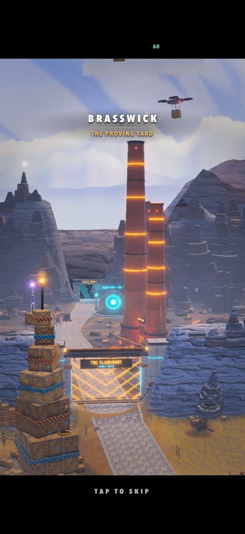](opening-shot.mp4)

Video: [opening-shot.mp4](opening-shot.mp4), 7 s, portrait 402x874, 2234 KB.

- **What:** After Start: the letterboxed fly-over of the Crate Fields' stack and chimneys, a cut to Brasswick's rooftops, then control hands over in the plaza and the hero walks toward Yardmaster Odell as his Talk prompt appears.
- **Where:** A fresh save: Start on the title screen.
- **Why:** The first seconds of play are a fly-in over Brasswick that hands over to the hero (src/systems/intro.ts; the brief's "wow from the very first frame").

## Sword string into a finisher

[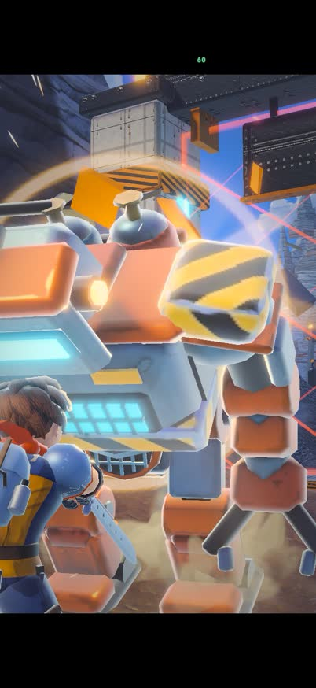](sword-string-finisher.mp4)

Video: [sword-string-finisher.mp4](sword-string-finisher.mp4), 7 s, portrait 402x874, 1956 KB.

- **What:** The saber string into a shift boss in Rivet Row: hits, BROKEN, the Finish button, the short letterboxed finisher close-up, then the hero standing in the dust with the HUD back.
- **Where:** Shift Boss Slag's gate, Slagworks (185, -68); level 14, Shop Blade.
- **Why:** Lights chain a string, a breaker fills the stagger meter, Broken under a quarter health offers the finisher (docs/COMBAT.md).

## A rifle, aimed in first person

[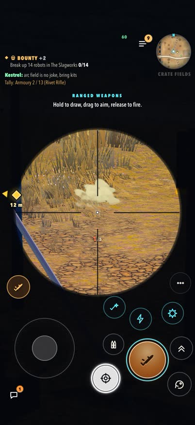](rifle-first-person.mp4)

Video: [rifle-first-person.mp4](rifle-first-person.mp4), 8 s, portrait 402x874, 905 KB.

- **What:** First person down the rifle scope across the Crate Fields: two shots, hit sparks on a training board, a slow pan. Weak: no robot crosses the scope, so it shows the aim view more than a fight.
- **Where:** Crate Fields (52, -16); Rivet Rifle, three Pallet Jacks at 12 m.
- **Why:** Aiming down sights always goes to first person; a round pierces up to three robots (docs/COMBAT.md, Shooter stance).

## A perfect dodge into a counter

[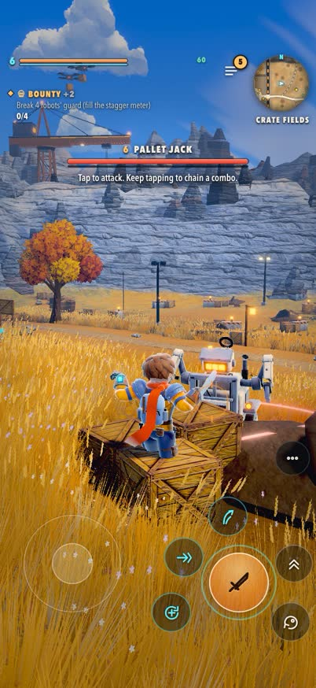](dodge-counter.mp4)

Video: [dodge-counter.mp4](dodge-counter.mp4), 6 s, portrait 402x874, 1775 KB.

- **What:** A Pallet Jack's ram, a dodge to the side (DODGED), and the counter-hit; the hero then stands by the sandbags. Weak: from this camera the dodge is small and quick.
- **Where:** Crate Fields (52, -16); a Pallet Jack's big attack.
- **Why:** A perfect dodge slows time; an attack within 0.6 s is a counter: a sure critical with x3 stagger (docs/COMBAT.md, Player moves).

## An elite mechanic and its answer: Gatecrasher

[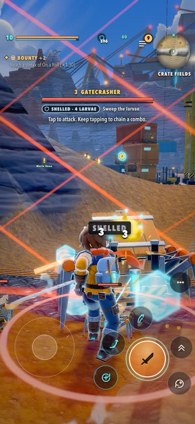](elite-gatecrasher.mp4)

Video: [elite-gatecrasher.mp4](elite-gatecrasher.mp4), 9 s, portrait 402x874, 2687 KB.

- **What:** The Gatecrasher at its gate: the cyan shell with larvae, the hero sweeps the larvae, the shell drops, BROKEN, and the gate sealer reads 'Defeat Gatecrasher to open it'.
- **Where:** Gatecrasher at the band 1 gate (65, 74); level 6.
- **Why:** Gatecrasher is shelled (x0.2 damage) while two or more larvae live; the answer is a sweep that clears them (docs/COMBAT.md, Gate elites).

## The Vault Warden's exam

[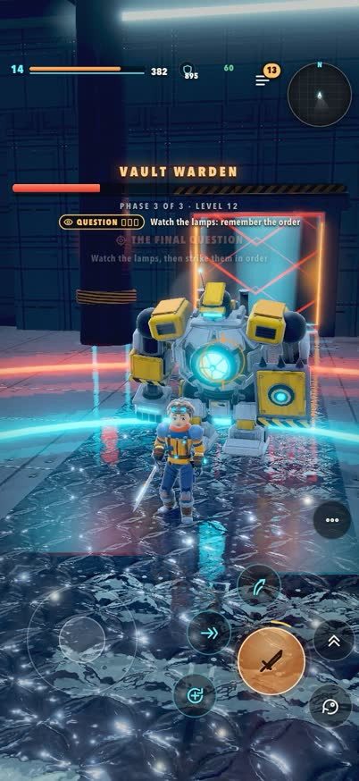](warden-exam.mp4)

Video: [warden-exam.mp4](warden-exam.mp4), 10 s, portrait 402x874, 1811 KB.

- **What:** The Vault Warden's exam: red sweep lines cross the floor, the hero answers between them, the Warden is hit and ends BROKEN with the Finish button up.
- **Where:** The Training Vault, the Warden's hall; phase 3 below a third of its health.
- **Why:** Exam: Final. Three of eight pillar lamps light in order; strike them in that order to break the Warden (docs/COMBAT.md, Vault Warden phase 3).

## The Crate Titan's planted fist

[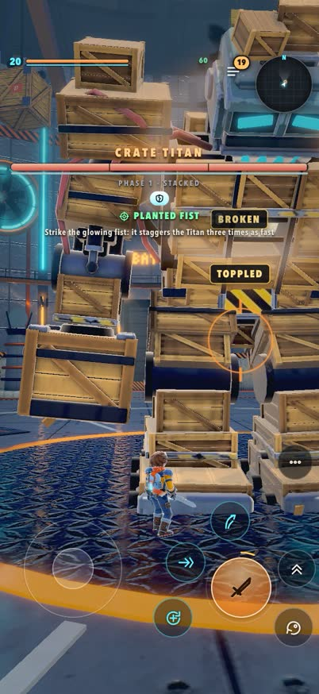](titan-fist.mp4)

Video: [titan-fist.mp4](titan-fist.mp4), 10 s, portrait 402x874, 2576 KB.

- **What:** The Crate Titan's planted fist: the arena wide, then the fist lands, PLANTED FIST is marked, the hero hits it, the Titan topples (TOPPLED) and gets up.
- **Where:** The Titan's arena; phase 1.
- **Why:** A fist slam leaves the fist planted for 2.6 s, glowing amber; a full punish on it topples the Titan (docs/COMBAT.md, Crate Titan phase 1).

## Riding the horse

[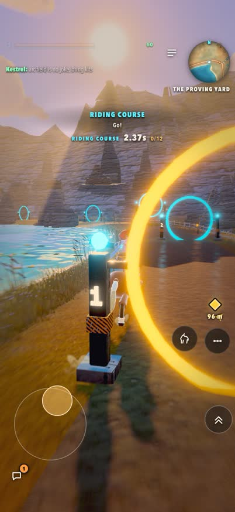](riding.mp4)

Video: [riding.mp4](riding.mp4), 8 s, portrait 402x874, 2282 KB.

- **What:** Out of the riding course gate at a gallop: the lap timer starts, rings are taken and missed (MISSED RING +2 s), the lake beside the track, low sun.
- **Where:** The riding course (-125, 82), loaner horse from the stable.
- **Why:** A mount with weight and a gallop camera (src/world/west/mounts.ts, src/world/west/riding.ts).

## The zipline into town

[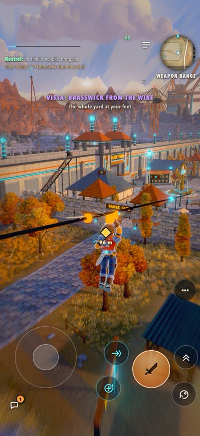](zipline-into-town.mp4)

Video: [zipline-into-town.mp4](zipline-into-town.mp4), 10 s, portrait 402x874, 2585 KB.

- **What:** Riding the zipline from the west hill over the wall into Brasswick: autumn trees and the town walls slide past, the drop onto the street at the end.
- **Where:** The tower at (-52, 30 m up, -159) down into Brasswick.
- **Why:** Speed and a composed arrival over the town (golden frame 20).

## Storm hour

[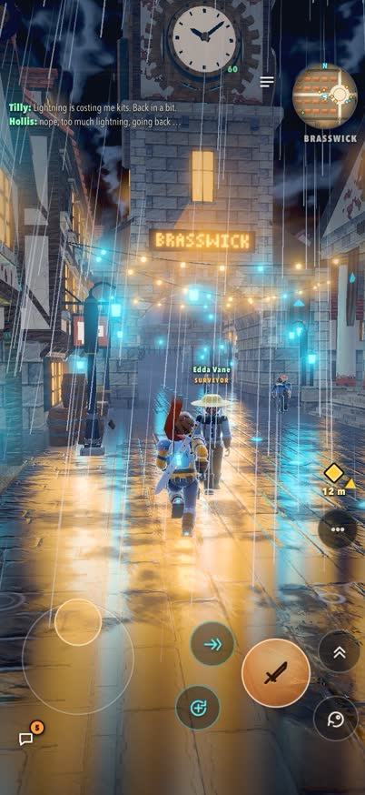](storm.mp4)

Video: [storm.mp4](storm.mp4), 8 s, portrait 402x874, 2146 KB.

- **What:** A run through Brasswick in the storm at dusk: rain, warm windows and cyan lamps reflected in the wet cobbles, townsfolk and prompts passing.
- **Where:** Brasswick plaza in the storm; Storm Hour lasts until four beacons are lit.
- **Why:** Rain, lightning, wet ground and thunder across the zone (src/world/environment.ts, src/gfx/rain.ts).

## Town life in Brasswick

[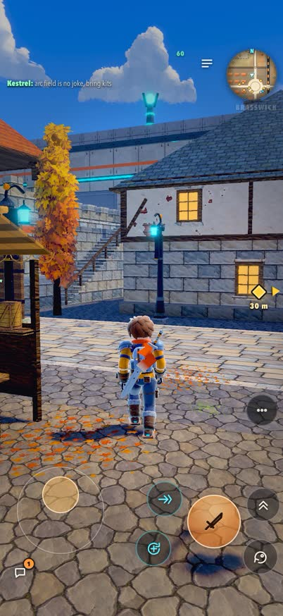](town-life.mp4)

Video: [town-life.mp4](town-life.mp4), 9 s, portrait 402x874, 2615 KB.

- **What:** A slow walk through the market and along the houses: stalls, awnings, a cart, townsfolk walking their routes.
- **Where:** The market street (-45, -24).
- **Why:** A town full of people: townsfolk at their work, smiths, adventurers passing (src/systems/npcs.ts, src/systems/living.ts).

## The hoverboard

[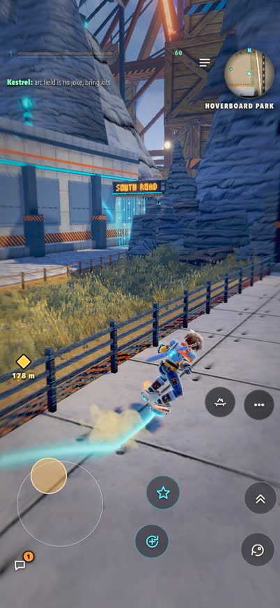](hoverboard.mp4)

Video: [hoverboard.mp4](hoverboard.mp4), 8 s, portrait 402x874, 1950 KB.

- **What:** The hoverboard along the park's lanes: cyan guide lines on the slab, rails, lamps and fences sliding past, the trick points ticking up at the top.
- **Where:** The hoverboard park (-67, 187); the board rack at (-40, 159).
- **Why:** Kickers, a halfpipe, rails and a bowl (src/world/west/hover.ts).

## Bow: a full draw

[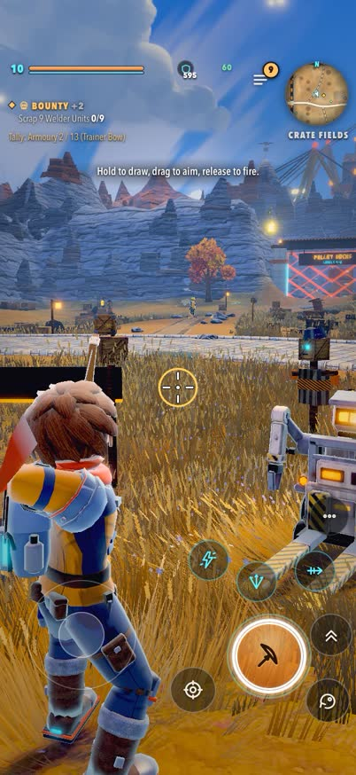](bow-full-draw.mp4)

Video: [bow-full-draw.mp4](bow-full-draw.mp4), 6 s, portrait 402x874, 1468 KB.

- **What:** The Trainer Bow over the shoulder: draw, the aim ring tightens, release, the arrow hits a Pallet Jack; repeated.
- **Where:** Crate Fields (52, -16); Trainer Bow, a Pallet Jack at 10 m.
- **Why:** Hold to draw; a full draw staggers a common robot and carries x2.5 stagger (docs/COMBAT.md).

## Overdrive: Meteor Drive

[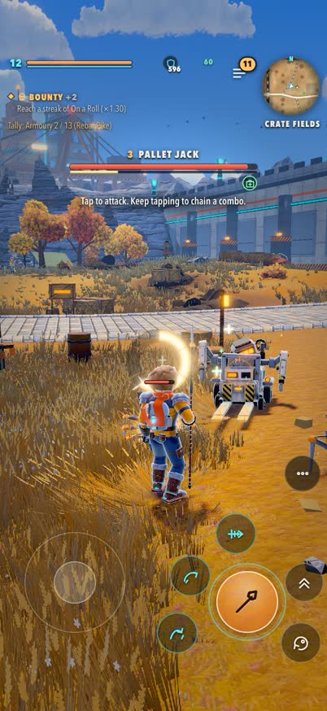](meteor-drive.mp4)

Video: [meteor-drive.mp4](meteor-drive.mp4), 6 s, portrait 402x874, 2144 KB.

- **What:** Meteor Drive: the leap, the crater on landing (METEOR DRIVE), robots thrown and Broken, dust settling.
- **Where:** Crate Fields; Rebar Pike, level 12, Overdrive full.
- **Why:** Each weapon spends the shared Overdrive meter on its own ultimate (docs/COMBAT.md).

## Bladestorm in a crowd

[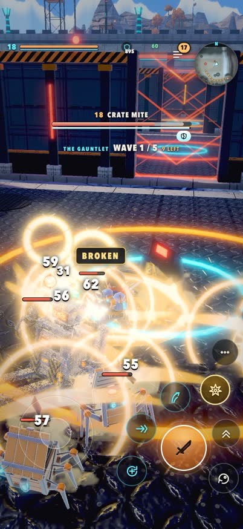](bladestorm-crowd.mp4)

Video: [bladestorm-crowd.mp4](bladestorm-crowd.mp4), 7 s, portrait 402x874, 2752 KB.

- **What:** Bladestorm in the gauntlet: the hero blinks robot to robot, gold rings and numbers everywhere, BROKEN tags, the arena's red floor marks.
- **Where:** Gauntlet court A, a wave of mites; level 18, Shop Blade.
- **Why:** Crowd combat in the gauntlet; the sword's ultimate clears a ring (docs/COMBAT.md).

## The night shift

[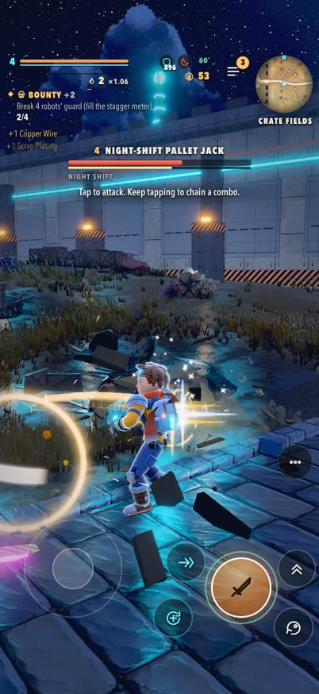](night-shift.mp4)

Video: [night-shift.mp4](night-shift.mp4), 7 s, portrait 402x874, 1997 KB.

- **What:** A night fight: a Night-Shift Crate Mite and Pallet Jack with running lights, saber arcs and a whirlwind over a wet floor lit cyan.
- **Where:** Crate Fields road (40, 6) at 23:30; night-shift robots.
- **Why:** Some robots only come out at night, a little tougher, and must read in the dark (ZONE-DESCRIPTION.md).

## A day in ten seconds

[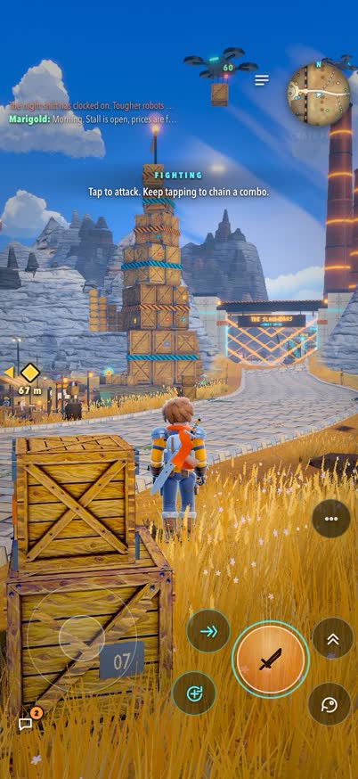](day-cycle.mp4)

Video: [day-cycle.mp4](day-cycle.mp4), 10 s, portrait 402x874, 1944 KB.

- **What:** One fixed shot of the Crate Fields from dawn through noon and dusk to night in ten seconds: the sky, the light on the crates and the gate lamps changing.
- **Where:** Crate Fields road (30, 6) looking east; the clock run from 05:00 to 23:00.
- **Why:** Light, sky and fog follow the hour (src/world/environment.ts; docs/LOOK.md).

## A camp fight, phone on its side

[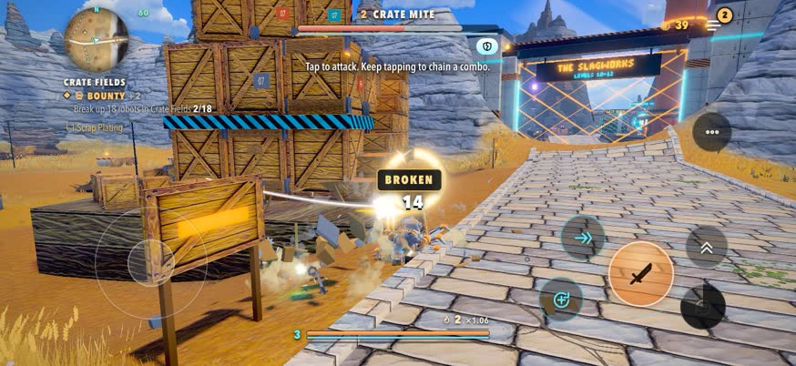](fight-landscape.mp4)

Video: [fight-landscape.mp4](fight-landscape.mp4), 8 s, landscape 874x402, 2228 KB.

- **What:** A camp fight with the phone on its side: Crate Mites broken one after another by the Great Stack, the action cluster on the right.
- **Where:** Crate Fields beside Tallyline Post (80, 0); Crate Mites; landscape 874x402.
- **Why:** Landscape is a first-class layout: the cluster in the thumb corner, the middle kept for the game (docs/HUD.md, Layouts).
