# Combat

Weapons, skills, Overdrive, stagger and Broken, finishers, statuses, telegraphs, the robots and the bosses. The design contract with every number is `docs/COMBAT.md`. Each elite's signature mechanic and its tell, state by state, is in the tell sheets under `elites/`. Frames are staged with the hero made invulnerable and the camera held, so they show the move, not a real fight's chaos; the clips show it moving.

Re-shoot: `node tools/media/shoot.mjs combat/` (see `../README.md`). Captions live in `tools/media/shots.js`; regenerate this file with `node tools/media/readme.mjs`.

## Contents

- [Sword: the third light of the string](#sword-the-third-light-of-the-string)
- [Sword: a charged heavy](#sword-a-charged-heavy)
- [Spear: long reach](#spear-long-reach)
- [Bow: full draw](#bow-full-draw)
- [Crossbow: a burst](#crossbow-a-burst)
- [Rifle: a piercing round](#rifle-a-piercing-round)
- [Sword skill: Arc Wave](#sword-skill-arc-wave)
- [Sword skill: Whirlwind](#sword-skill-whirlwind)
- [Spear skill: Javelin](#spear-skill-javelin)
- [Bow skill: Arrow Rain](#bow-skill-arrow-rain)
- [Rifle skill: Concussion Round](#rifle-skill-concussion-round)
- [Overdrive: Bladestorm (sword)](#overdrive-bladestorm-sword)
- [Overdrive: Meteor Drive (spear)](#overdrive-meteor-drive-spear)
- [Stagger full: Broken](#stagger-full-broken)
- [A finisher](#a-finisher)
- [Status: Shock chaining in rain](#status-shock-chaining-in-rain)
- [Status: Jam](#status-jam)
- [A telegraph: red means leave](#a-telegraph-red-means-leave)
- [Crate Mite (band 1, L1-3)](#crate-mite-band-1-l1-3)
- [Pallet Jack (band 2, L4-6)](#pallet-jack-band-2-l4-6)
- [Plumb Drone (band 3, L7-9)](#plumb-drone-band-3-l7-9)
- [Welder Unit (band 4, L10-12)](#welder-unit-band-4-l10-12)
- [Riveter (band 5, L13-15)](#riveter-band-5-l13-15)
- [Arc Sentry (band 6, L16-18)](#arc-sentry-band-6-l16-18)
- [A night-shift variant](#a-night-shift-variant)
- [A rare: Pallet Royale](#a-rare-pallet-royale)
- [The Crate Titan](#the-crate-titan)

Tell sheets for each elite and boss mechanic: [elites/README.md](elites/README.md).

## Sword: the third light of the string

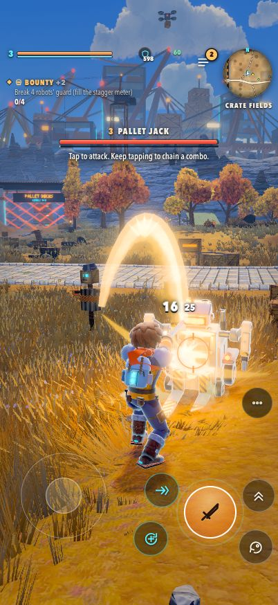

- **What:** The third light swing of the Bandsaw Saber string: a bright arc around the hero, two Pallet Jacks and a mite taking hits, damage numbers over them.
- **Where:** Crate Fields (52, -16), a Pallet Jack; level 3, Shop Blade.
- **Why:** Three-hit string, the third the heaviest (1.8x); hit-stop and sparks sell the weight (docs/COMBAT.md, As built).

## Sword: a charged heavy

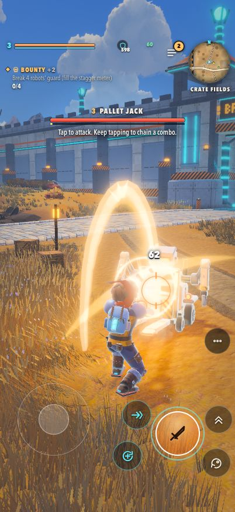

- **What:** A charged heavy with the saber into a Pallet Jack: a wide gold sweep and a big number (72) over the robot.
- **Where:** As above; hold attack.
- **Why:** Hold 0.28 s to charge, two levels; real anticipation, fast strike, long recovery (docs/COMBAT.md, Player moves).

## Spear: long reach

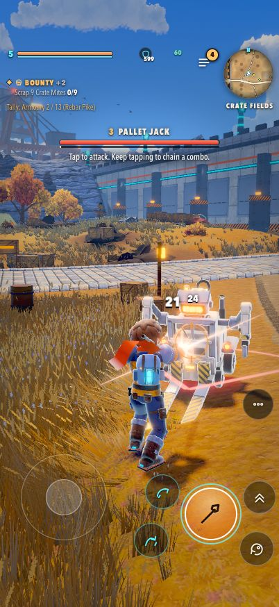

- **What:** The Rebar Pike's thrust reaching a Pallet Jack at spear length, the hit flash and numbers on the robot.
- **Where:** As above, Rebar Pike, robot at 4.2 m.
- **Why:** Fast pokes, long reach, slow recovery, the best breaker (docs/COMBAT.md, Weapon identity).

## Bow: full draw

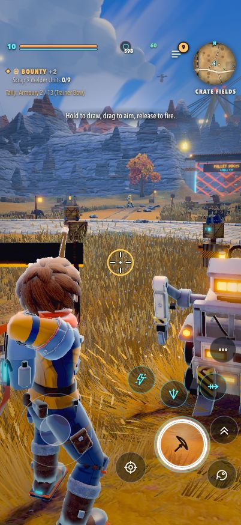

- **What:** The Trainer Bow at full draw over the hero's shoulder: the gold aim ring on a Pallet Jack, the shooter cluster with the aim button, the hint 'Hold to draw, drag to aim, release to fire'.
- **Where:** As above, Trainer Bow, robot at 10 m.
- **Why:** Charged shots and weak points; a full draw staggers a common robot (docs/COMBAT.md).

## Crossbow: a burst

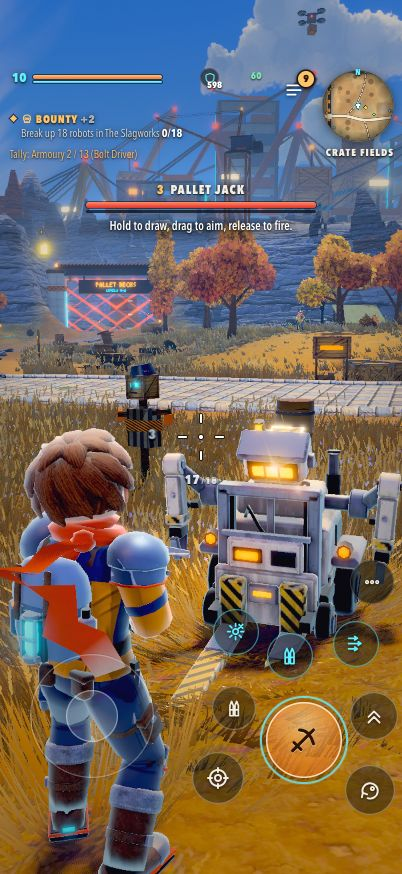

- **What:** The Bolt Driver's three-bolt burst at a Pallet Jack from over the shoulder: bolt trails and a hit number on the robot.
- **Where:** As above, Bolt Driver, robot at 7 m.
- **Why:** A press looses three bolts from a magazine of six; the first carries the chosen ammunition (docs/COMBAT.md).

## Rifle: a piercing round

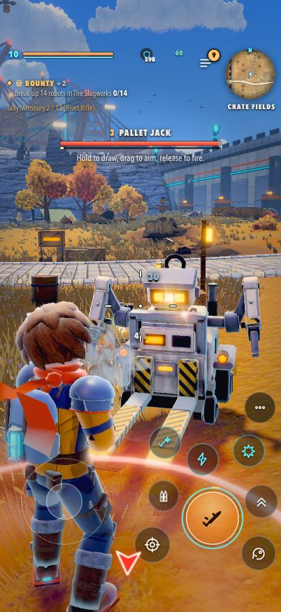

- **What:** The Rivet Rifle from the shooter stance at a Pallet Jack 7 m off, a hit puff and a small number on the robot, two mites behind it.
- **Where:** As above, Rivet Rifle, three robots in a line at 12 m.
- **Why:** Slow, piercing, charged: a round goes through up to three robots (docs/COMBAT.md).

## Sword skill: Arc Wave

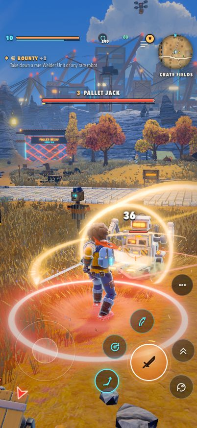

- **What:** Arc Wave: a gold crescent leaving the saber and a red attack ring under the hero, a Pallet Jack hit for 36.
- **Where:** As above, level 10.
- **Why:** Four skills per weapon, three slotted; skills cost energy and cool down (docs/COMBAT.md, Skills).

## Sword skill: Whirlwind

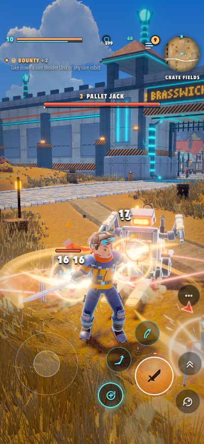

- **What:** Whirlwind: the hero spinning with the saber in a gold ring, hits landing on a Pallet Jack and a mite at once.
- **Where:** As above, robots close.
- **Why:** A spinning crowd skill for camps.

## Spear skill: Javelin

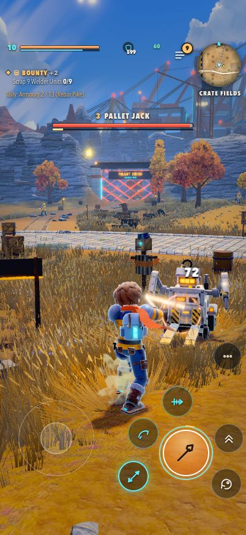

- **What:** Javelin: the pike thrown at a Pallet Jack, its streak and the hit on the robot.
- **Where:** As above, Rebar Pike, robot at 9 m.
- **Why:** A thrown spear: the spear's answer to range.

## Bow skill: Arrow Rain

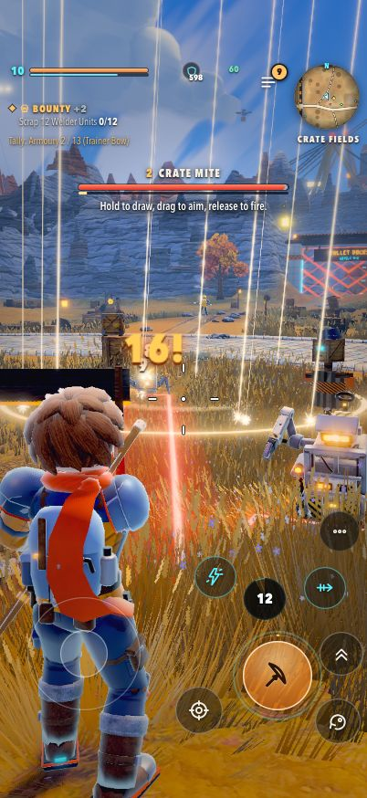

- **What:** Arrow Rain: white arrow streaks falling on a mite and a Pallet Jack, a red marker on the ground where they land.
- **Where:** As above, Trainer Bow, a camp at 10 m.
- **Why:** An area skill for the bow.

## Rifle skill: Concussion Round

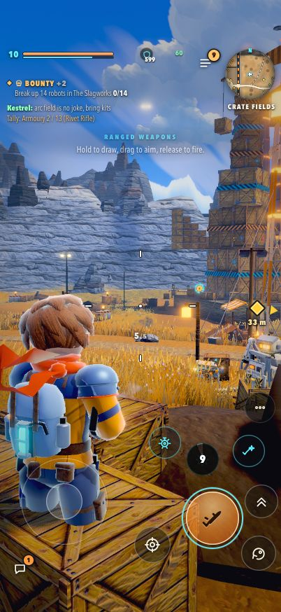

- **What:** Concussion Round from the rifle in open ground: the hero on a wooden deck, the robots small in the distance. Weak: the robots are too far away for the blast and knock-back to read.
- **Where:** As above, Rivet Rifle.
- **Why:** A blast round that knocks a group back.

## Overdrive: Bladestorm (sword)

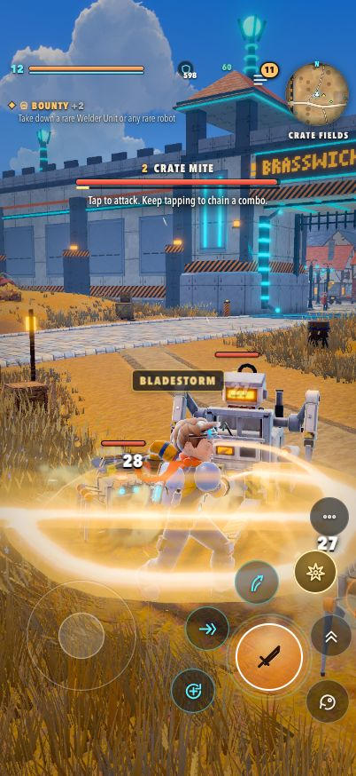

- **What:** Bladestorm, the saber's Overdrive: the BLADESTORM label over the hero, a gold slash ring, a Crate Mite and a Pallet Jack hit (27, 28), the Brasswick gate behind.
- **Where:** As above, level 12, meter full.
- **Why:** One shared meter from damage, perfect dodges and breaks; each weapon spends it on its own ultimate (docs/COMBAT.md, Overdrive).

## Overdrive: Meteor Drive (spear)

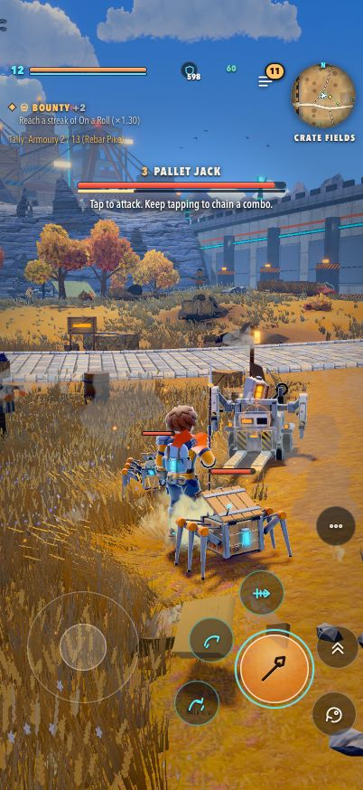

- **What:** Meteor Drive, the pike's Overdrive, in its landing: the hero among a Pallet Jack and two mites. Weak: in the still the crater and the leap barely read; the clip clips/meteor-drive shows it better.
- **Where:** As above with the Rebar Pike.
- **Why:** The spear's ultimate: a leap and a crater.

## Stagger full: Broken

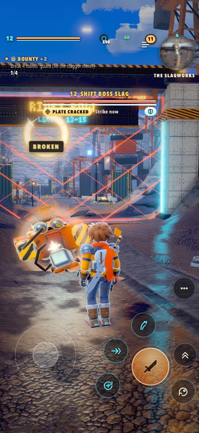

- **What:** A Broken shift boss: the BROKEN label and the PLATE CRACKED tag on the target frame, the robot knocked down on its side and the hero standing over it, with the cue to strike now.
- **Where:** Shift Boss Slag's gate in the Slagworks (185, -68).
- **Why:** A full stagger meter breaks a robot for 3-5 s: it cannot act, its core shows, it takes 40% more (docs/COMBAT.md, Enemy states).

## A finisher

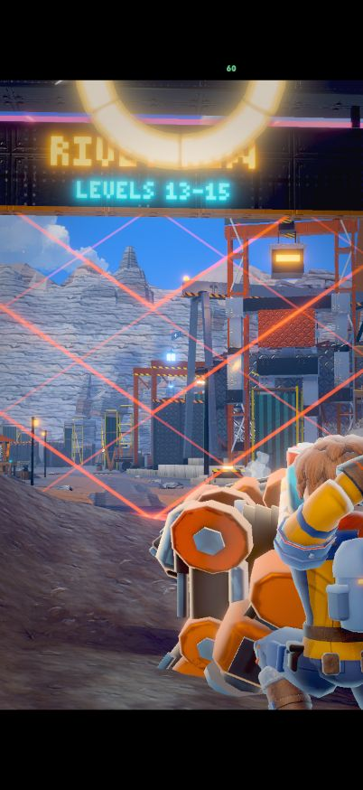

- **What:** The finisher's short cinematic: letterboxed, the camera low behind the robot under the RIVET ROW sign. Weak: the frame is mostly the sign and the robot's plating; the clip clips/sword-string-finisher shows the move.
- **Where:** As above, the elite Broken under a quarter health; the context prompt offers it.
- **Why:** A 1.45 s invulnerable kill; +25 Overdrive and full energy (docs/COMBAT.md, As tuned).

## Status: Shock chaining in rain

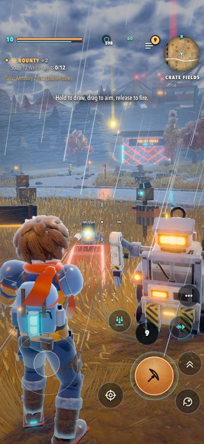

- **What:** A Shock Arrow in rain: rain streaks, a Pallet Jack and a drone ahead, a small spark where the arrow hit. Weak: the chain to the other robots is a thin flash and does not read at phone size.
- **Where:** Crate Fields in rain; a Shock Arrow into a camp.
- **Why:** Shock interrupts; in rain or storm it chains up to 7 m to three robots (docs/COMBAT.md, Statuses).

## Status: Jam

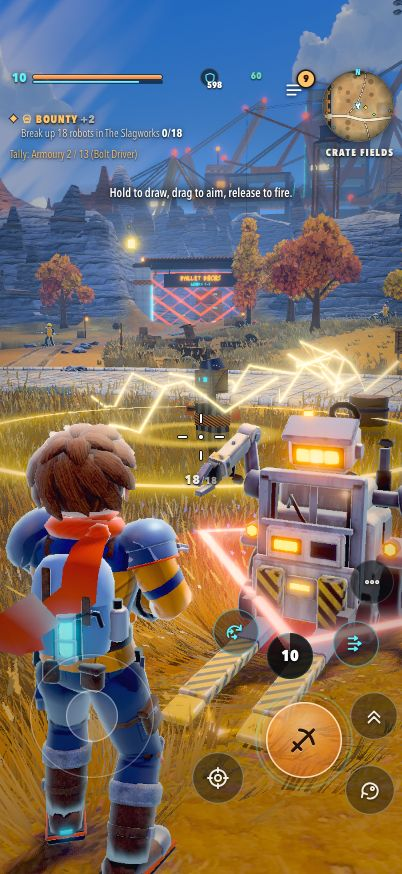

- **What:** A Jam Bolt into a Pallet Jack: yellow crackle lines around the robot and the bolt's red trail, the number on the hit.
- **Where:** Crate Fields, a Jam Bolt from the Bolt Driver.
- **Why:** Jam halves speed and stretches wind-ups (docs/COMBAT.md, Statuses).

## A telegraph: red means leave

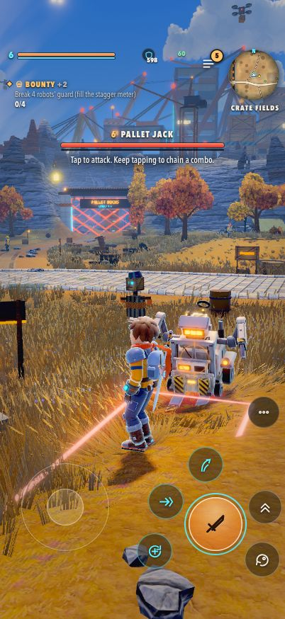

- **What:** A Pallet Jack winding up its ram: a red line on the ground ahead of it, the hero to the side. Weak: the red shape is thin and the wind-up pose is small at this distance.
- **Where:** Crate Fields, a Pallet Jack winding up its big attack.
- **Why:** Red floor shapes mean leave; each attack has its own wind-up pose; the shortest is 0.5 s (docs/COMBAT.md, Telegraphs).

## Crate Mite (band 1, L1-3)

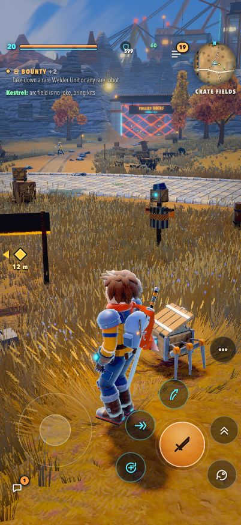

- **What:** A Crate Mite next to the hero: a crate body on four spider legs with a cyan eye. It comes up to the hero's knee.
- **Where:** Crate Fields.
- **Why:** Small, quick, many: the first robot (ZONE-DESCRIPTION.md, Enemies; Blender model in public/models, built by art/build.py).

## Pallet Jack (band 2, L4-6)

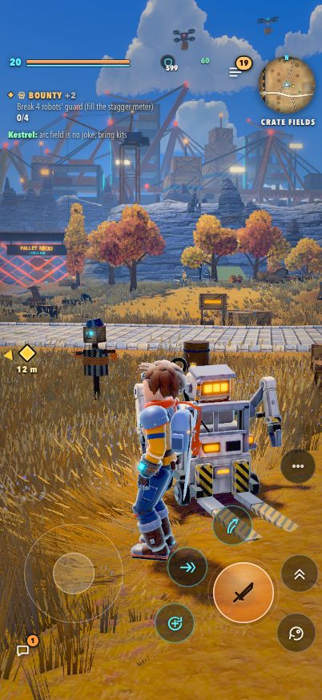

- **What:** A Pallet Jack beside the hero: a forklift body with two forks, square headlight eyes and hazard stripes; Pallet Docks containers behind.
- **Where:** Pallet Docks.
- **Why:** A forklift brawler with a ram.

## Plumb Drone (band 3, L7-9)

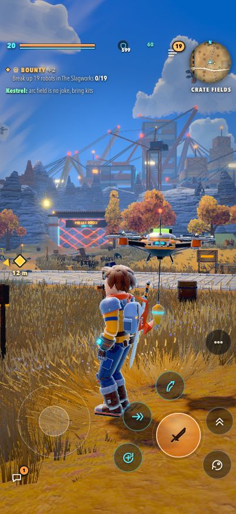

- **What:** A Plumb Drone hovering at head height in front of the hero, its cyan rotor ring and yellow plumb bob. Small in the frame at this distance.
- **Where:** Plumb Heights.
- **Why:** A flyer: holds off and shoots; dives that end GROUNDED give melee a way in (docs/COMBAT.md).

## Welder Unit (band 4, L10-12)

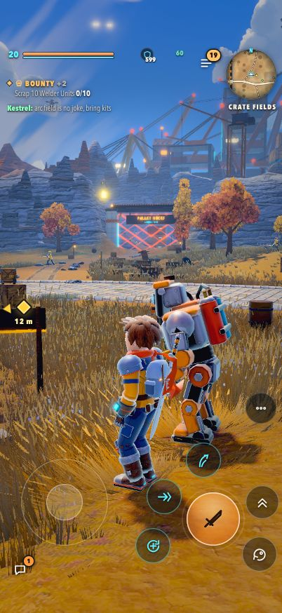

- **What:** A Welder Unit beside the hero: a tall grey walker with a red fuel tank on its back and a torch arm.
- **Where:** Slagworks.
- **Why:** A torch at close range; burns on slag ground.

## Riveter (band 5, L13-15)

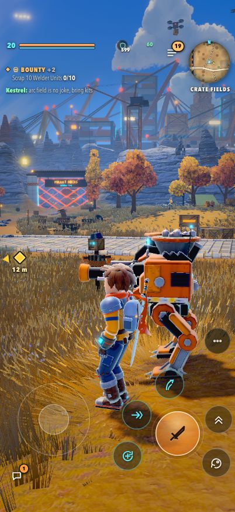

- **What:** A Riveter: an armoured orange walker with a rivet gun arm and a chimney, as tall as the hero.
- **Where:** Rivet Row.
- **Why:** An armoured gunner.

## Arc Sentry (band 6, L16-18)

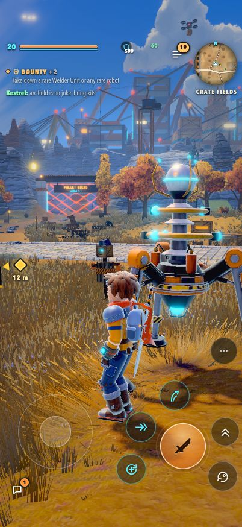

- **What:** An Arc Sentry: a tripod with a stacked cyan coil head and a glowing orb on top.
- **Where:** Arc Field.
- **Why:** Storm caster: arcs from range.

## A night-shift variant

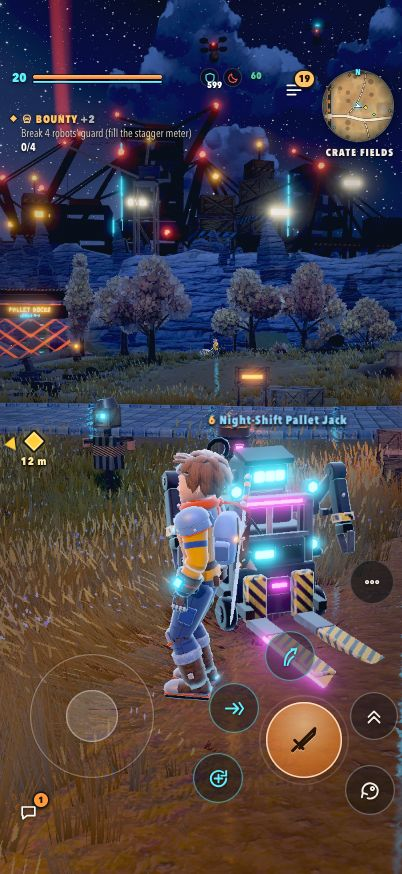

- **What:** A Night-Shift Pallet Jack at 23:30: the same body in dark paint with pink and cyan running lights, its name in pink above it, the starry sky and docks lights behind.
- **Where:** Any band after dark.
- **Why:** Night variants of each kind, a little tougher, with their own colours (ZONE-DESCRIPTION.md).

## A rare: Pallet Royale

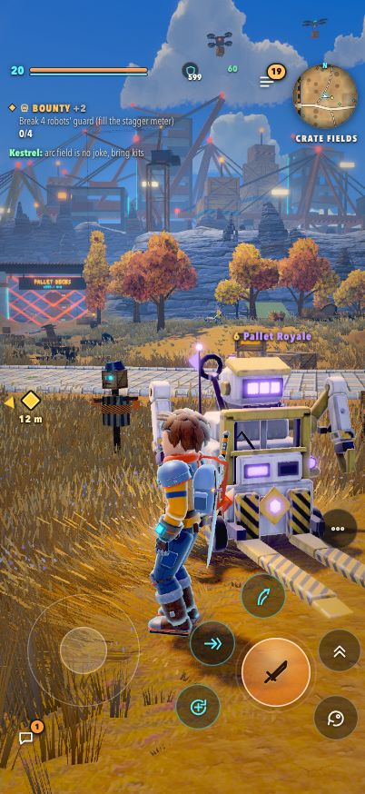

- **What:** A rare, the Pallet Royale: a Pallet Jack in cream and purple with violet eyes and a purple sceptre lamp, its name in gold.
- **Where:** Rares turn up among the commons.
- **Why:** Named rares carry one trick each (docs/COMBAT.md, Elites and bosses).

## The Crate Titan

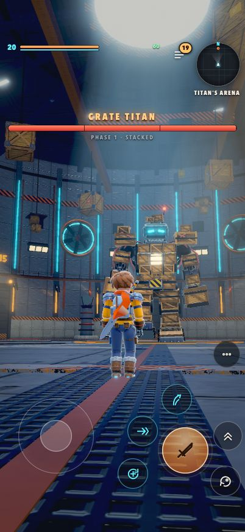

- **What:** The Crate Titan at the far end of its arena in phase 1 (Stacked), the hero small in the foreground on the runway, the boss bar at the top. Weak: from the door the Titan is small; the clip clips/titan-fist shows its scale.
- **Where:** The arena, after the boss portal.
- **Why:** A 15 m giant of crates (src/world/arena.ts).
