# Features

One showcase per system: field quests, bounties and contracts, the Tally Book, After hours, simulated adventurers, chat, zone events, emotes, mounts, first person, fast travel, the day cycle and weather, and the loading screen. Where a feature is better seen moving, the clip is in `../clips/`.

Re-shoot: `node tools/media/shoot.mjs features/` (see `../README.md`). Captions live in `tools/media/shots.js`; regenerate this file with `node tools/media/readme.mjs`.

## Contents

- [The first frame after Start](#the-first-frame-after-start)
- [Install and loading](#install-and-loading)
- [Field quest: scope the nests (first person)](#field-quest-scope-the-nests-first-person)
- [Field quest: sabotage a burrow at night](#field-quest-sabotage-a-burrow-at-night)
- [Field quest: escort](#field-quest-escort)
- [Field quest: the lamp-order puzzle](#field-quest-the-lamp-order-puzzle)
- [Field quest: a timed foot run](#field-quest-a-timed-foot-run)
- [Bounties and a crate drop](#bounties-and-a-crate-drop)
- [The kill-contract board](#the-kill-contract-board)
- [The Tally Book](#the-tally-book)
- [Old Bram's cog exchange](#old-brams-cog-exchange)
- [After hours: Backhaul and records](#after-hours-backhaul-and-records)
- [After hours: Overtime](#after-hours-overtime)
- [After hours: the Long Shift](#after-hours-the-long-shift)
- [The Long Shift running](#the-long-shift-running)
- [Simulated adventurers](#simulated-adventurers)
- [Zone chat](#zone-chat)
- [An emote](#an-emote)
- [Zone event: a cratefall](#zone-event-a-cratefall)
- [Mounts: the horse](#mounts-the-horse)
- [Mounts: the hoverboard](#mounts-the-hoverboard)
- [First person: a rifle aimed](#first-person-a-rifle-aimed)
- [Fast travel](#fast-travel)
- [Day cycle: dawn](#day-cycle-dawn)
- [Day cycle: noon](#day-cycle-noon)
- [Day cycle: dusk](#day-cycle-dusk)
- [Day cycle: night](#day-cycle-night)
- [Weather: rain](#weather-rain)
- [Weather: storm](#weather-storm)

## The first frame after Start

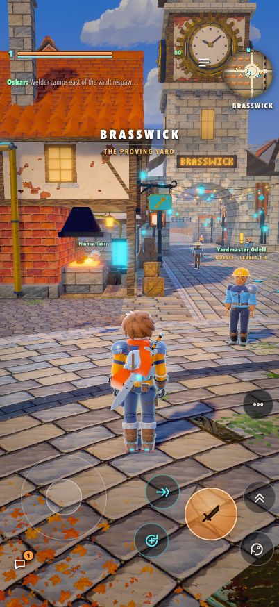

- **What:** The first frame after Start: Brasswick's plaza, the hero, Oskar's line in chat, and the first hint 'A yellow ! means a job. Walk up and tap the prompt'.
- **Where:** Title, Start, on a fresh save.
- **Why:** The brief asks for a wow from the very first frame (README.md; golden frame 2).
- **Staged by:** `golden:first-frame` in `tools/media/shots.js`.

## Install and loading

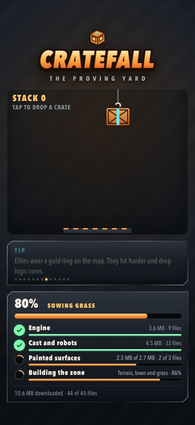

- **What:** The loading screen on a slow first visit: CRATEFALL, a stack-the-crates mini game to pass the time, a tip, and the install list (engine, cast and robots, painted surfaces, building the zone) with sizes and a progress bar.
- **Where:** The first visit, before the zone is built (throttled network here so the stages show).
- **Why:** Tens of megabytes are acceptable if staged, with an informative, interactive loading screen and PWA caching (AAA-PLAN section 2; src/ui/loading.ts, tools/release/sw.js).

## Field quest: scope the nests (first person)

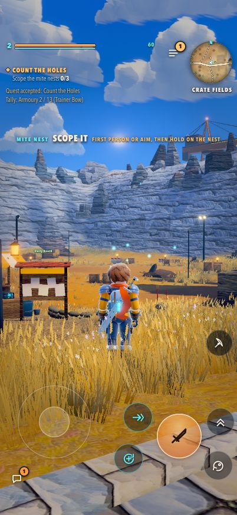

- **What:** Count the Holes, step one: 'Mite nest: scope it, first person or aim, then hold on the nest', in the Crate Fields by the Tally board. The scope step itself is not shown here.
- **Where:** Count the Holes, band 1, from Tally Brock at Tallyline Post (64, -14); a nest at (82, -24).
- **Why:** Fifteen field quests, none a kill count; this one is played through the scope in first person (docs/AAA-PLAN.md, Field outposts and quests; src/data/quests-field.ts).

## Field quest: sabotage a burrow at night

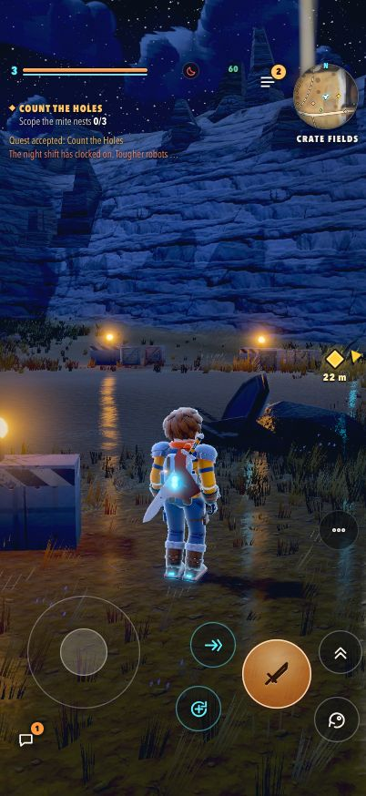

- **What:** Count the Holes at night: the hero beside a mite burrow by a pond, the night-shift notice in chat, Tallyline's lamps behind.
- **Where:** Lid on It, band 1: seal three burrows, the first at (92, -30).
- **Why:** A channel that a hit breaks; a charge set next to an awake mite brings the family up (src/systems/objectives/steps.ts).

## Field quest: escort

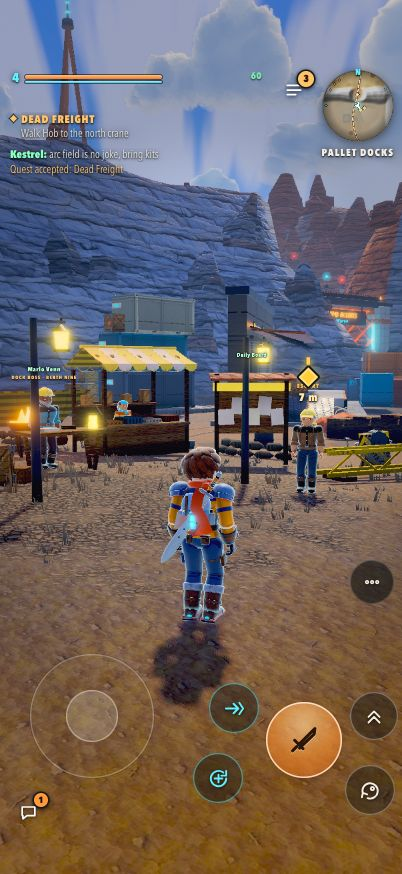

- **What:** Dead Freight at Berth Nine: 'Walk Hob to the north crane', the camp stall and board, the giver's waypoint. Weak: Hob is not clearly in frame.
- **Where:** Dead Freight, band 2: walk Hob from (70, 104) up the trail to the north crane.
- **Why:** An escort with two ambushes; if Hob goes down the step resets, the quest stays in hand (docs/AAA-PLAN.md).

## Field quest: the lamp-order puzzle

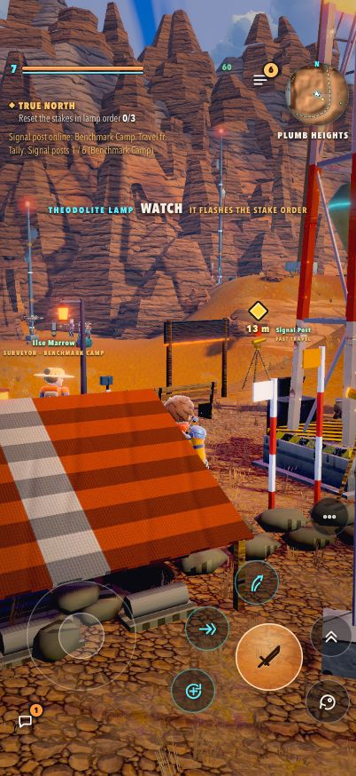

- **What:** True North at Benchmark Camp: 'Reset the stakes in lamp order 0/3' with the banner 'Theodolite lamp: watch, it flashes the stake order', the surveyor Ilse Marrow and a striped stake.
- **Where:** True North, band 3: watch the theodolite lamp at (178, 141), then reset the stakes in its order.
- **Why:** A puzzle step in the open world; the wrong stake resets it (src/systems/objectives/steps.ts).

## Field quest: a timed foot run

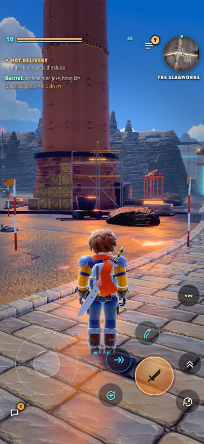

- **What:** Hot Delivery in the Slagworks: 'Run a hot ingot to the sluice', the furnace chimney, the road and the sluice gate ahead. The run's timer is not yet running in this frame.
- **Where:** Hot Delivery, band 4: run an ingot from (202, -9) through four gates in 14 s.
- **Why:** A timer step with gates in the world (src/systems/objectives/steps.ts).

## Bounties and a crate drop

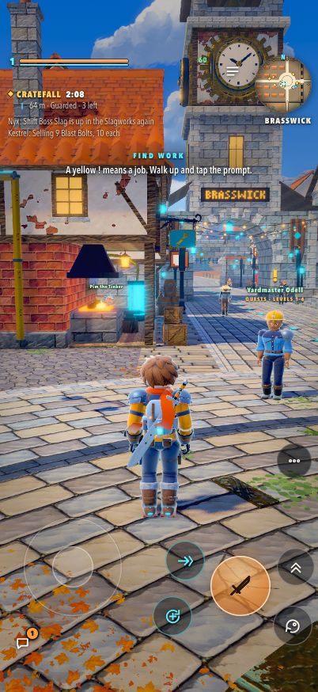

- **What:** A first minute in town: a Cratefall timer (2:08, 64 m, guarded) in the tracker, chat from other adventurers, the hint for jobs, Yardmaster Odell ahead.
- **Where:** Out in the bands: a bounty line in the tracker column.
- **Why:** Bounties are priced in kills (at most 3.5 kills' worth) so they stay a side order to the grind (docs/AAA-PLAN.md, QA round four).
- **Staged by:** `hm:first-minute` in `tools/media/shots.js`.

## The kill-contract board

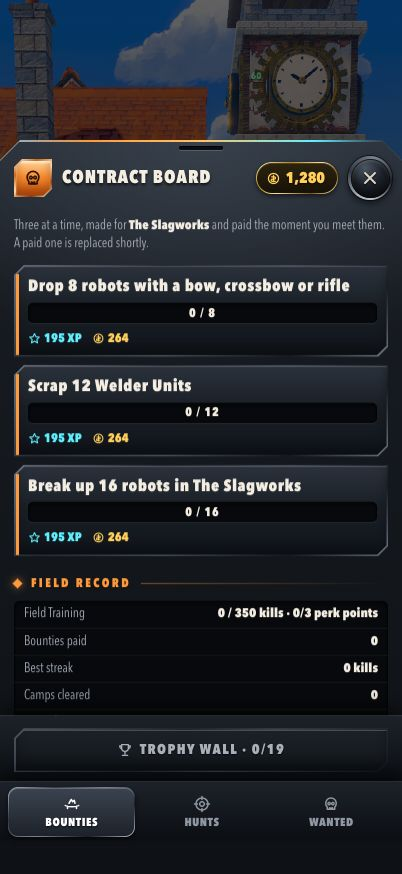

- **What:** The contract board in Brasswick: three kill contracts with their XP and scrip, the field record, and tabs for bounties, hunts and wanted.
- **Where:** Brasswick plaza (-11, -12).
- **Why:** Contracts pay for each enemy kind, elite and the boss, with a trophy and a joke title the first time (ZONE-DESCRIPTION.md).
- **Staged by:** `pn:board` in `tools/media/shots.js`.

## The Tally Book

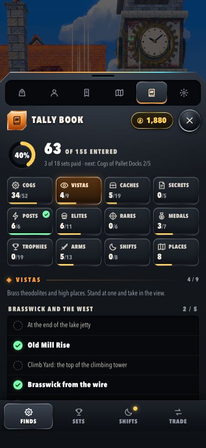

- **What:** The Tally Book: 63 of 155 finds, a tile for each kind with its count, and the vista checklist for Brasswick and the west.
- **Where:** Menu tray, Tally.
- **Why:** 155 entries in twelve kinds, read from what the save already keeps (src/systems/tally.ts).
- **Staged by:** `pn:tally-finds` in `tools/media/shots.js`.

## Old Bram's cog exchange

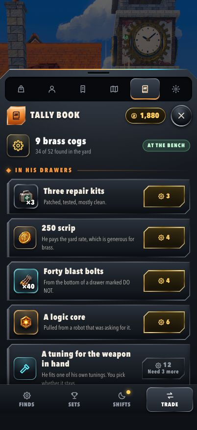

- **What:** The Tally Book's trade tab: 9 brass cogs to spend, and what Old Bram has in his drawers (repair kits, scrip, blast bolts, a logic core, a weapon tuning) with prices in cogs.
- **Where:** Old Bram, Brasswick (-28, 10).
- **Why:** Brass cogs found across the zone buy kits, scrip, tunings and a title (docs/AAA-PLAN.md, Collections).
- **Staged by:** `pn:tally-trade` in `tools/media/shots.js`.

## After hours: Backhaul and records

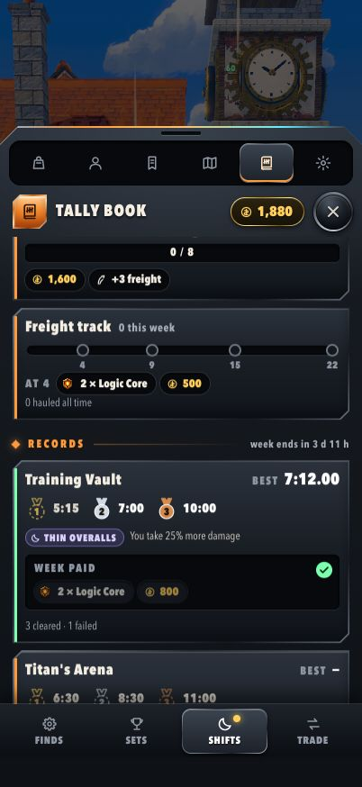

- **What:** The Tally Book's shifts tab: the Freight track for this week (Backhaul), and the after-hours records: Training Vault best 7:12 with today's Overtime rule, week paid, the Titan's Arena times.
- **Where:** Tally Book, After hours; opens with the first Titan kill.
- **Why:** Daily and weekly orders that raise robots in an ordered band to the player's level (src/systems/overtime/).
- **Staged by:** `pn:tally-after` in `tools/media/shots.js`.

## After hours: Overtime

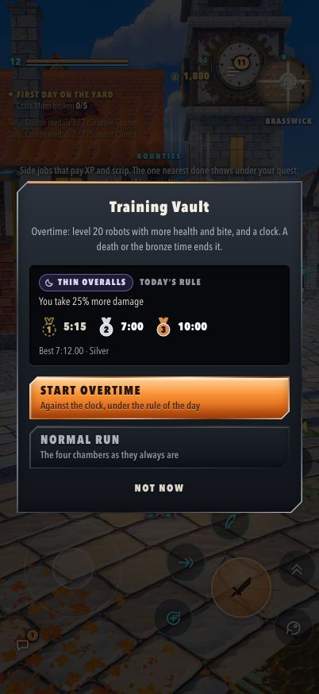

- **What:** The Training Vault door: Start Overtime under today's rule (thin overalls, 25% more damage taken), bronze, silver and gold times, or a Normal Run.
- **Where:** The vault door or the arena door after the first Titan kill.
- **Why:** The vault or the Titan at level 20, one of four rules a day, medals against par (docs/AAA-PLAN.md, After hours).
- **Staged by:** `pn:choice-overtime` in `tools/media/shots.js`.

## After hours: the Long Shift

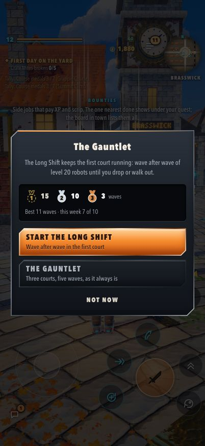

- **What:** The Gauntlet's choice: Start the Long Shift ('wave after wave of level 20 robots until you drop or walk out', with 15, 10 and 3 wave medals) or the normal Gauntlet.
- **Where:** The gauntlet start post (88, -203).
- **Why:** Endless waves at level 20 in court A, medals by waves.
- **Staged by:** `pn:choice-longshift` in `tools/media/shots.js`.

## The Long Shift running

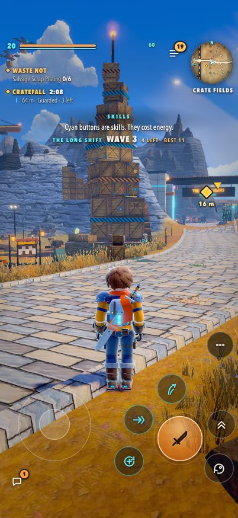

- **What:** The Long Shift running: WAVE 3 with 4 left and a best of 11 under the bars, a Waste Not quest and a Cratefall in the tracker, the hint about skill buttons.
- **Where:** Gauntlet court A.
- **Why:** Its wave timer in the timer slot (docs/HUD.md).
- **Staged by:** `hm:wave-timer-tip` in `tools/media/shots.js`.

## Simulated adventurers

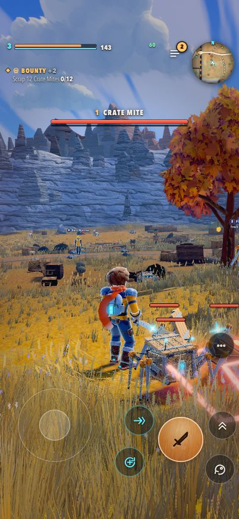

- **What:** Crate Fields at 11:00: a fight with a Crate Mite by an autumn tree, the adventurer Pip Tumbler nearby. Weak: the adventurer is hard to pick out at this size; clips/town-life and the desktop map show adventurers better.
- **Where:** Crate Fields near (38, -10), where the adventurer Pip works the mites.
- **Why:** Other adventurers fight, travel and chat in the open world as ambient life; they never join the player's party or touch their fights or loot (AAA-PLAN section 2; src/systems/adventurers.ts).

## Zone chat

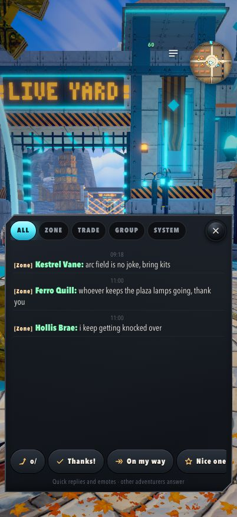

- **What:** Zone chat open over the Live Yard gate: tabs (all, zone, trade, group, system), lines from adventurers, and quick replies and emotes ('o/', Thanks!, On my way, Nice one).
- **Where:** The chat glyph, bottom corner.
- **Why:** The player cannot type: quick replies and emotes, and the zone's adventurers answer (src/ui/chat.ts, src/systems/chat/).

## An emote

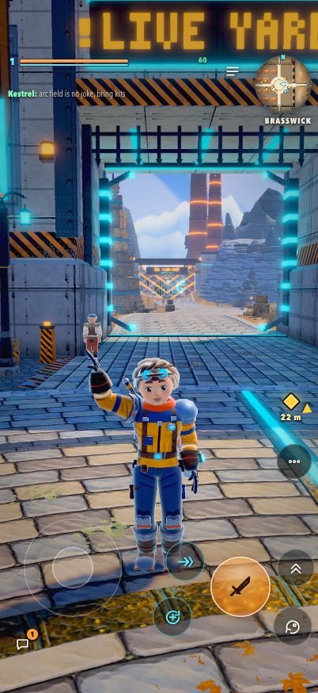

- **What:** The hero waving under the LIVE YARD gate; a townsperson by the gate.
- **Where:** Quick wheel, Emote; or the chat panel.
- **Why:** Emotes are wheel items (docs/HUD.md); adventurers nearby may answer.

## Zone event: a cratefall

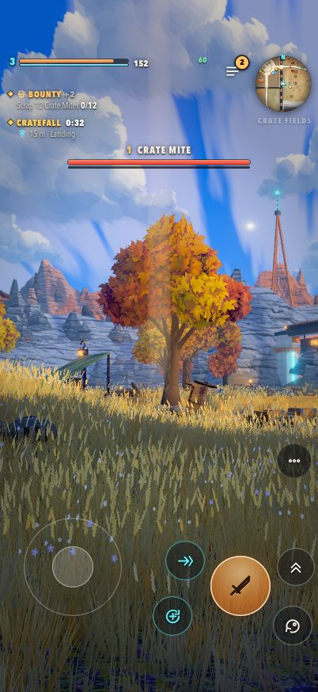

- **What:** A cratefall landing: CRATEFALL 0:32, 15 m, landing in the tracker, a Crate Mite targeted nearby. Weak: the crate and its beam are out of frame; the timer is the only sign of the event.
- **Where:** Anywhere in the bands: a freighter pass drops a crate, marked by a beam over the zone.
- **Why:** The event the game is named for: a fight to open, a short channel, better loot; gold and booby-trapped variants (src/systems/events.ts).

## Mounts: the horse

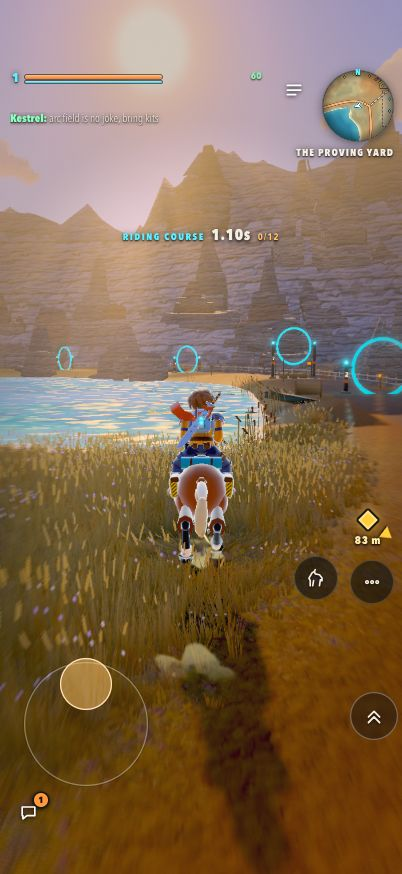

- **What:** The loaner horse on the riding course: lap timer and ring count, cyan rings over the lake, low sun.
- **Where:** Borrowed from the stable; the riding course (-125, 82).
- **Why:** A mount with weight: gallop, jumps, a lap timer (src/world/west/mounts.ts).
- **Staged by:** `golden:riding-course` in `tools/media/shots.js`.

## Mounts: the hoverboard

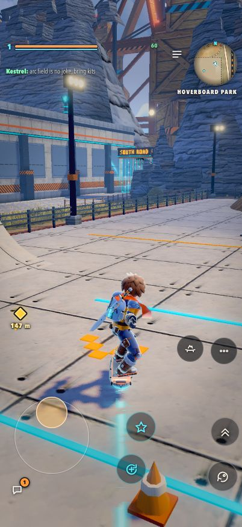

- **What:** On the hoverboard in the board park: the hero crouched on the board, cyan guide lines, a cone, the SOUTH ROAD sign, the distance to the next ring.
- **Where:** The board rack at (-40, 159); the hoverboard park (-67, 187).
- **Why:** Kickers, a halfpipe, rails and a bowl (src/world/west/hover.ts).

## First person: a rifle aimed

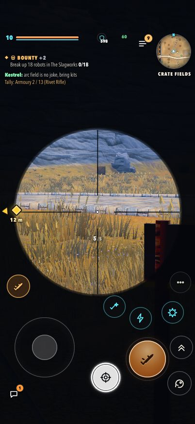

- **What:** First person, rifle aimed: the scope circle over the Crate Fields with its reticle, the world outside it dimmed, a hit marker on a board. No robot in the scope.
- **Where:** Crate Fields; aim with a rifle in hand.
- **Why:** Aiming down sights always goes to first person (owner's ruling; docs/FIRST-PERSON.md).

## Fast travel

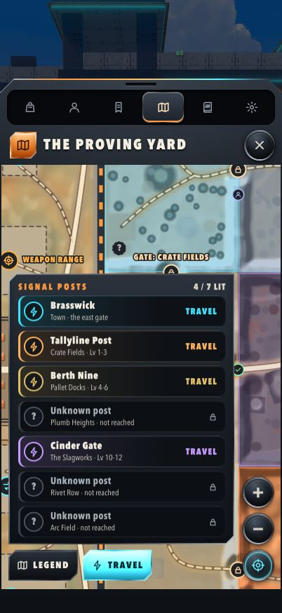

- **What:** Fast travel from the map: the signal post list (4 of 7 lit) with Travel on Brasswick, Tallyline Post, Berth Nine and Cinder Gate; the unreached posts are locked.
- **Where:** A signal post terminal at any outpost, or Map, Travel.
- **Why:** A post unlocks on approach; travel is refused in combat, indoors or mid-run (docs/AAA-PLAN.md, Fast travel).
- **Staged by:** `pn:map-travel` in `tools/media/shots.js`.

## Day cycle: dawn

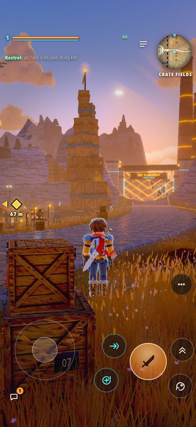

- **What:** The Crate Fields at 06:24 from a fixed spot: the sky orange and violet, the Great Stack and the gate in long light.
- **Where:** Crate Fields road (30, 6) looking east.
- **Why:** A full day and night cycle with a colour script per hour (src/world/environment.ts; docs/LOOK.md, Light).

## Day cycle: noon

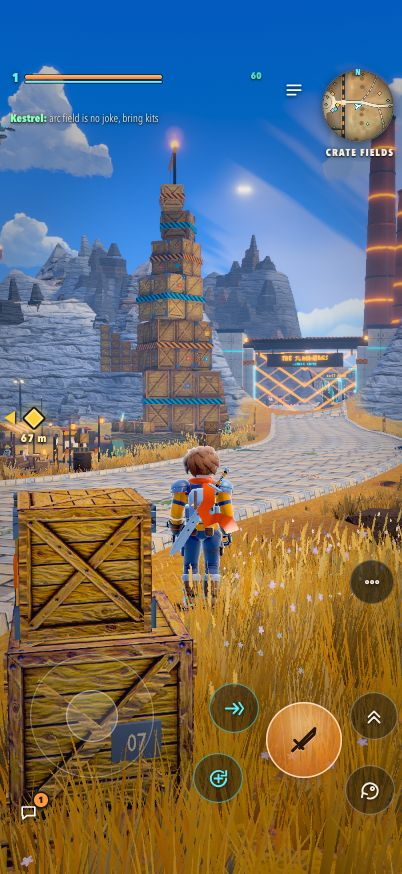

- **What:** The same spot at 12:30: a blue sky, white clouds, hard short shadows.
- **Where:** As above.
- **Why:** As above.

## Day cycle: dusk

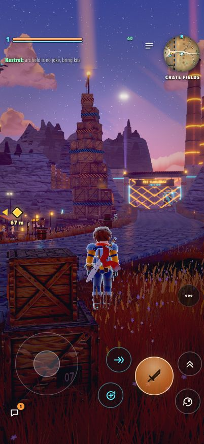

- **What:** The same spot at 18:36: a purple sky, the stack's lamp and the gate's lights coming on.
- **Where:** As above.
- **Why:** As above.

## Day cycle: night

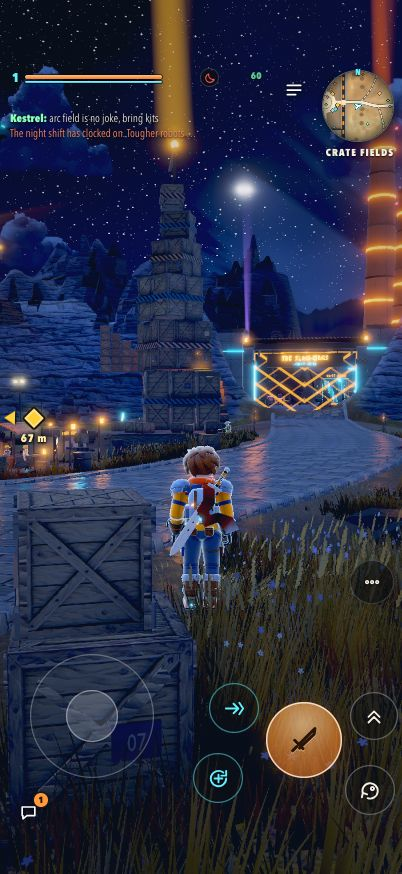

- **What:** The same spot at 23:00: a starry sky, the gate and the stack lit, the night-shift notice in chat.
- **Where:** As above.
- **Why:** As above; night-shift robots come out.

## Weather: rain

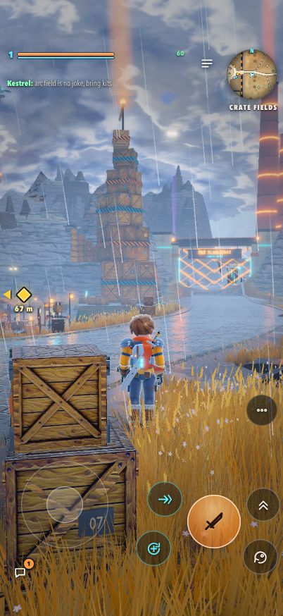

- **What:** The same spot at 14:00 in rain: grey clouds, rain streaks, a wet sheen on the road.
- **Where:** As above.
- **Why:** Rain with rings on the ground and wet surfaces; Shock chains further (src/gfx/rain.ts).

## Weather: storm

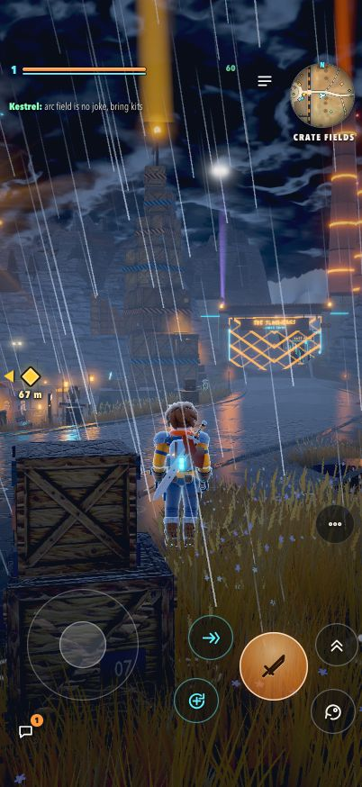

- **What:** The same spot at 19:24 in the storm: a dark sky, heavy rain, the lamps reflected in the wet road.
- **Where:** As above, Storm Hour.
- **Why:** The storm quest turns the whole zone to an evening storm until four beacons are lit.
