# The HUD

The HUD in its contexts and every panel, in portrait (402x874), landscape (874x402) and desktop (1440x900) where the layout differs. The design and its rules are in `docs/HUD.md` (built from the study in `docs/HUD-STUDY.md`); the staging is borrowed from the HUD matrix (`tools/hud-matrix/states.js`, `tools/hud-matrix/panels.js`), so these frames match what `tools/hud-matrix.sh` checks.

Re-shoot: `node tools/media/shoot.mjs hud/` (see `../README.md`). Captions live in `tools/media/shots.js`; regenerate this file with `node tools/media/readme.mjs`.

## Contents

- [Exploring](#exploring)
- [Fighting](#fighting)
- [A boss on a clock](#a-boss-on-a-clock)
- [A gate elite in its shell](#a-gate-elite-in-its-shell)
- [Shooter stance, from the hip](#shooter-stance-from-the-hip)
- [Shooter stance, aimed down sights](#shooter-stance-aimed-down-sights)
- [First person, sword drawn](#first-person-sword-drawn)
- [Riding](#riding)
- [The quick wheel](#the-quick-wheel)
- [The menu tray](#the-menu-tray)
- [The cluster at its peak](#the-cluster-at-its-peak)
- [Level 1: what is locked is not drawn](#level-1-what-is-locked-is-not-drawn)
- [A busy fight](#a-busy-fight)
- [Left-handed, landscape](#left-handed-landscape)
- [Panel: the pack](#panel-the-pack)
- [Panel: weapons compared](#panel-weapons-compared)
- [Panel: character](#panel-character)
- [Panel: loadout](#panel-loadout)
- [Panel: perks](#panel-perks)
- [Panel: quests](#panel-quests)
- [Panel: fast travel over the map](#panel-fast-travel-over-the-map)
- [Panel: the Tally Book](#panel-the-tally-book)
- [Panel: Tally Book sets](#panel-tally-book-sets)
- [Panel: settings](#panel-settings)
- [Panel: comfort settings](#panel-comfort-settings)
- [Panel: the armourer](#panel-the-armourer)
- [Panel: the tinker](#panel-the-tinker)
- [Panel: an outpost stall](#panel-an-outpost-stall)
- [Panel: the contract board](#panel-the-contract-board)
- [Panel: the trophy wall](#panel-the-trophy-wall)
- [A conversation](#a-conversation)
- [A job offered](#a-job-offered)
- [Level up](#level-up)
- [Down](#down)
- [The title screen](#the-title-screen)
- [The Overtime choice](#the-overtime-choice)

## Exploring

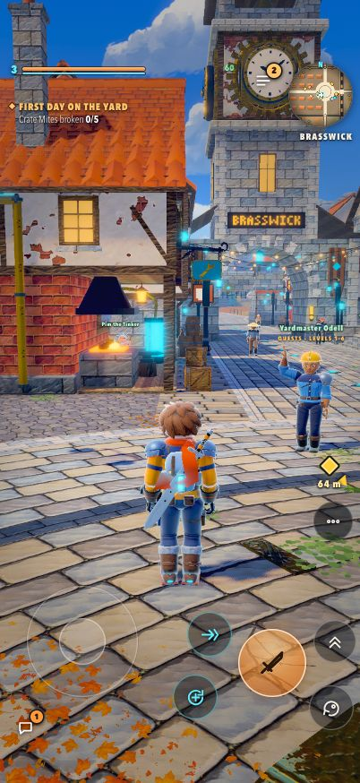 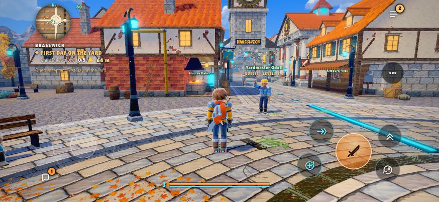

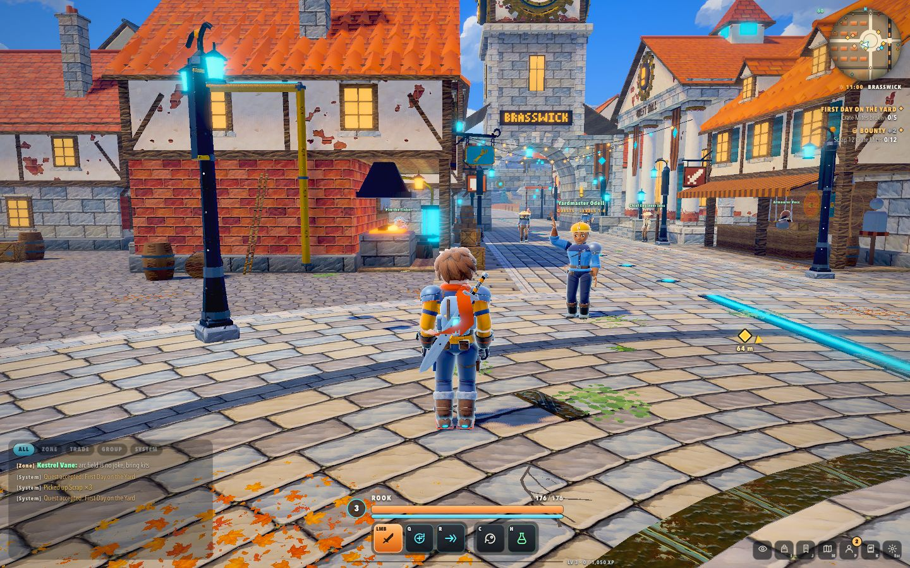

(portrait 402x874; landscape 874x402; desktop 1440x900)

- **What:** Walking in Brasswick with nothing to fight: health and energy top left, minimap and place name top right, the tracked quest under the bars, and only the stick, the attack button, dodge, jump and the dash and skill buttons that are unlocked. A guide line on the cobbles leads to the next giver.
- **Where:** Brasswick plaza, level 3, first quest tracked, a Talk prompt up.
- **Why:** Out of a fight the HUD is nearly empty: health, the quest line, minimap, menu glyph, and the thumb cluster at rest (docs/HUD.md, Principles 5-7).
- **Staged by:** `hm:town-idle` in `tools/media/shots.js`.

## Fighting

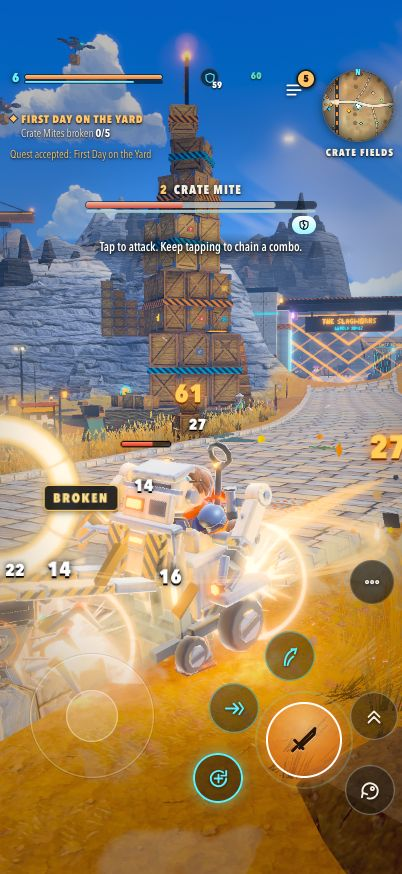 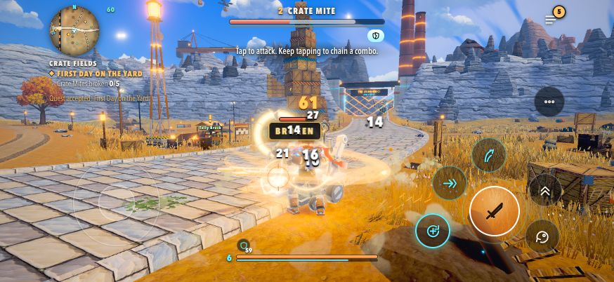

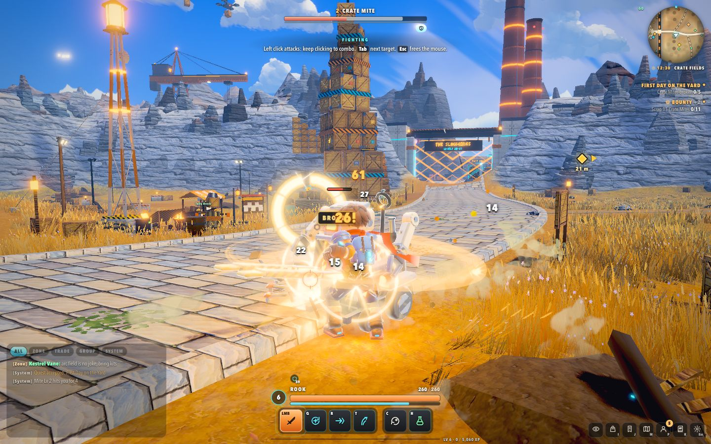

(portrait 402x874; landscape 874x402; desktop 1440x900)

- **What:** A Broken Crate Mite with damage numbers flying, the target frame and its stagger bar at the top, and the action cluster in the corner. Portrait, landscape and desktop share the layout, scaled to the safe area; on desktop the buttons become a key-hinted bar along the bottom.
- **Where:** Crate Fields (40, 6), level 6, a Crate Mite targeted, a skill just used.
- **Why:** In a fight the quest line goes, the target frame with its stagger meter comes, and only the moves a thumb needs are drawn (docs/HUD.md, Layouts).
- **Staged by:** `hm:fight-target` in `tools/media/shots.js`.

## A boss on a clock

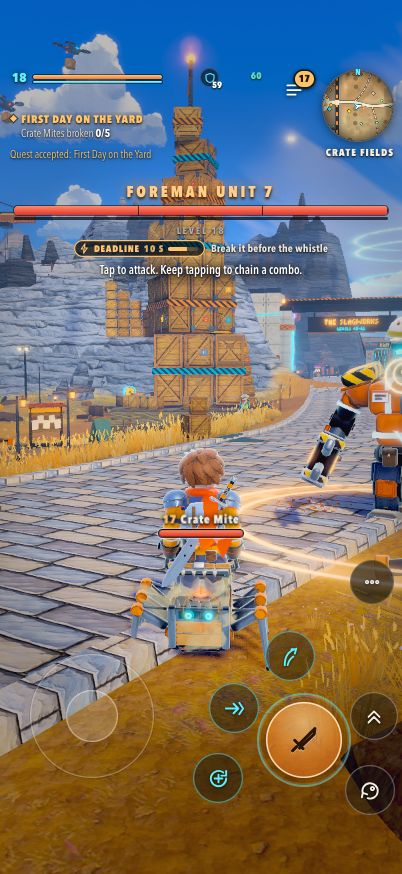 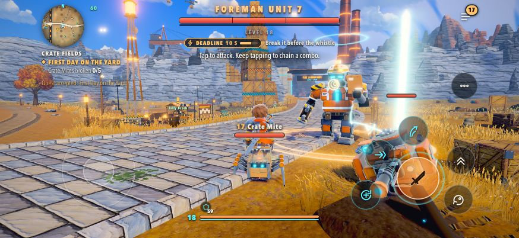

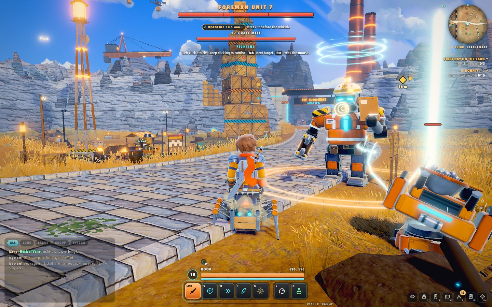

(portrait 402x874; landscape 874x402; desktop 1440x900)

- **What:** Foreman Unit 7 with its DEADLINE timer under the target bar ('Break it before the whistle'). The clock is the elite's mechanic, so it sits on the target frame, not in a separate widget.
- **Where:** Foreman Unit 7 staged in the Crate Fields; its deadline ring running.
- **Why:** Elites and bosses put their phase, state chip and the answer under the boss bar, so the mechanic reads with the sound off (docs/HUD.md, Elites and bosses on the frame).
- **Staged by:** `hm:boss-clock` in `tools/media/shots.js`.

## A gate elite in its shell

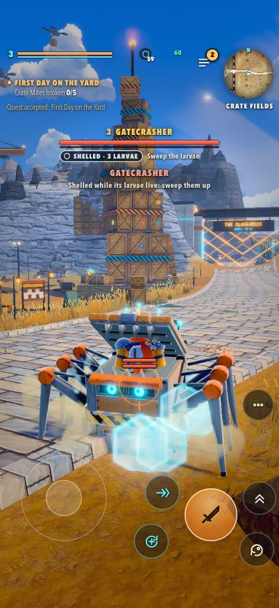

- **What:** The Gatecrasher shelled behind its cyan shield with three larvae; the target frame names the state (SHELLED, 3 LARVAE) and the hint says what to do (sweep the larvae).
- **Where:** Gatecrasher staged in the Crate Fields with its larvae out.
- **Why:** The state chip and a one-line answer sit under the target frame; the elite's introduction runs in the notice lane (docs/HUD.md).
- **Staged by:** `hm:elite-shield` in `tools/media/shots.js`.

## Shooter stance, from the hip

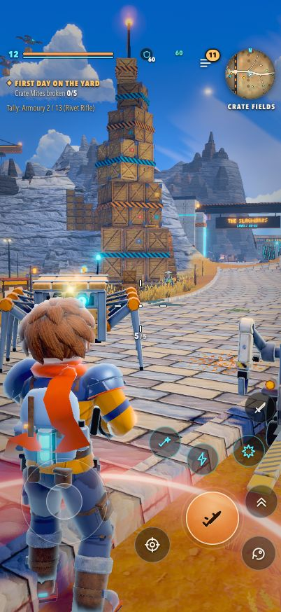 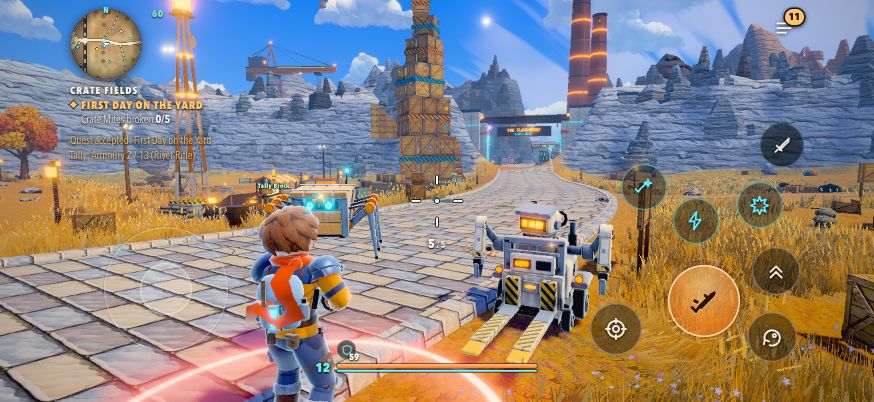

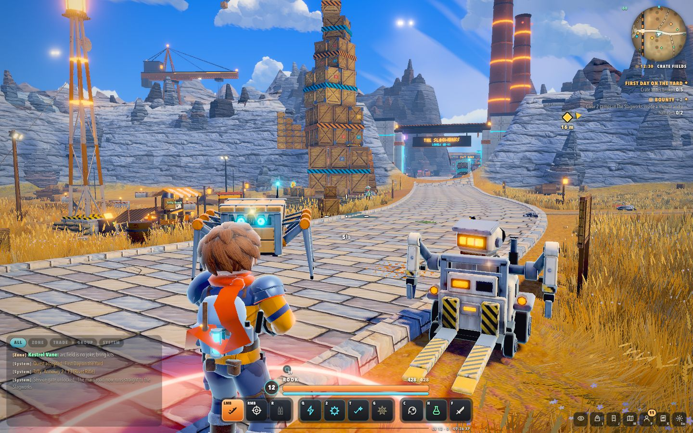

(portrait 402x874; landscape 874x402; desktop 1440x900)

- **What:** A rifle from the hip at a Pallet Jack: a small crosshair, the aim button (a white reticle) beside the attack button, the same cluster otherwise.
- **Where:** Rifle in hand in the Crate Fields, robots ahead.
- **Why:** A ranged weapon swaps the cluster: fire takes attack's seat, aim the inner arc, reload beside fire (docs/HUD.md, Shooter stance; docs/COMBAT.md, Shooter stance).
- **Staged by:** `hm:shooter-rifle` in `tools/media/shots.js`.

## Shooter stance, aimed down sights

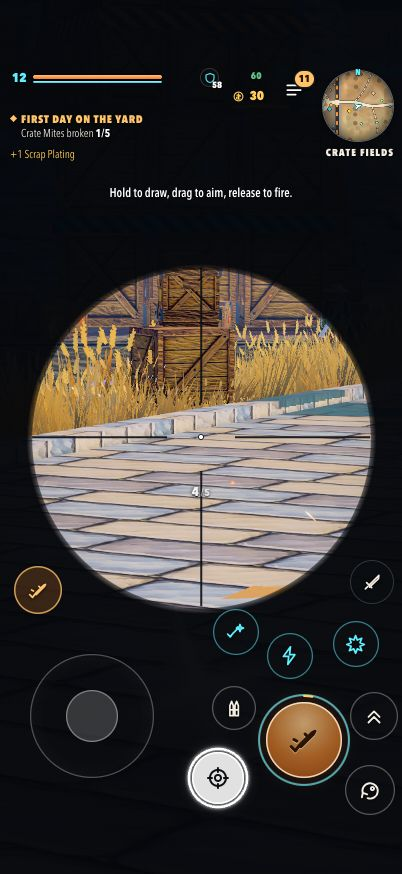 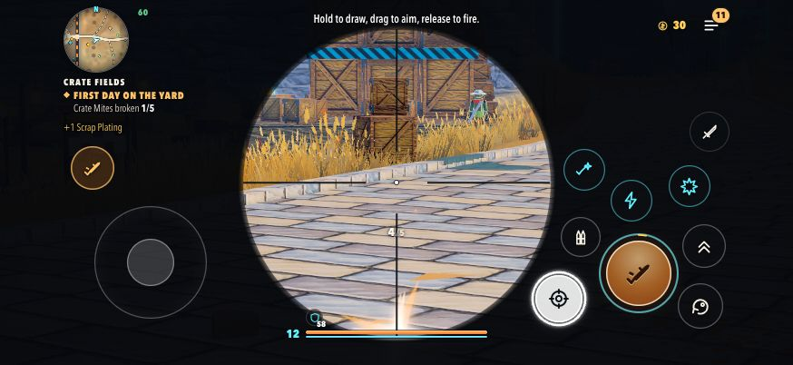

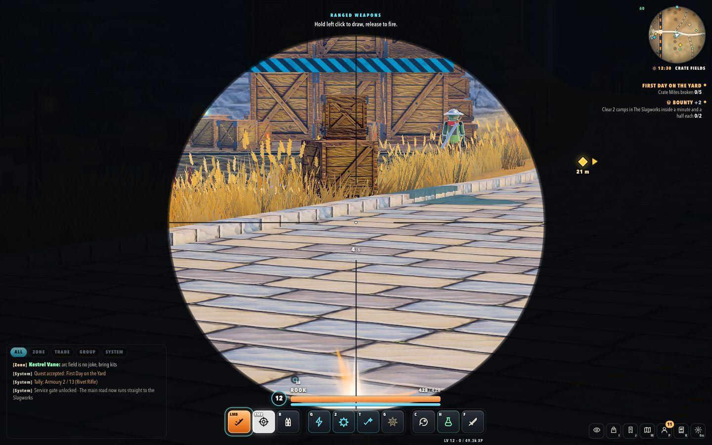

(portrait 402x874; landscape 874x402; desktop 1440x900)

- **What:** Aimed down the scope: the world shrinks to a circle with a reticle, everything but the bars, minimap, stick and fire buttons dims away, and a hint reads 'Hold to draw, drag to aim, release to fire'.
- **Where:** Rifle aimed, rounds spent: the left fire and reload are in.
- **Why:** Aiming down sights always goes to first person, from either view (owner's ruling, docs/AAA-PLAN.md section 2).
- **Staged by:** `hm:shooter-ads` in `tools/media/shots.js`.

## First person, sword drawn

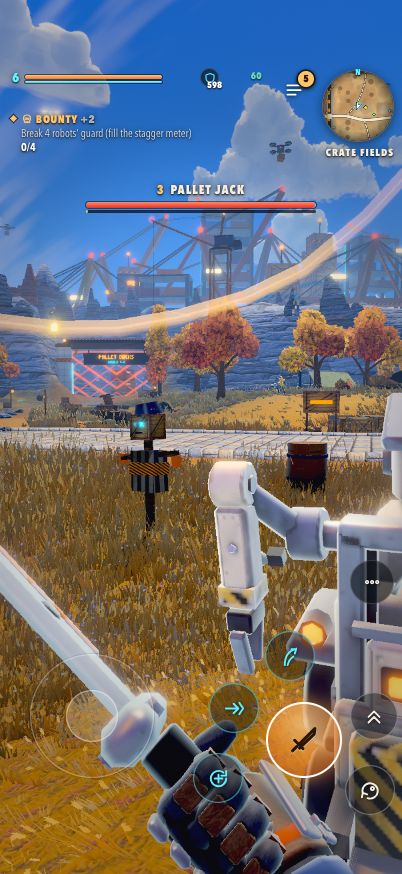 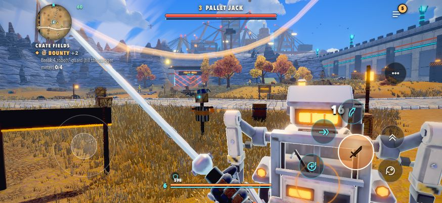

(portrait 402x874; landscape 874x402)

- **What:** First person with a sword in the Crate Fields: the blade crosses the lower half of the frame toward a Pallet Jack, and the HUD does not change. The sword is the only part of the hero you see.
- **Where:** Crate Fields (52, -16), a Pallet Jack ahead. Settings, Camera, View, or the V key.
- **Why:** The whole game plays in first person too: the hero's own body, hands and weapon in view (docs/FIRST-PERSON.md).

## Riding

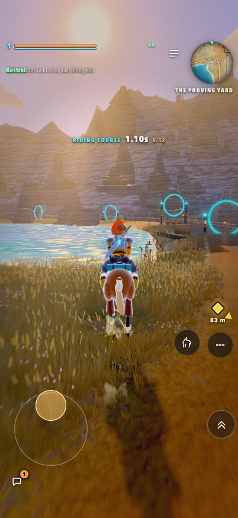

- **What:** On the horse on the riding course: the action cluster collapses to stick, dismount and jump; the lap timer and the ring count sit under the bars.
- **Where:** On the loaner horse at the riding course (-125, 82), lap timer running.
- **Why:** Riding is its own HUD context: no fight buttons, a dismount, the sprint (docs/HUD.md, Principle 6).
- **Staged by:** `golden:riding-course` in `tools/media/shots.js`.

## The quick wheel

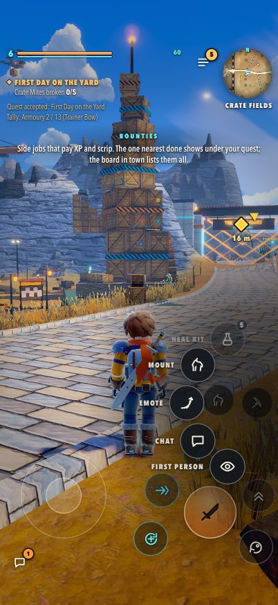 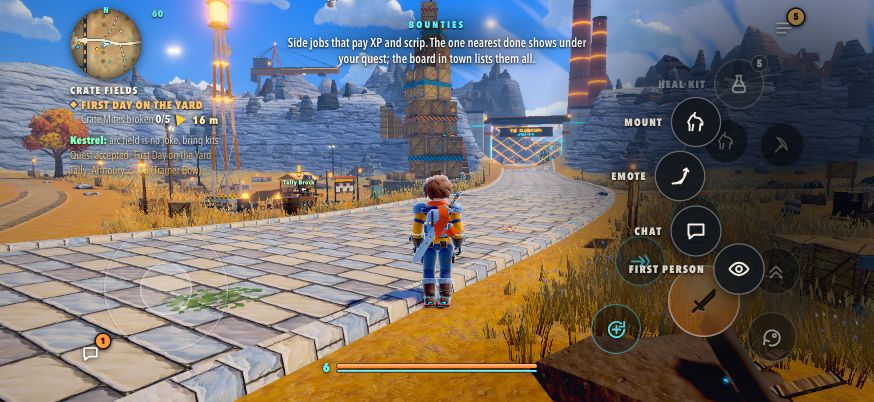

(portrait 402x874; landscape 874x402)

- **What:** The quick wheel opened from the cluster: Heal kit, Mount, Emote, Chat and First person as labelled round buttons on an arc. The actions that are not needed every second live here, not on the screen.
- **Where:** Long-press the weapon chip.
- **Why:** Rare actions live in one wheel: kit, mount, emote, chat, the view toggle (docs/HUD.md, Principle 5).
- **Staged by:** `hm:wheel-open` in `tools/media/shots.js`.

## The menu tray

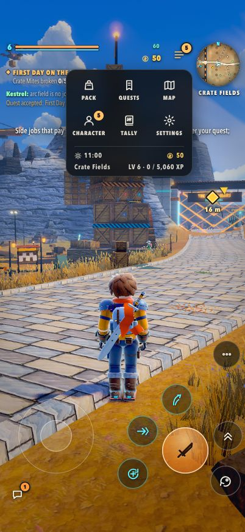 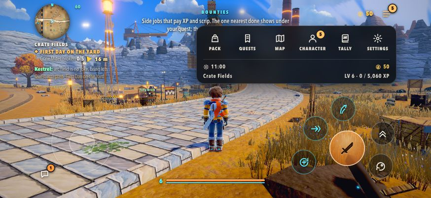

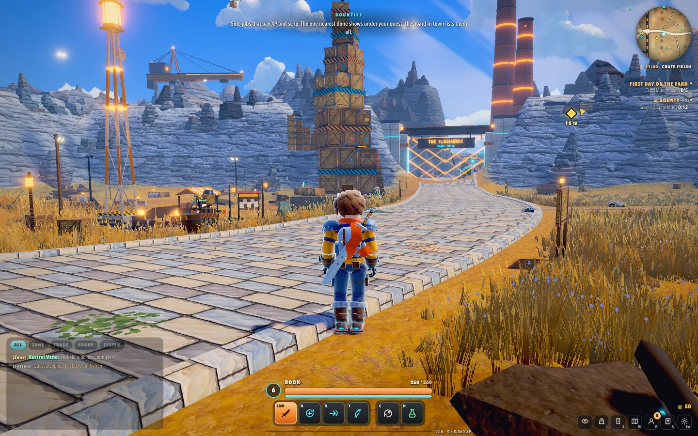

(portrait 402x874; landscape 874x402; desktop 1440x900)

- **What:** The menu tray from the top right: Pack, Quests, Map, Character, Tally and Settings, with the time, the place, the scrip and the level and XP. On desktop the frame shows no tray: the same buttons sit at the right end of the bottom bar with their keys.
- **Where:** Tap the menu glyph (top right on a phone; the micro menu on a desktop).
- **Why:** Five panels behind one glyph instead of five buttons on screen (docs/HUD.md, Panels).
- **Staged by:** `hm:tray-open` in `tools/media/shots.js`.

## The cluster at its peak

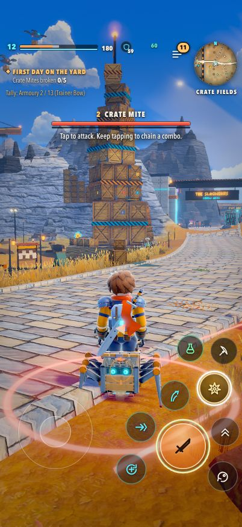

- **What:** A fight with every button lit: skills, dash, the Overdrive button glowing gold because the meter is full, a Crate Mite inside its red attack ring.
- **Where:** Level 12 melee, hurt with kits left and Overdrive full.
- **Why:** The action budget's worst case: seven buttons, Overdrive on its own seat with a gold pulse (docs/HUD.md, Principle 1).
- **Staged by:** `hm:hurt-overdrive` in `tools/media/shots.js`.

## Level 1: what is locked is not drawn

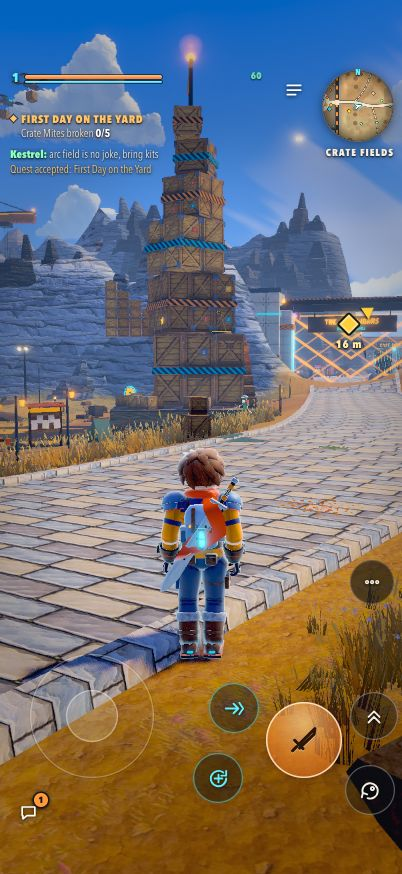

- **What:** A level 1 player at the Great Stack: no skill buttons, no Overdrive, no dash, because nothing locked is drawn. The cluster grows as the player levels.
- **Where:** A fresh level 1 hero in the Crate Fields.
- **Why:** No padlocks: the third skill and Overdrive take no space until they open (docs/HUD.md, Principle 4).
- **Staged by:** `hm:level1-locked` in `tools/media/shots.js`.

## A busy fight

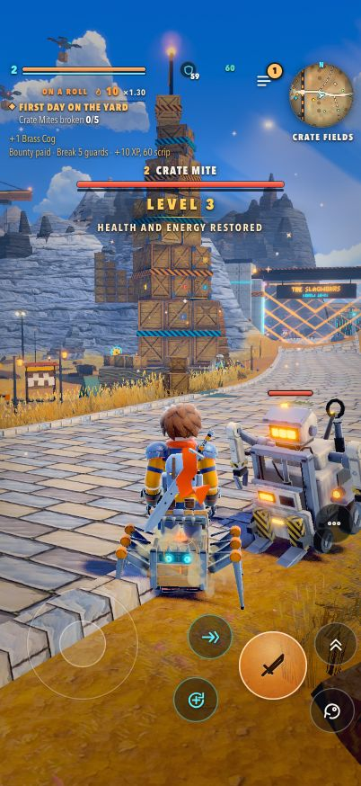

- **What:** A Crate Mite and a Pallet Jack at once, the LEVEL 3 banner ('Health and energy restored') over the fight. The banner sits high so it does not cover the robots.
- **Where:** Toasts, a level, a zone name, a streak and a tip raised at once.
- **Why:** The notice lane shows one thing at a time and the feed two, so a busy moment never stacks text over the fight (src/ui/notices.ts).
- **Staged by:** `hm:busy-fight` in `tools/media/shots.js`.

## Left-handed, landscape

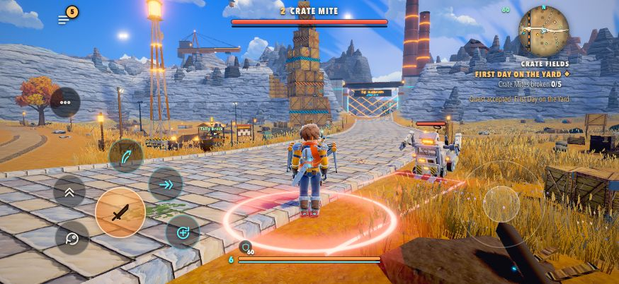

(landscape 874x402)

- **What:** The left-handed layout in landscape: the action cluster on the left, the stick on the right, the minimap moved to match; a Crate Mite in its red ring.
- **Where:** Settings, Controls, Left-handed.
- **Why:** Every slot mirrors; the stick and the cluster trade corners (docs/HUD.md, Left-handed).
- **Staged by:** `hm:lefty-fight` in `tools/media/shots.js`.

## Panel: the pack

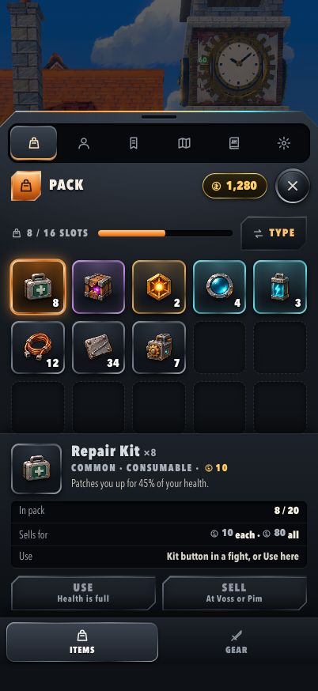 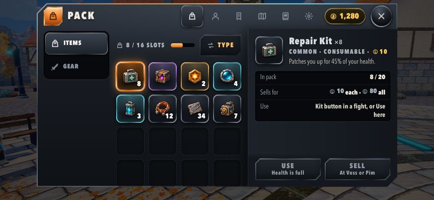

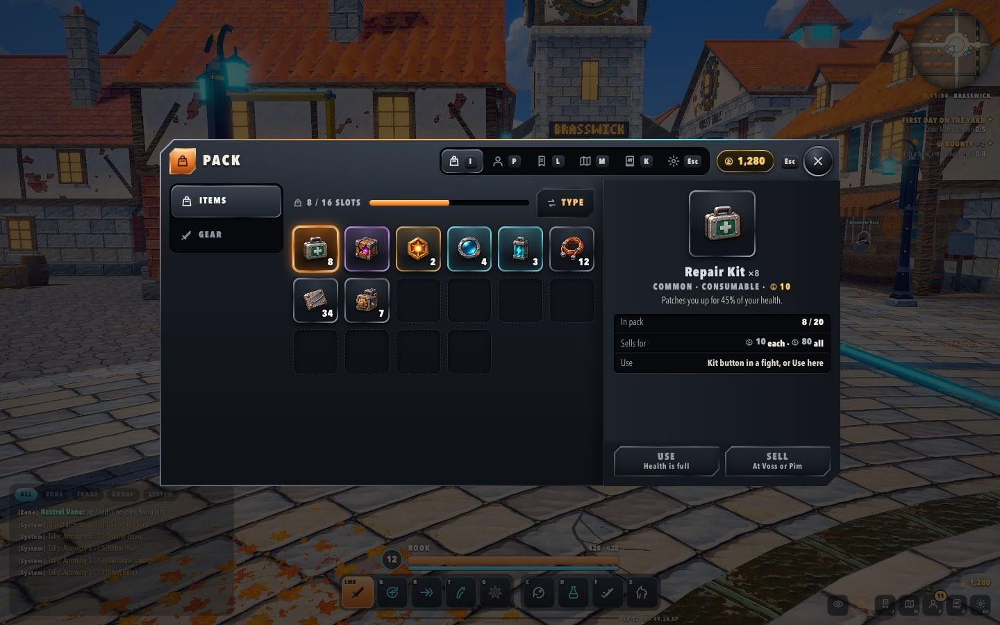

(portrait 402x874; landscape 874x402; desktop 1440x900)

- **What:** The pack on the items tab: 8 of 16 slots, the Repair Kit selected with its uses, sale price and Use and Sell buttons. Portrait is a bottom sheet, landscape a side panel, desktop a window.
- **Where:** Menu tray, Pack (I on a desktop).
- **Why:** One frame for every screen: a bottom sheet on an upright phone, a window on its side and on a desktop (docs/HUD.md, Panels).
- **Staged by:** `pn:bag-items` in `tools/media/shots.js`.

## Panel: weapons compared

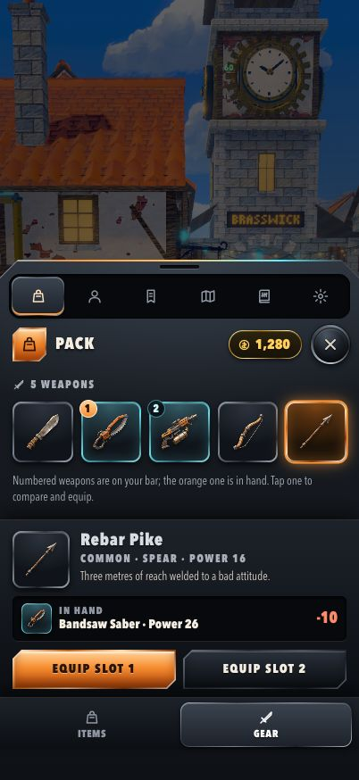

- **What:** The pack's gear tab: five weapons in a row, the Rebar Pike selected and compared with the Bandsaw Saber in hand (-10 power), with Equip slot 1 and Equip slot 2.
- **Where:** Pack, a weapon selected.
- **Why:** A weapon is compared against the one in hand before it is equipped.
- **Staged by:** `pn:bag-gear` in `tools/media/shots.js`.

## Panel: character

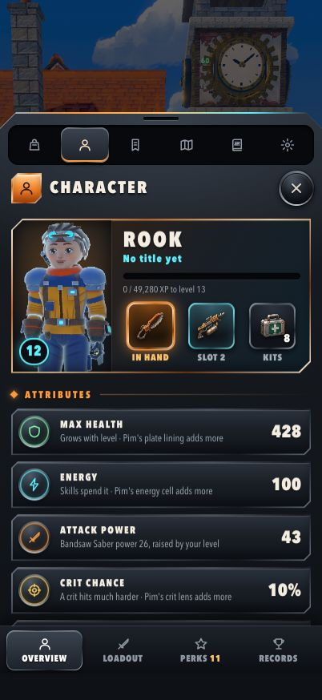 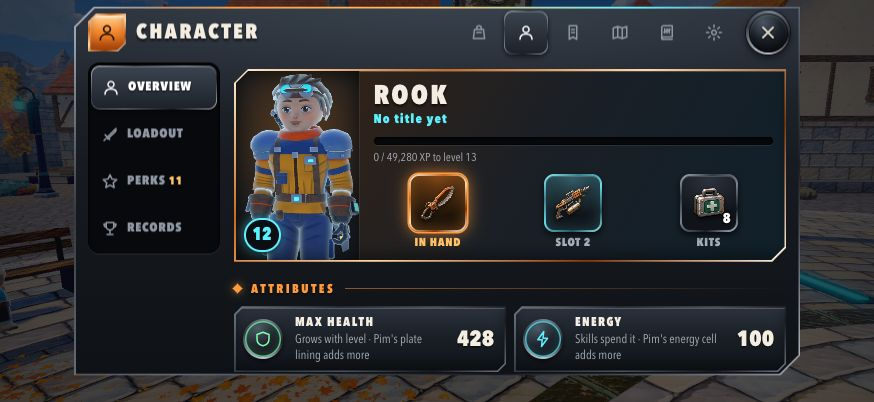

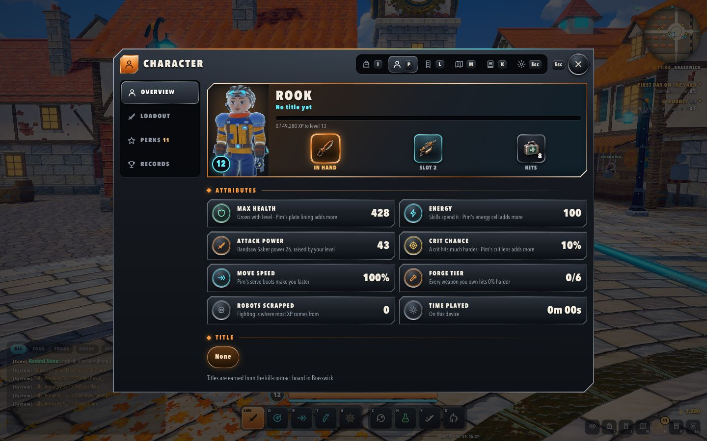

(portrait 402x874; landscape 874x402; desktop 1440x900)

- **What:** The character overview: Rook, level 12, the weapons in hand and in slot 2, kits, and the attribute list with where each number comes from (health from level and plate, attack from the weapon and level).
- **Where:** Menu tray, Character (P on a desktop).
- **Why:** The hero, stats and records.
- **Staged by:** `pn:char-overview` in `tools/media/shots.js`.

## Panel: loadout

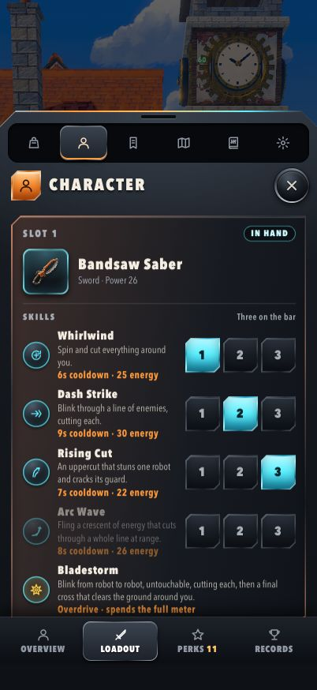

- **What:** The loadout tab for the Bandsaw Saber: five skills with cost and cooldown, each put on button 1, 2 or 3; Bladestorm shown as the Overdrive.
- **Where:** Character, Loadout.
- **Why:** Two weapons and three skill slots each; skill names live here, not on the buttons (docs/HUD.md, Principle 3).
- **Staged by:** `pn:char-loadout` in `tools/media/shots.js`.

## Panel: perks

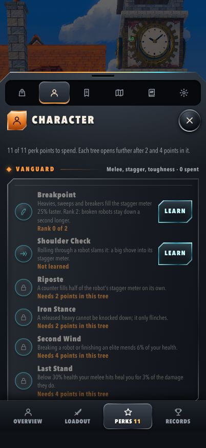

- **What:** The perks tab: 11 points to spend, the Vanguard tree (Breakpoint, Shoulder Check, Riposte, Iron Stance, Second Wind, Last Stand) with Learn buttons and the point cost of the locked rows.
- **Where:** Character, Perks.
- **Why:** Perk trees with points from levels, Field Training and the Tally Book (docs/AAA-PLAN.md, Perk points).
- **Staged by:** `pn:char-perks` in `tools/media/shots.js`.

## Panel: quests

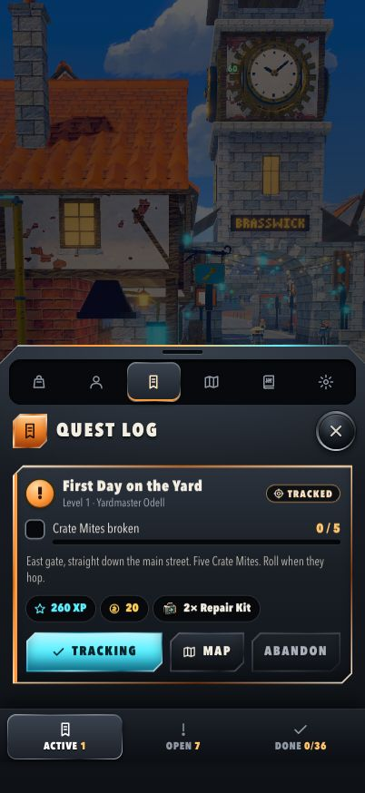

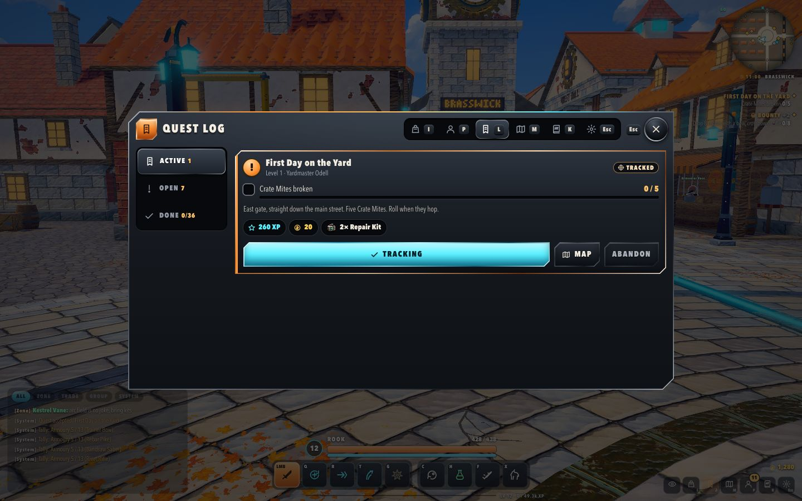

(portrait 402x874; desktop 1440x900)

- **What:** The quest log: First Day on the Yard tracked, its step (Crate Mites broken 0/5), the reward (XP, scrip, two repair kits) and Tracking, Map and Abandon.
- **Where:** Menu tray, Quests (L on a desktop).
- **Why:** Active quests, one tracked; the tracked one drives the waypoint.
- **Staged by:** `pn:quests-active` in `tools/media/shots.js`.

## Panel: fast travel over the map

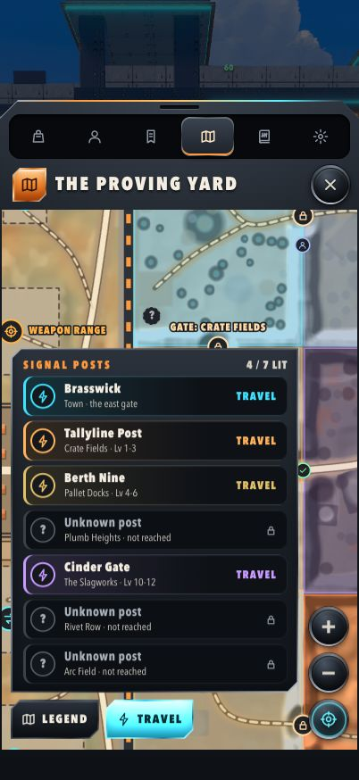

- **What:** The map with the signal posts listed for travel: Brasswick, Tallyline Post, Berth Nine and Cinder Gate lit with a Travel button, the posts not yet reached shown as Unknown.
- **Where:** Map, Travel; or a signal post terminal.
- **Why:** Signal posts unlock on approach; three lit, three unknown here (docs/AAA-PLAN.md, Fast travel).
- **Staged by:** `pn:map-travel` in `tools/media/shots.js`.

## Panel: the Tally Book

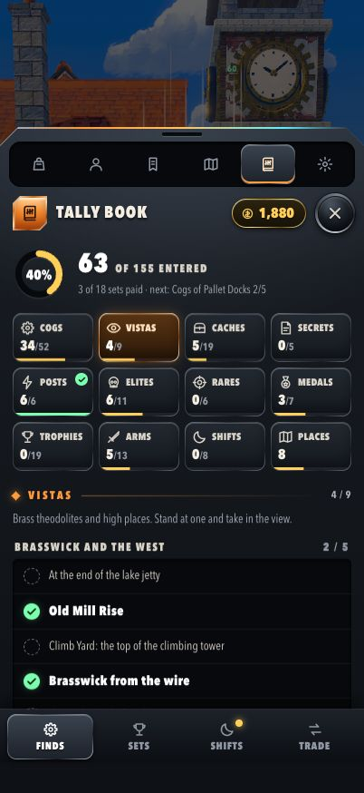

- **What:** The Tally Book on its finds tab: 63 of 155 entered (40%), counts per kind (cogs, vistas, caches, secrets, posts, elites, rares, medals, trophies, arms, shifts, places) and the vista list for Brasswick and the west.
- **Where:** Menu tray, Tally.
- **Why:** One log of 155 finds across twelve kinds, with a clue for each missing entry (docs/AAA-PLAN.md, Collections).
- **Staged by:** `pn:tally-finds` in `tools/media/shots.js`.

## Panel: Tally Book sets

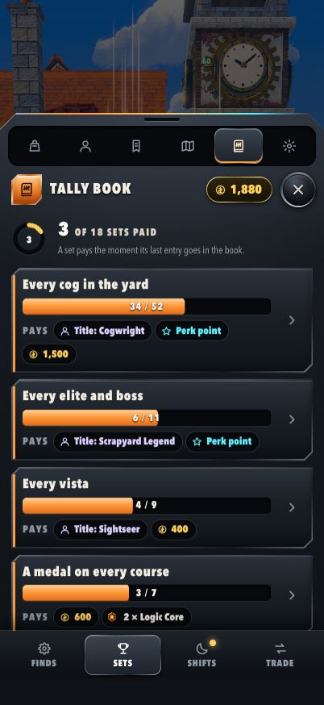

- **What:** The Tally Book's sets: 3 of 18 paid, bars for 'Every cog in the yard', 'Every elite and boss', 'Every vista', 'A medal on every course', each with its title, perk point and scrip reward.
- **Where:** Tally, Sets.
- **Why:** 18 sets pay scrip, items, titles, perk points; never XP.
- **Staged by:** `pn:tally-sets` in `tools/media/shots.js`.

## Panel: settings

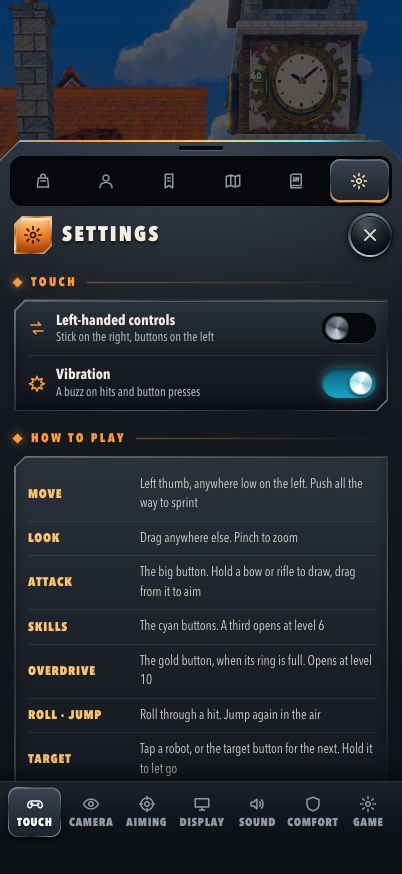

- **What:** Settings on the Touch tab: left-handed controls, vibration, and a How to Play list (move, look, attack, skills, Overdrive, roll and jump, target).
- **Where:** Menu tray, Settings.
- **Why:** Controls first; camera, aiming, display, sound, comfort and game follow.
- **Staged by:** `pn:settings` in `tools/media/shots.js`.

## Panel: comfort settings

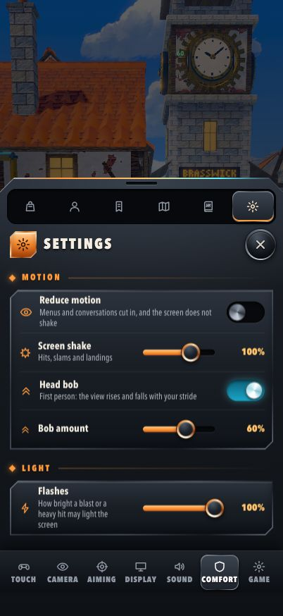

- **What:** The Comfort tab: reduce motion, screen shake, head bob and its amount, and flash strength. Each slider says what it changes.
- **Where:** Settings, Comfort.
- **Why:** Motion, shake, head bob and flashes, for first person especially (docs/FIRST-PERSON.md, Comfort settings).
- **Staged by:** `pn:settings-comfort` in `tools/media/shots.js`.

## Panel: the armourer

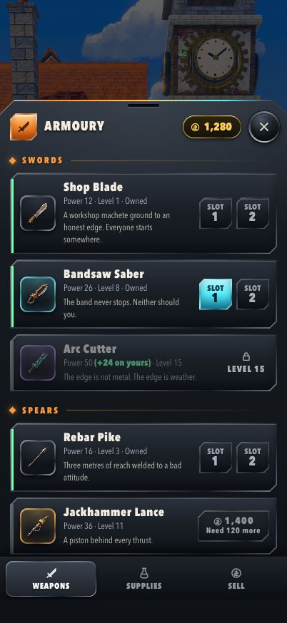

- **What:** The armourer's weapons tab: Shop Blade and Bandsaw Saber owned with slot buttons, Arc Cutter locked until level 15, Rebar Pike, and a Jackhammer Lance for 1,400 scrip.
- **Where:** Armourer Voss, Brasswick (-49, -8).
- **Why:** Weapons unlocked by level, priced in Scrip (ZONE-DESCRIPTION.md, Quests and economy).
- **Staged by:** `pn:shop` in `tools/media/shots.js`.

## Panel: the tinker

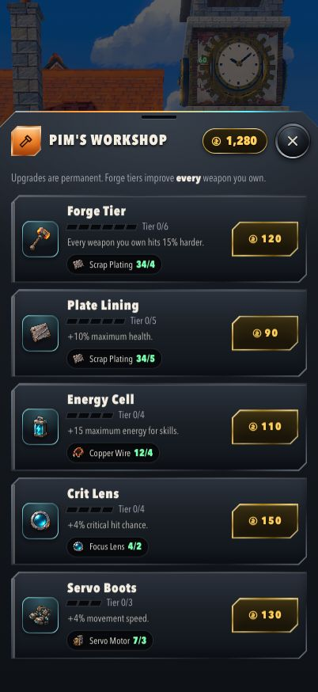

- **What:** Pim's workshop: permanent upgrades (Forge Tier, Plate Lining, Energy Cell, Crit Lens, Servo Boots), each with its tier, its effect, the parts it needs and its price.
- **Where:** Pim the Tinker, Brasswick (-47, 8).
- **Why:** Upgrades, including forge tiers that improve every weapon.
- **Staged by:** `pn:tinker` in `tools/media/shots.js`.

## Panel: an outpost stall

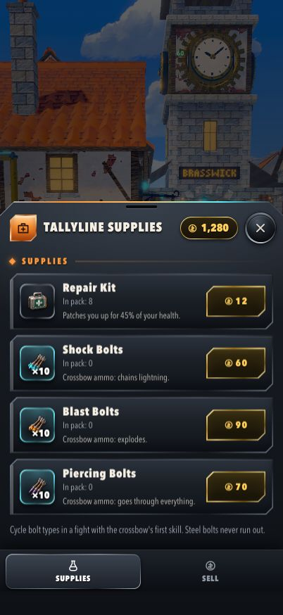

- **What:** Tallyline Post's supply stall: repair kits and crossbow bolt types (shock, blast, piercing) with prices; the hint explains how to cycle bolts in a fight.
- **Where:** Any field outpost's stall.
- **Why:** Kits and bolts in the field, under the stall's own name.
- **Staged by:** `pn:shop-outpost` in `tools/media/shots.js`.

## Panel: the contract board

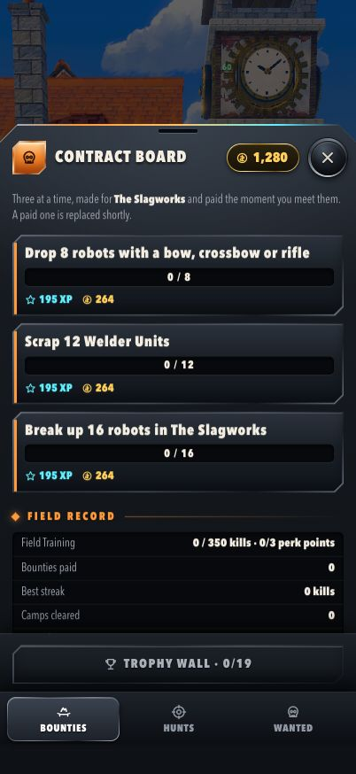

- **What:** The contract board: three kill contracts (drop 8 robots with a ranged weapon, scrap 12 Welder Units, break 16 robots in the Slagworks) with XP and scrip, and the field record below.
- **Where:** Brasswick plaza (-11, -12).
- **Why:** Kill contracts for each kind, elite and the boss (ZONE-DESCRIPTION.md).
- **Staged by:** `pn:board` in `tools/media/shots.js`.

## Panel: the trophy wall

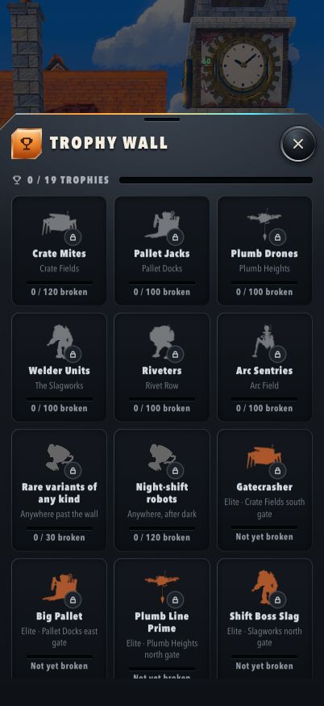

- **What:** The trophy wall: 0 of 19, one tile per robot kind and elite with its band and a count to break; elites not yet broken are greyed.
- **Where:** Brasswick plaza (-11, 12).
- **Why:** A trophy and a joke title the first time each contract is paid.
- **Staged by:** `pn:trophies` in `tools/media/shots.js`.

## A conversation

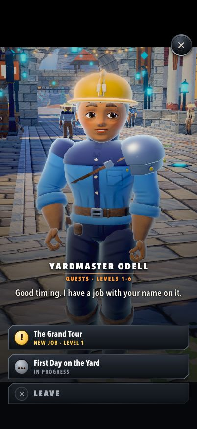 

(portrait 402x874; landscape 874x402; desktop 1440x900)

- **What:** Yardmaster Odell in close-up with his line ('Good timing. I have a job with your name on it.') and the reply list: the new job, the quest in progress, Leave. In landscape and on desktop the replies move to the right.
- **Where:** Yardmaster Odell, Brasswick (-36, 4).
- **Why:** Speaker, line and choices over the scene, the camera on the speaker (docs/HUD.md, Conversations).
- **Staged by:** `pn:dialogue` in `tools/media/shots.js`.

## A job offered

- **What:** A job offered: Odell's line, then the card for The Grand Tour (level 1) with its steps (physics yard, climb yard, movers run, hoverboard park, grapple course, the Rock lookout) and reward, Accept and Not now.
- **Where:** A quest giver's last beat.
- **Why:** Terms and reward shown before accepting.
- **Staged by:** `pn:dialogue-offer` in `tools/media/shots.js`.

## Level up

- **What:** LEVEL 5 over the field: 'Health and energy restored'. Big and brief, then gone.
- **Where:** Any level gained.
- **Why:** A short moment, then out of the way.
- **Staged by:** `pn:level-up` in `tools/media/shots.js`.

## Down

- **What:** Down: the world drains to grey, 'Systems down, returning to safety, nothing is lost'. A soft failure for a single-player zone.
- **Where:** Health to zero.
- **Why:** The fall and the way back: respawn at the nearest unlocked post.
- **Staged by:** `pn:death` in `tools/media/shots.js`.

## The title screen

 

(portrait 402x874; landscape 874x402; desktop 1440x900)

- **What:** The title over a live shot of Brasswick: CRATEFALL, The Proving Yard, a Start button ('Level 1 in Brasswick to the Crate Titan'), Settings and the view toggle.
- **Where:** Load the game without ?dev.
- **Why:** The title sits over the live town scene (golden frame 1).
- **Staged by:** `pn:title` in `tools/media/shots.js`.

## The Overtime choice

- **What:** The Training Vault's door choice: Start Overtime (today's rule: thin overalls, 25% more damage taken; bronze, silver and gold times) or a Normal Run.
- **Where:** The vault or arena door after the first Titan kill.
- **Why:** After hours: the day's rule and the medal row (docs/AAA-PLAN.md, After hours).
- **Staged by:** `pn:choice-overtime` in `tools/media/shots.js`.
