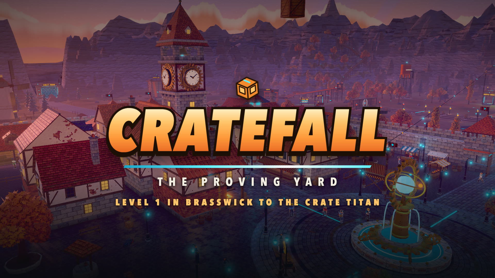
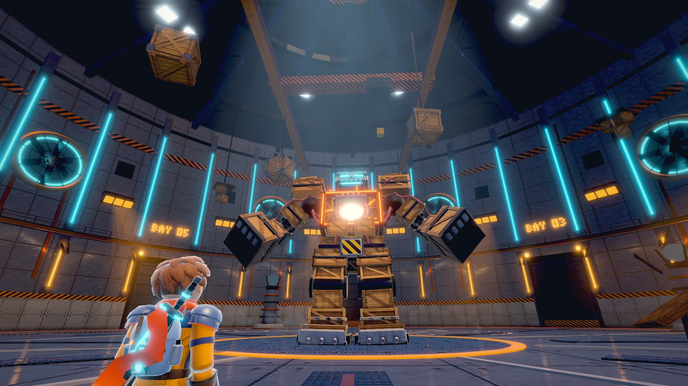

# CRATEFALL trailers

Two action trailers cut from real gameplay of a production build, each in a
landscape master and a portrait phone cut. Every frame is the game's own
renderer at the `high` tier; the soundtrack is the game's own score and
effects, rendered offline. Nothing comes from outside the game.

| File                           | Format          | Length | Size    |
|--------------------------------|-----------------|--------|---------|
| `cratefall-30s.mp4`            | 1920×1080 16:9  | 30 s   | 13.8 MB |
| `cratefall-30s-portrait.mp4`   | 1080×1920 9:16  | 30 s   | 13.9 MB |
| `cratefall-15s.mp4`            | 1920×1080 16:9  | 15 s   | 7.0 MB  |
| `cratefall-15s-portrait.mp4`   | 1080×1920 9:16  | 15 s   | 7.0 MB  |

All are H.264 High, yuv420p, 30 fps, AAC 160 kb/s 48 kHz at -16 LUFS,
`+faststart`.

## Posters

| Trailer | Poster                                | Shows                    |
|---------|---------------------------------------|--------------------------|
| 30 s    | `cratefall-30s-poster.jpg`            | the title card           |
| 30 s    | `cratefall-30s-portrait-poster.jpg`   | the title card, portrait |
| 15 s    | `cratefall-15s-poster.jpg`            | Rook facing the Titan    |
| 15 s    | `cratefall-15s-portrait-poster.jpg`   | the same, portrait       |

## The 30 s trailer, shot by shot

The music is the title theme, then the gauntlet score at 150 bpm; every cut
lands on a beat (0.4 s).

| Time   | Shot             | What it shows                                  |
|--------|------------------|------------------------------------------------|
| 0.0 s  | Town at dawn     | Aerial over Brasswick's roofs to the fountain  |
| 2.4 s  | First blood      | Sword string on a Crate Mite pack, hit rings   |
| 4.4 s  | Big Pallet       | The elite's ram tell, then the charge          |
| 6.0 s  | On horseback     | Galloping the riding course, through a ring    |
| 8.0 s  | The laser        | Plumb Line Prime's lock closes, the beam fires |
| 9.6 s  | The gauntlet     | A court of robots, a skill, then Overdrive     |
| 11.2 s | Storm hour       | A lit beacon in the storm, lightning           |
| 13.2 s | Vault Warden     | Phase three: the beam sweeps, Rook strikes     |
| 15.6 s | The Crate Titan  | The Titan assembling from crates               |
| 18.0 s | Face to face     | Rook in front of the Titan's glowing core      |
| 20.4 s | Planted fist     | The fist slams, the Titan bends over it        |
| 22.4 s | Overdrive        | Cyan hits up the broken Titan                  |
| 24.4 s | Flashes          | Mites, gauntlet, Warden, Titan, a beat each    |
| 26.0 s | Title            | CRATEFALL logo over the town at dusk           |

## The 15 s trailer, shot by shot

| Time   | Shot             | What it shows                                  |
|--------|------------------|------------------------------------------------|
| 0.0 s  | Town             | Aerial over Brasswick                          |
| 1.6 s  | First blood      | Sword string on Crate Mites                    |
| 2.8 s  | Big Pallet       | The ram tell                                   |
| 4.0 s  | On horseback     | Galloping through a ring                       |
| 5.2 s  | The laser        | The lock and the beam                          |
| 6.4 s  | Vault Warden     | The beam sweeps the hall                       |
| 8.0 s  | The Crate Titan  | The Titan assembling                           |
| 9.6 s  | Planted fist     | The slam                                       |
| 10.8 s | Flashes          | Gauntlet, then Rook facing the Titan           |
| 11.6 s | Title            | CRATEFALL logo over the town at dusk           |

The title card is the game's own title-screen logo, "The Proving Yard", and
the line "Level 1 in Brasswick to the Crate Titan". There are no quotes,
platform logos, dates or prices.

## Known weak spots

- Big Pallet: a passing robot crosses close to the lens for a few frames.
- Vault Warden: the Warden's beam whites out most of the frame for about
  a frame in the 30 s cut.
- Not in the edit: the zipline (the camera could not hold the rider and
  the line together), Sir Nibbles at night (muddy) and Whirlwind (too far
  and busy). Their shots are still in `tools/trailer/shots.js`.

## Re-rendering

The plan and the reasoning are in `PLAN.md`. The tools are in
`tools/trailer/`: `shots.js` (each shot's staging and camera), `cuts.json`
(the edit: shots, in-points, beats, music and sound cues), and scripts.
Use one scratch folder outside the repo, here `$T`.

1. Build a committed HEAD in a scratch worktree:
   `git worktree add --detach $T/wt HEAD`, link `node_modules`, then
   `npm run build -- --outDir $T/dist` inside it.
2. Serve it and take frames:
   `node tools/trailer/serve.mjs --dir $T/dist --out $T/frames --port 5231`.
3. Record every shot in both aspects (one `agent-browser` session named
   `trailer`, closed at the end): `tools/trailer/shoot.sh l all` and
   `tools/trailer/shoot.sh p all`, or name shots to redo just those.
4. Record the title card: `tools/trailer/card.sh l $T/frames 120` and
   `tools/trailer/card.sh p $T/frames 120`.
5. Render the soundtrack from the game's audio code:
   `node tools/trailer/render.mjs 30 15` (starts its own Vite on 5232,
   writes `$T/frames/trailer-30.wav` and `trailer-15.wav` through the
   server). Without a WAV the cut is silent.
6. Cut: `python3 tools/trailer/edit.py $T/frames docs/media/trailer 30 15`.
   It prints each file's shots, and writes a contact sheet (a frame every
   half second) per file to `$T/frames/_edit/` to review.
7. Remove the worktree (`git worktree remove $T/wt`) and `$T`.

To change the edit, change `cuts.json` (`in` is the first frame of a take,
`pin` overrides it for portrait; `beats` is the length) and run step 6
again; to change a shot, change `shots.js` and redo steps 3 and 6.
