# The zone, segment by segment

Every part of the 500 x 500 m map: Brasswick, the six combat bands east of the Blast Wall, the six field outposts, the peaceful west with its courses, the Training Vault, the gauntlet and the Crate Titan's arena, plus the map panel. Day unless the title says otherwise; a few at night or in a storm. Coordinates are game metres (x east, z south; the town is near (-30, 0), x > 0 is the combat half). Every frame is the phone tier (`?q=medium`) in portrait, with the HUD as a player sees it.

Re-shoot: `node tools/media/shoot.mjs zone/` (see `../README.md`). Captions live in `tools/media/shots.js`; regenerate this file with `node tools/media/readme.mjs`.

## Contents

- [Brasswick, the town square](#brasswick-the-town-square)
- [Brasswick, the market street](#brasswick-the-market-street)
- [Brasswick, the stable and paddock](#brasswick-the-stable-and-paddock)
- [Brasswick, the trophy wall and contract board](#brasswick-the-trophy-wall-and-contract-board)
- [Brasswick at night](#brasswick-at-night)
- [Brasswick in a storm](#brasswick-in-a-storm)
- [The Blast Wall gate, looking east](#the-blast-wall-gate-looking-east)
- [The skyline from town](#the-skyline-from-town)
- [Band 1: the Crate Fields (L1-3)](#band-1-the-crate-fields-l1-3)
- [Band 1: a fight in the Crate Fields](#band-1-a-fight-in-the-crate-fields)
- [Band 1 at night: the night shift](#band-1-at-night-the-night-shift)
- [Band 2: the Pallet Docks (L4-6)](#band-2-the-pallet-docks-l4-6)
- [Band 2 at night](#band-2-at-night)
- [Band 3: Plumb Heights (L7-9)](#band-3-plumb-heights-l7-9)
- [Band 4: the Slagworks (L10-12) by day](#band-4-the-slagworks-l10-12-by-day)
- [Band 4: the Slagworks at dusk](#band-4-the-slagworks-at-dusk)
- [Band 5: Rivet Row (L13-15)](#band-5-rivet-row-l13-15)
- [Band 6: the Arc Field (L16-18)](#band-6-the-arc-field-l16-18)
- [Band 6 in a storm](#band-6-in-a-storm)
- [Storm Hour at a beacon](#storm-hour-at-a-beacon)
- [Outpost, band 1: Tallyline Post](#outpost-band-1-tallyline-post)
- [Outpost, band 2: Berth Nine](#outpost-band-2-berth-nine)
- [Outpost, band 3: Benchmark Camp](#outpost-band-3-benchmark-camp)
- [Outpost, band 4: Cinder Gate at dusk](#outpost-band-4-cinder-gate-at-dusk)
- [Outpost, band 5: Lineman's Rest](#outpost-band-5-linemans-rest)
- [Outpost, band 6: Last Light at night](#outpost-band-6-last-light-at-night)
- [The west: the weapon range](#the-west-the-weapon-range)
- [The west: the riding course, on horseback](#the-west-the-riding-course-on-horseback)
- [The west: the physics yard](#the-west-the-physics-yard)
- [The west: the long zipline into town](#the-west-the-long-zipline-into-town)
- [The west: the climb yard](#the-west-the-climb-yard)
- [The west: the Rock lookout](#the-west-the-rock-lookout)
- [The west: the hoverboard park](#the-west-the-hoverboard-park)
- [The west: the movers run](#the-west-the-movers-run)
- [The Training Vault portal](#the-training-vault-portal)
- [The Training Vault: the Warden's hall](#the-training-vault-the-wardens-hall)
- [The gauntlet courts](#the-gauntlet-courts)
- [The gauntlet, mid-wave](#the-gauntlet-mid-wave)
- [The boss portal to the Crate Titan](#the-boss-portal-to-the-crate-titan)
- [The Crate Titan's arena](#the-crate-titans-arena)
- [The zone map](#the-zone-map)
- [The zone map on a desktop](#the-zone-map-on-a-desktop)

## Brasswick, the town square

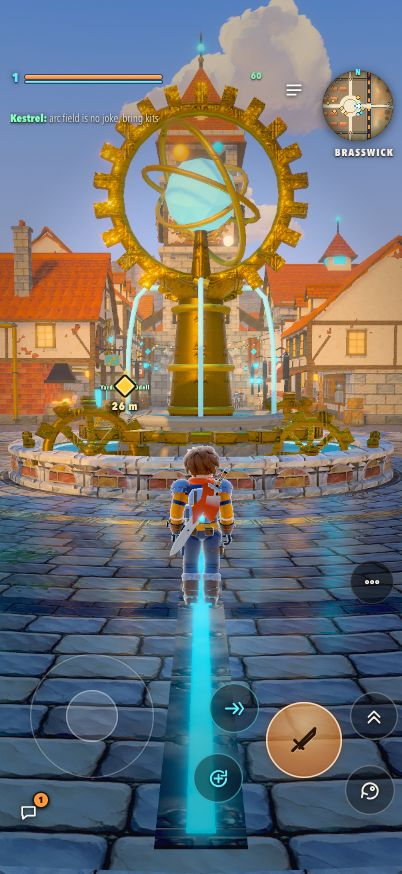

- **What:** Rook from behind at the brass orrery fountain in the plaza, timber and plaster houses with orange roofs either side, the clock tower behind; Yardmaster Odell's waypoint diamond at 26 m and a cyan guide line on the cobbles leading to him. Zone chat line top left.
- **Where:** Brasswick plaza, hero at (-10, 0) looking west down the main street; 08:12.
- **Why:** The hub every session starts from: warm plaster, slate and brass under a low morning sun (docs/LOOK.md, Light). Built in src/world/town.ts.
- **Staged by:** `golden:town-square-morning` in `tools/media/shots.js`.

## Brasswick, the market street

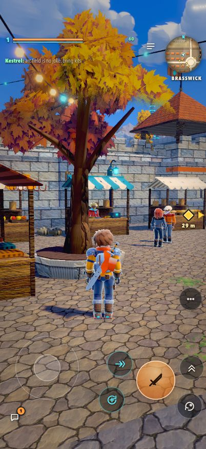

- **What:** A cobbled market corner: a big autumn tree, striped awnings over stalls, two townsfolk walking away, the town wall behind with string lights.
- **Where:** South-west quarter of Brasswick, hero at (-45, -24); 10:30.
- **Why:** Dense, readable props at walking pace: stalls, awnings, crates (docs/LOOK.md, Materials).
- **Staged by:** `golden:market-street` in `tools/media/shots.js`.

## Brasswick, the stable and paddock

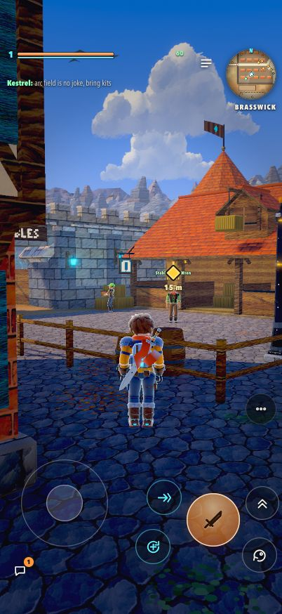

- **What:** The paddock fence and the stable's orange roof, Stable Hand Wren (waypoint at 15 m) and a second townsperson under it, the town wall and grey mountains behind.
- **Where:** West side of town, Stable Hand Wren at (-86, 32); the loaner horse is here.
- **Why:** Mounts start here: the stable hand lends the horse (src/world/west/mounts.ts). The paddock leads out to the riding course.

## Brasswick, the trophy wall and contract board

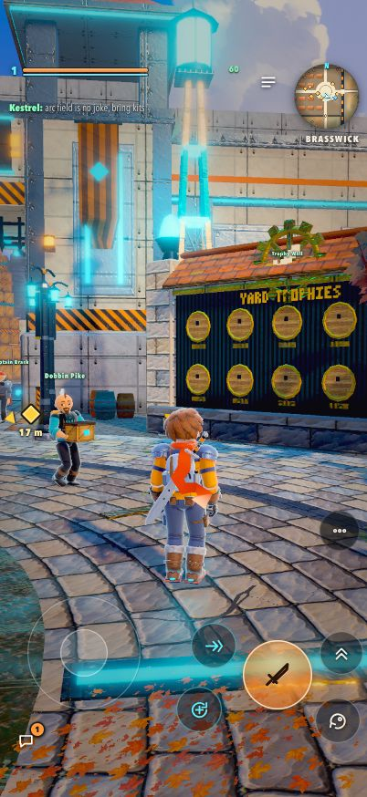

- **What:** The YARD TROPHIES board with its round plaques under a little roof, hazard-striped walls and cyan lamps; Dobbin Pike walking past with a crate.
- **Where:** East end of the plaza, trophy wall at (-11, 12), contract board at (-11, -12).
- **Why:** The kill-contract board pays for each enemy kind; the first kill of each hangs a trophy here with a joke title (ZONE-DESCRIPTION.md, Quests and economy; src/world/trophies.ts).

## Brasswick at night

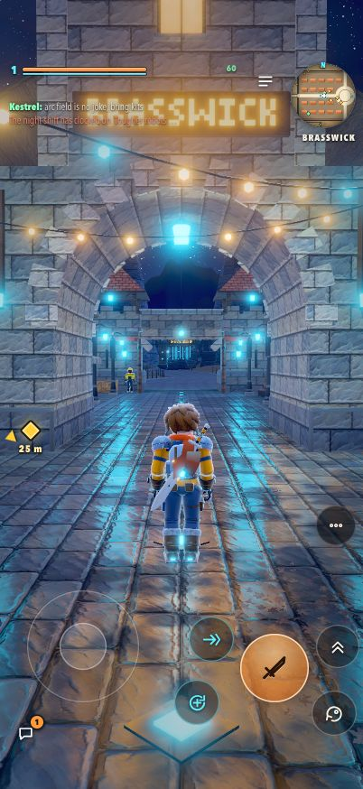

- **What:** The east gate arch at 22:00: string lights, cyan lamps along the wet street, the BRASSWICK sign in lights over the arch. Reads well; the street is lit by the town, not the moon.
- **Where:** Main street, hero at (-60, 0) looking east; 22:00.
- **Why:** Night is lit by the town itself: lanterns, windows and a baked lamp map (docs/LOOK.md, Light; AAA-PLAN run 2).
- **Staged by:** `golden:town-night` in `tools/media/shots.js`.

## Brasswick in a storm

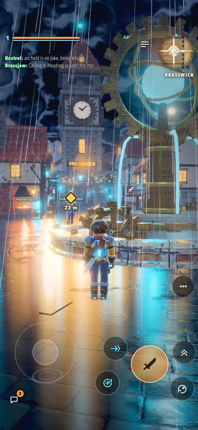

- **What:** The plaza at 19:24 in the storm: rain streaks, puddle reflections of warm windows and lamps, the clock tower lit. Zone chat shows adventurers reacting to the storm.
- **Where:** The plaza during Storm Hour (a quest turns the zone to an evening storm until four beacons are lit).
- **Why:** Weather changes the whole zone: rain, wet ground, lightning and a dark grade (src/world/environment.ts, src/gfx/rain.ts).

## The Blast Wall gate, looking east

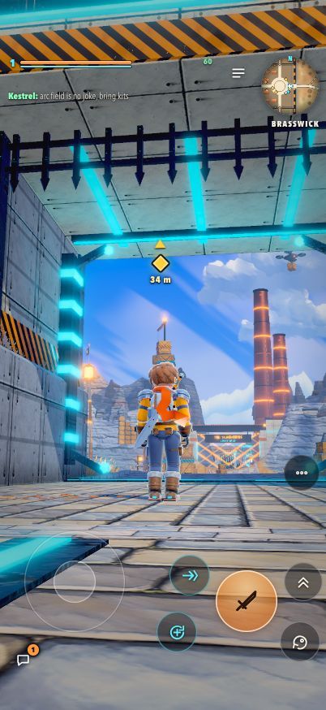

- **What:** Inside the Blast Wall gate looking east: steel portcullis teeth, cyan strips, hazard stripes; through the gate the Crate Fields' great crate stack and the Slagworks chimneys.
- **Where:** Brasswick east gate, hero at (-1.5, 0); 15:00. The west half is peaceful, the east is combat.
- **Why:** The one way across into the combat half, framed as a threshold with the bands beyond (ZONE-DESCRIPTION.md, Shape).
- **Staged by:** `golden:blast-wall-gate` in `tools/media/shots.js`.

## The skyline from town

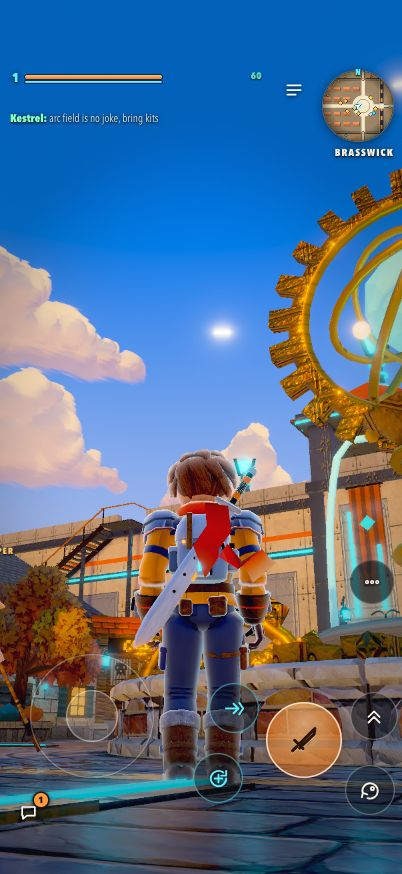

- **What:** Looking up from Brasswick's plaza in late afternoon: the orrery fountain's brass ring, rooftops and a stair, clouds, and a sky freighter crossing the sun. The sky traffic reads; the far skyline of the combat half does not show from this spot.
- **Where:** Brasswick plaza (-30, 0), camera low and pitched up toward the north-east.
- **Why:** Sky traffic, the freighter lanes and far landmarks make the zone feel part of a bigger world (src/world/vista/, AAA-PLAN phase 7).

## Band 1: the Crate Fields (L1-3)

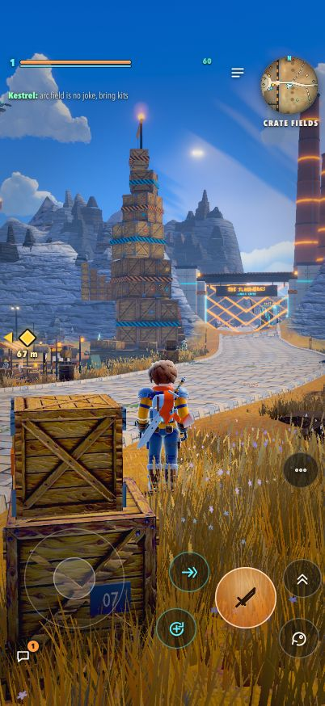

- **What:** Band 1 in the morning: golden grass, a wooden crate in the foreground, the road to the Great Stack (a tower of crates with a light on top) and the Slagworks gate beyond.
- **Where:** Just east of the Blast Wall, hero at (30, 6) looking east toward the Great Stack (91, -8).
- **Why:** The first band: open meadow, crate stacks and Crate Mites, soft and readable for a level 1 hero (ZONE-DESCRIPTION.md, The east).

## Band 1: a fight in the Crate Fields

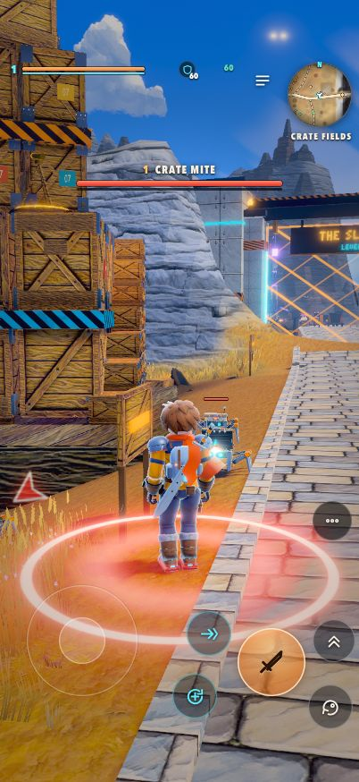

- **What:** A level 1 hero fighting a Crate Mite beside a crate stack on the field road; a red attack ring on the ground, the target frame (1 Crate Mite) at the top, the quest tracker and minimap.
- **Where:** Crate Fields beside Tallyline Post, (80, 0), three Crate Mites; 12:30.
- **Why:** Golden frame 8: grass, robots and the HUD in a fight (docs/AAA-PLAN.md section 3).
- **Staged by:** `golden:crate-fields-fight` in `tools/media/shots.js`.

## Band 1 at night: the night shift

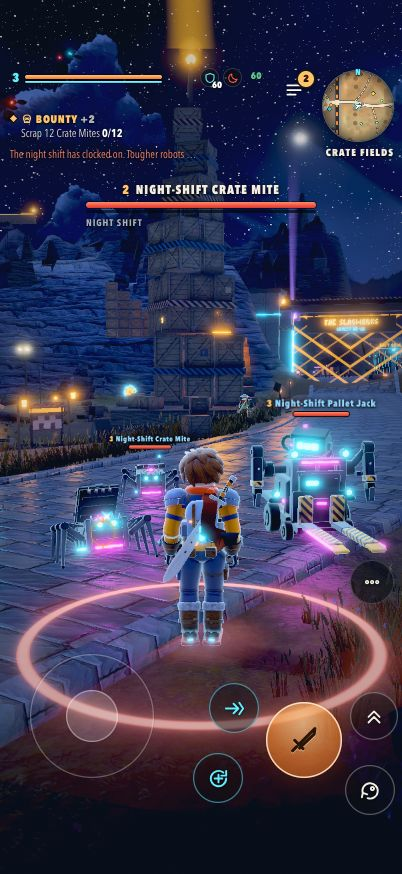

- **What:** The night shift: a Night-Shift Crate Mite and a Night-Shift Pallet Jack with pink and cyan running lights in front of the hero, the starry sky, the Great Stack and gate lit. The notice reads 'The night shift has clocked on. Tougher robots'.
- **Where:** Field road at (40, 6) looking east; 23:30. Night-shift robots spawn after dark.
- **Why:** Some enemies only come out at night; night variants are a little tougher and must stay readable (ZONE-DESCRIPTION.md).
- **Staged by:** `golden:night-shift-fields` in `tools/media/shots.js`.

## Band 2: the Pallet Docks (L4-6)

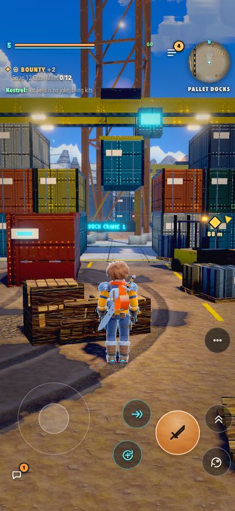

- **What:** The docks band: stacked shipping containers in red, green and blue, a crane gantry overhead, a dock crane sign; a quiet working yard at 11:00.
- **Where:** North-east, hero at (46, 184) looking south over the cranes; 11:00.
- **Why:** Hard surfaces and container stacks: the docks band of Pallet Jacks, gated by Big Pallet.
- **Staged by:** `golden:pallet-docks` in `tools/media/shots.js`.

## Band 2 at night

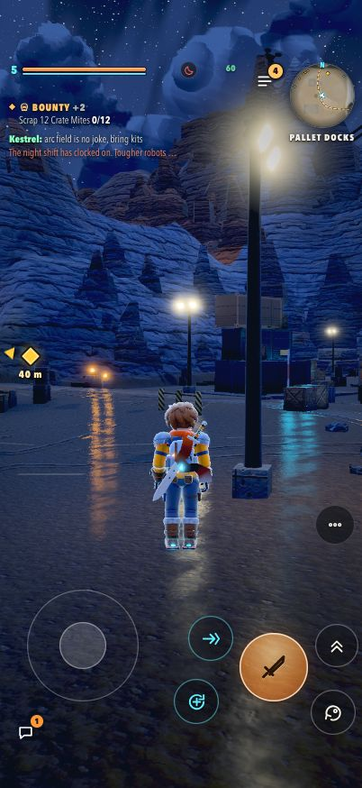

- **What:** The docks at 22:30: a tall lamp post with a warm halo over wet asphalt, distant lamps, dark rock walls. Readable but sparse.
- **Where:** Pallet Docks at (70, 150) looking north-east; 22:30.
- **Why:** Floodlights and lamp heads carry the docks at night (docs/LOOK.md, Light).

## Band 3: Plumb Heights (L7-9)

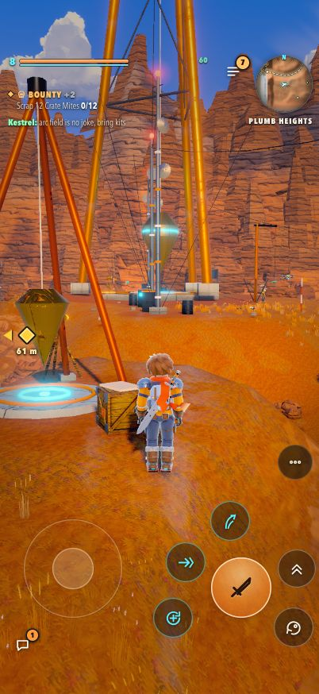

- **What:** Plumb Heights at 16:00: orange earth, red rock spires, a yellow survey tripod, a cyan beacon pad and a tall plumb mast.
- **Where:** High ground around the plumb tower (206, 174); 16:00.
- **Why:** Height and depth: the band with long views and Plumb Drones, gated by Plumb Line Prime.
- **Staged by:** `golden:plumb-heights-vista` in `tools/media/shots.js`.

## Band 4: the Slagworks (L10-12) by day

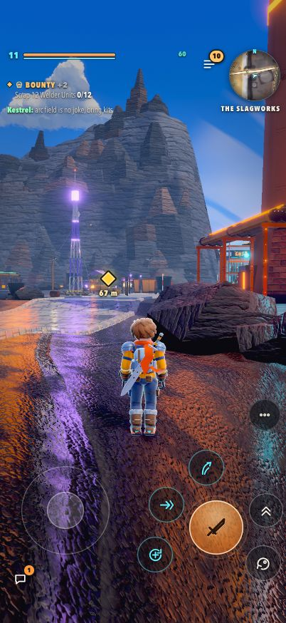

- **What:** The Slagworks by day: a wet purple-tinted road past dark rock, a lattice mast with a lamp, the furnace building on the right.
- **Where:** Inside the service gate, hero at (140, 8) looking east over the slag floor.
- **Why:** Heat and industry: Welder Units on slag ground where Burn is stronger (docs/COMBAT.md, statuses).

## Band 4: the Slagworks at dusk

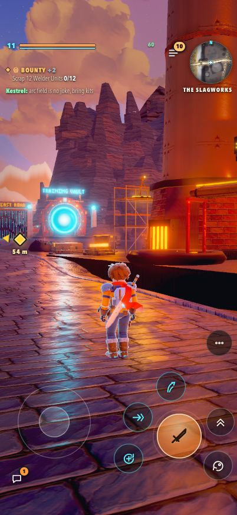

- **What:** The Slagworks at dusk: warm red rock, a glowing furnace doorway, wet reflective plates, and the Training Vault portal's cyan ring on the left.
- **Where:** Hero at (146, -3) looking east; 18:18.
- **Why:** Golden frame 12: emissive slag, furnace glow and heat haze against the evening.
- **Staged by:** `golden:slagworks-dusk` in `tools/media/shots.js`.

## Band 5: Rivet Row (L13-15)

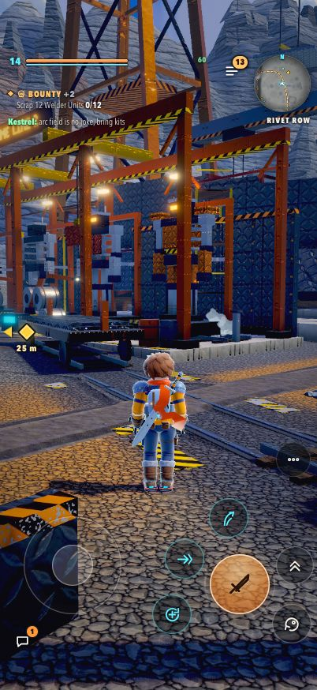

- **What:** Rivet Row: red steel gantries over a rail siding, crane lights, stacked plate; Old Reliable's band.
- **Where:** South-east, hero at (174, -144) looking north-east; 14:00.
- **Why:** Industrial detail at street scale: gantries and riveted plate, the Riveters' band, gated by Old Reliable.
- **Staged by:** `golden:rivet-row` in `tools/media/shots.js`.

## Band 6: the Arc Field (L16-18)

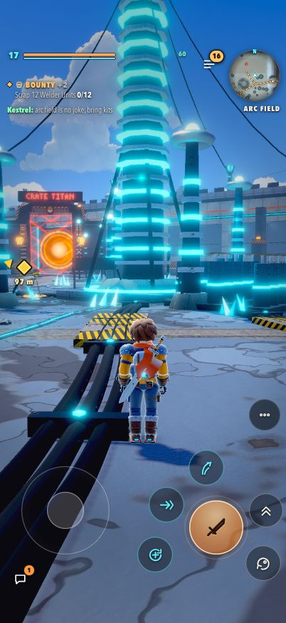

- **What:** The Arc Field at 13:00: banded cyan coil towers, cable runs on the ground, the Crate Titan's portal sign glowing orange ahead.
- **Where:** South, hero at (80, -178) looking west; 13:00.
- **Why:** The last band: coils and arcs of energy, Arc Sentries, Foreman Unit 7 at its gate.
- **Staged by:** `golden:arc-field` in `tools/media/shots.js`.

## Band 6 in a storm

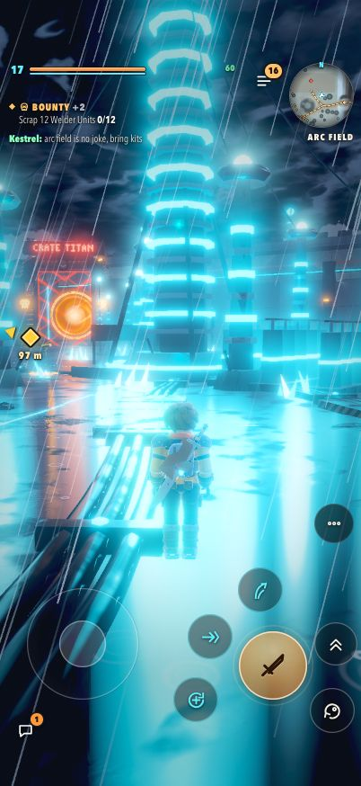

- **What:** The same Arc Field view in the storm at 19:30: rain, a wet floor, and the nearest coil's cyan glow washing over the right half of the frame. Weak: the coil's light overwhelms the hero; it shows the storm's effect on the coils more than the place.
- **Where:** Arc Field, hero at (80, -178) looking west, Storm Hour.
- **Why:** Shock chains further in rain and storm (docs/COMBAT.md), and the coils read best against a dark sky.
- **Staged by:** `golden:arc-field` in `tools/media/shots.js`.

## Storm Hour at a beacon

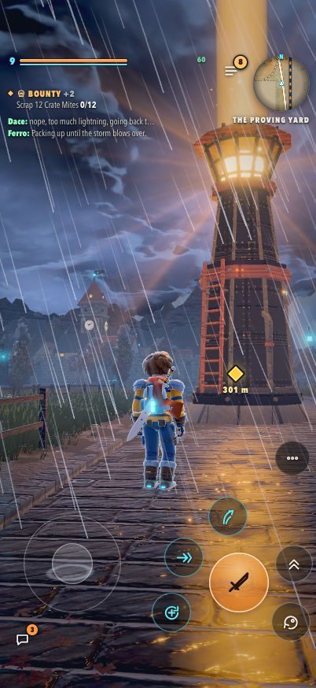

- **What:** Storm Hour on the northern causeway: rain across a lit lighthouse-like beacon, wet boards, a dark storm sky with sun breaking low.
- **Where:** Beacon 1 on the northern causeway (-11, 146), one beacon lit; 19:24, storm.
- **Why:** Golden frame 17: the storm quest lights four beacons across the zone to end it.
- **Staged by:** `golden:storm-beacon` in `tools/media/shots.js`.

## Outpost, band 1: Tallyline Post

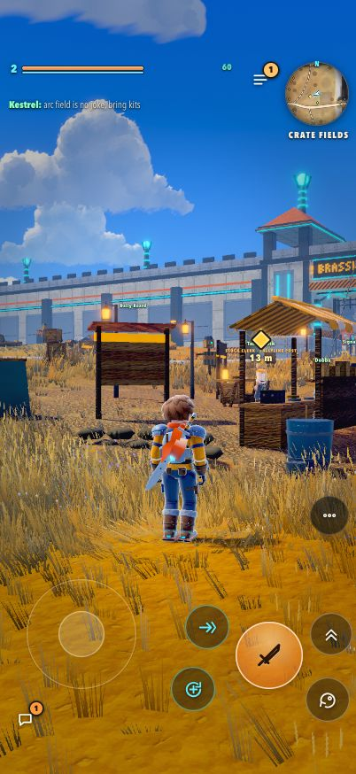

- **What:** Tallyline Post: the giver's table, the stall, notice boards and sandbags on golden grass, the town wall behind; the giver's waypoint at 13 m. The mast is out of frame above.
- **Where:** (64, -14), Crate Fields. Giver Tally Brock, vendor Dobbs.
- **Why:** One camp per band: a lit lattice mast, fast-travel terminal, quest giver, stall, daily board and a safe ring (AAA-PLAN, Field outposts).

## Outpost, band 2: Berth Nine

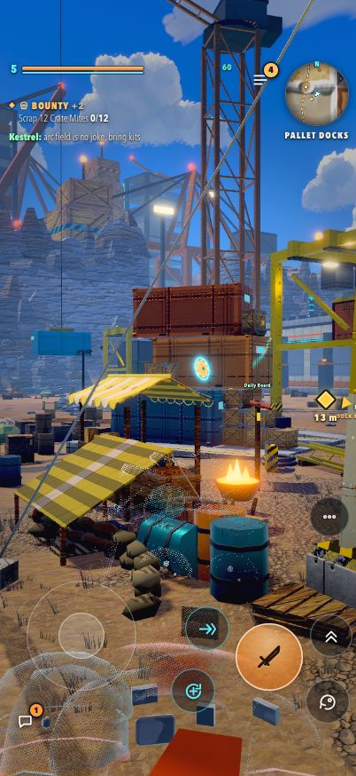

- **What:** Berth Nine among the docks' containers: a striped awning stall, a fire basket, barrels and sandbags, a crane behind.
- **Where:** (76, 101), Pallet Docks. Giver Marlo Venn, vendor Jessa Pike.
- **Why:** Same kit as every camp, dressed for its band.

## Outpost, band 3: Benchmark Camp

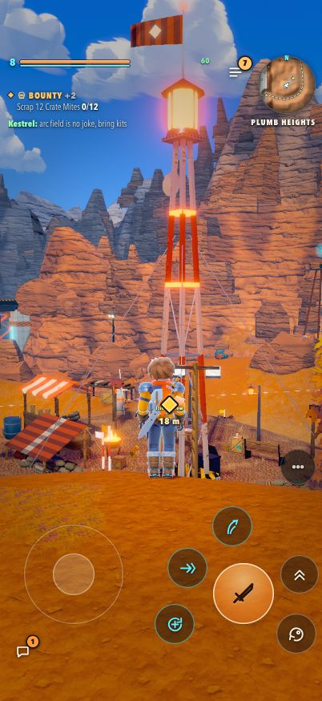

- **What:** Benchmark Camp in Plumb Heights at 15:00: the red lattice mast with its lit lamp head, the BENCHMARK sign, the stall and a fire, red rock spires behind.
- **Where:** (172, 132), Plumb Heights. Giver Ilse Marrow, vendor Fennick.
- **Why:** Same kit as every camp, dressed for its band.

## Outpost, band 4: Cinder Gate at dusk

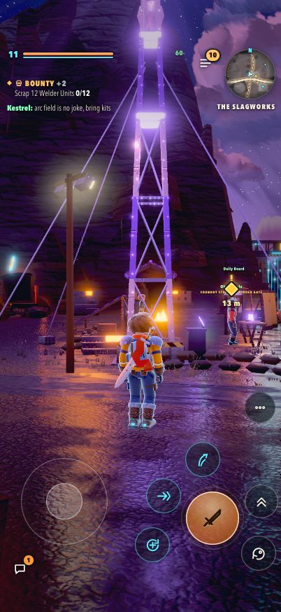

- **What:** Cinder Gate at 19:12: the lattice mast lit purple in the band colour against dark rock, warm lamps, the stall and board.
- **Where:** (198, -17), Slagworks. Giver Okoro Hale, vendor Cass Ember.
- **Why:** Shot at dusk: the mast's lamp head and halo carry the camp after dark.

## Outpost, band 5: Lineman's Rest

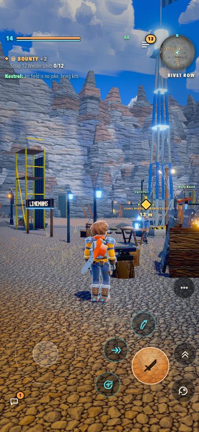

- **What:** Lineman's Rest at noon: the blue-lit lattice mast, a LINEMANS sign, lamps, the stall and its giver under the rock wall of Rivet Row.
- **Where:** (186, -166), Rivet Row. Giver Pell Quarry, vendor Old Tamsy.
- **Why:** Same kit as every camp, dressed for its band.

## Outpost, band 6: Last Light at night

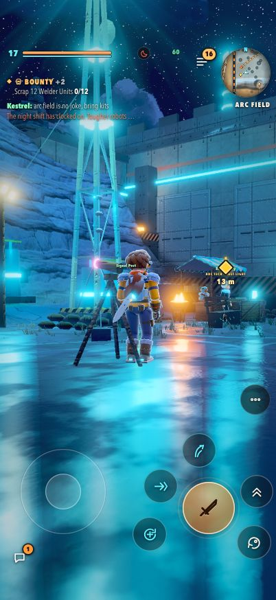

- **What:** Last Light at 22:30: the mast's cyan halo over a wet floor, the camp lamps and fire, the signal post terminal by the hero.
- **Where:** (22, -100), Arc Field. Giver Sorrel Vey, vendor Wick.
- **Why:** The night halo round the mast is the camp's landmark from across the band.

## The west: the weapon range

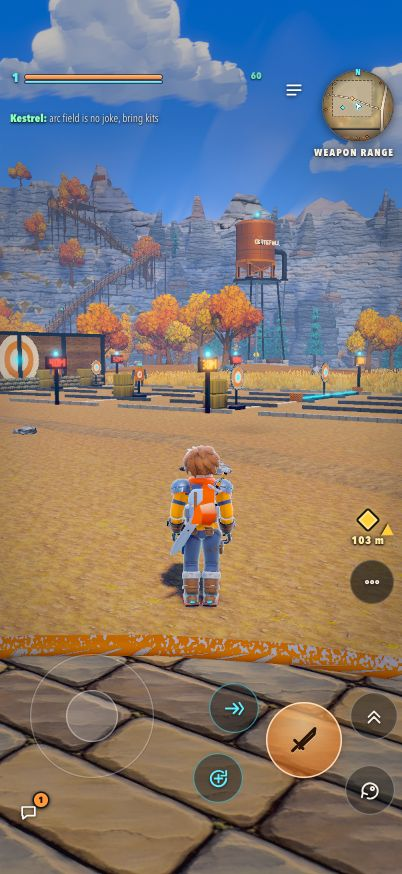

- **What:** The weapon range: lanes of practice targets and dummies, autumn trees, a water tower and the climbing course on the hill behind.
- **Where:** (-69, -90), north-west of town. Practice dummies and long lanes; Target Rush at (-84, -75).
- **Why:** Somewhere safe to learn every weapon (ZONE-DESCRIPTION.md, The west; src/world/west/range.ts).

## The west: the riding course, on horseback

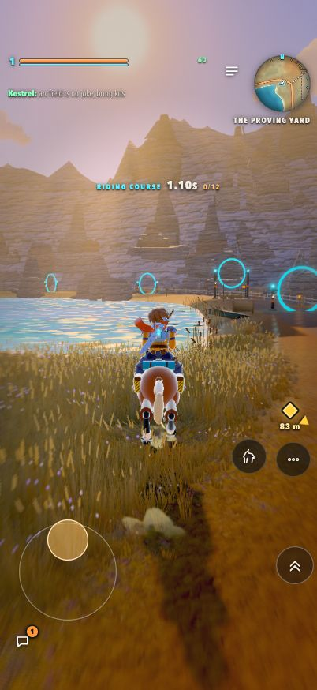

- **What:** On the loaner horse on the riding course at 16:30: the lap timer (RIDING COURSE 1.10 s, 0/12 rings), cyan rings ahead over a lake, low sun.
- **Where:** Riding course (-125, 82), loaner horse from the stable; 16:30.
- **Why:** Golden frame 19: rings, jumps and a lap timer for the horse (src/world/west/riding.ts).
- **Staged by:** `golden:riding-course` in `tools/media/shots.js`.

## The west: the physics yard

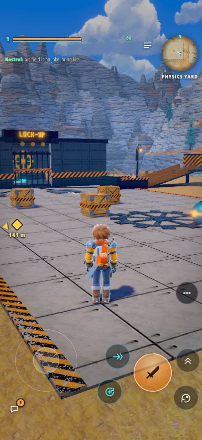

- **What:** The physics yard: a plated floor, loose crates, the LOCK-UP building with its gate, ramps and see-saw frames.
- **Where:** (-145, -100). Pressure plates, crates, see-saws, a ball run; lever at (-125, -117).
- **Why:** A toy box for the physics engine (Rapier): plates open a gate, crates tumble (src/world/west/physics.ts).

## The west: the long zipline into town

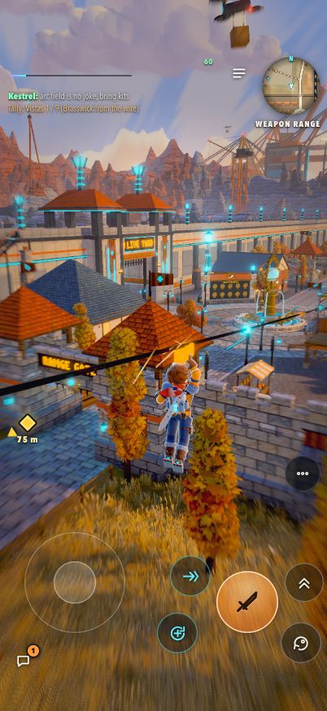

- **What:** On the zipline over the town wall into Brasswick: the cable, the town's roofs and lit signs below, autumn trees, the hero hanging from the line at left.
- **Where:** From the tower at (-52, 30 m up, -159) down into Brasswick; 16:30.
- **Why:** Golden frame 20: speed and a composed view of the town on the way in.
- **Staged by:** `golden:zipline-into-town` in `tools/media/shots.js`.

## The west: the climb yard

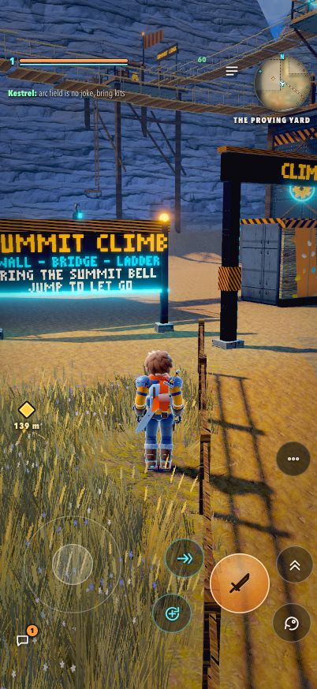

- **What:** The climb yard: a SUMMIT CLIMB sign (wall, bridge, ladder; ring the summit bell), the scramble frames and a rope bridge on the cliff behind.
- **Where:** (-204, -62): scramble wall, ladders, rope bridges; the summit ledge at (-230, -76).
- **Why:** Vertical play in the peaceful half (src/world/west/climb.ts).

## The west: the Rock lookout

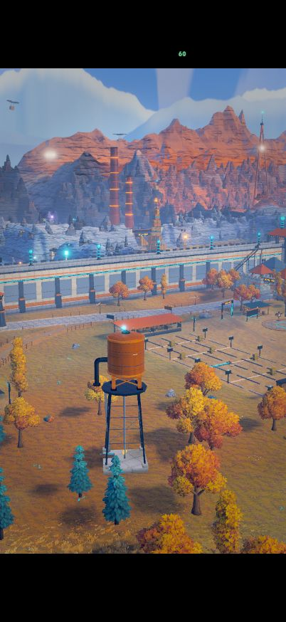

- **What:** The Rock's lookout bench with its vista camera (HUD hidden, letterboxed): the whole west half below, a water tower, autumn trees and the far mountains.
- **Where:** The bench on the Rock (-179, 39 m up, -199), with its vista camera; 15:30.
- **Why:** Golden frame 18: the zone's big vista, earned by a climb.
- **Staged by:** `golden:rock-lookout` in `tools/media/shots.js`.

## The west: the hoverboard park

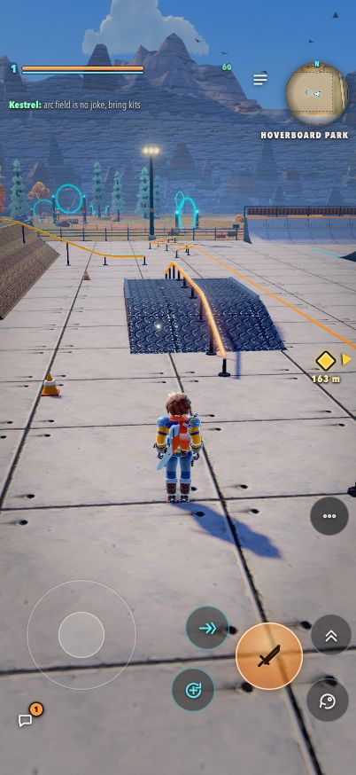

- **What:** The hoverboard park: a long slab with kickers, a grind rail and a sunken bowl, cyan rings and trees beyond, the rock wall behind.
- **Where:** (-67, 187), south-west of town; the board rack is at (-40, 159).
- **Why:** Kickers, a halfpipe, rails and a bowl for the hoverboard (src/world/west/hover.ts).

## The west: the movers run

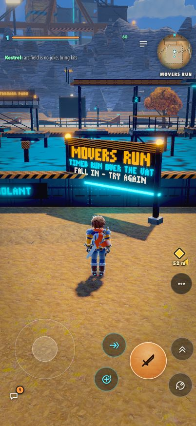

- **What:** The movers run's start: a lit MOVERS RUN sign ('Timed run over the vat. Fall in, try again'), the moving platforms and gantries over the cyan vat behind it.
- **Where:** (-70, 96): moving platforms, lifts and conveyors.
- **Why:** A timed platform course (src/world/west/moversrun.ts).

## The Training Vault portal

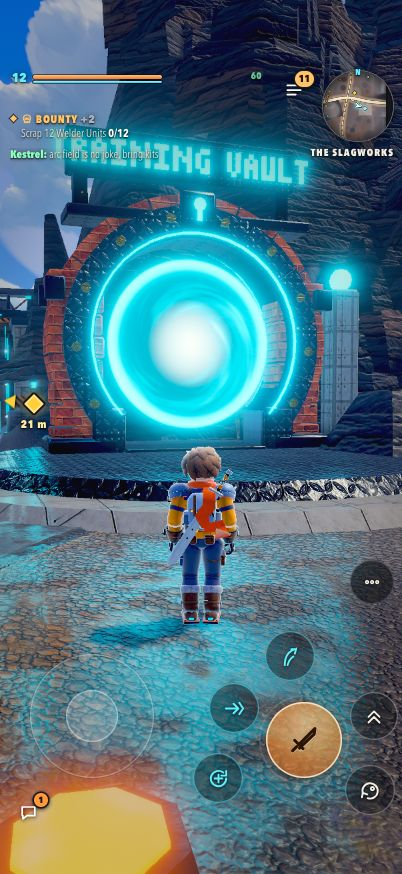

- **What:** The TRAINING VAULT portal: a brick arch around a bright cyan ring, set into the Slagworks rock.
- **Where:** Slagworks edge, portal at (215, 8).
- **Why:** The mini dungeon sits physically inside the zone cube, underground, reached by a portal (ZONE-DESCRIPTION.md, Shape).

## The Training Vault: the Warden's hall

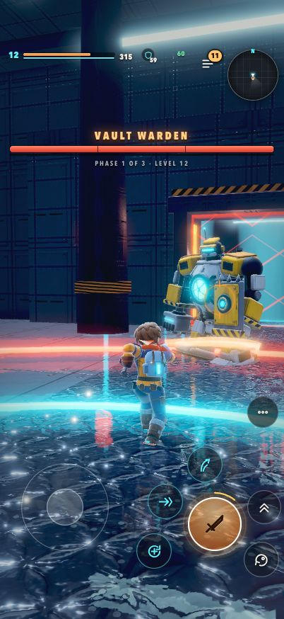

- **What:** Inside the vault, the Warden's hall: the Vault Warden (phase 1 of 3, level 12) on a reflective floor with red sweep lines and cyan light bars; boss bar at the top.
- **Where:** Fourth room of the vault, underground at (200, -54, -60).
- **Why:** Golden frame 21: interior light; the vault is a puzzle, a fight, a climb and the Vault Warden (src/world/vault.ts).
- **Staged by:** `golden:vault-warden` in `tools/media/shots.js`.

## The gauntlet courts

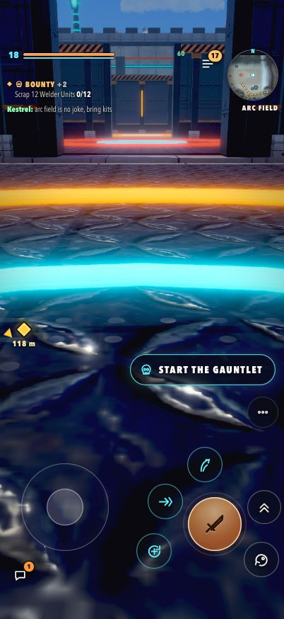

- **What:** The gauntlet's court gate from the start post: the gate with its glowing sill, the wet court floor, the START THE GAUNTLET prompt. Weak: the camera sits high over the hero, who is out of frame, and the courts themselves are behind the wall.
- **Where:** South, court A at (62, -203); the start post is at (88, -203).
- **Why:** Wave survival in three sealed courts, five waves, an elite in the middle waves (ZONE-DESCRIPTION.md, The east).

## The gauntlet, mid-wave

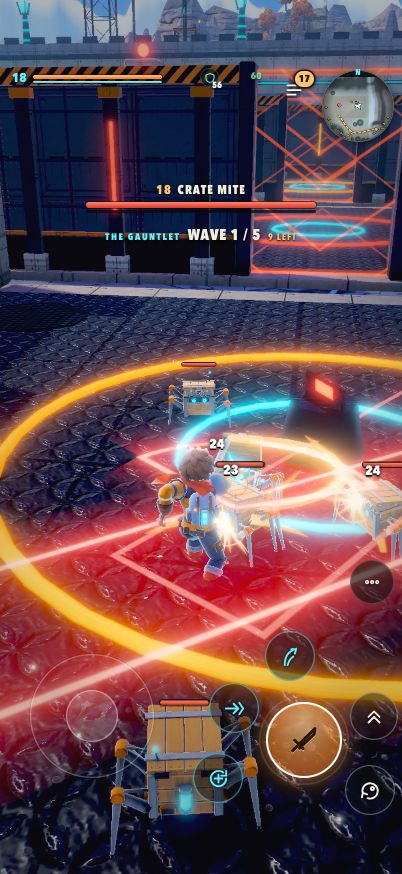

- **What:** Court A of the gauntlet, wave 1 of 5: crate mites closing on the hero, red and orange attack rings on the floor, damage numbers.
- **Where:** Court A, a wave running; 13:00.
- **Why:** Golden frame 22: crowd combat.
- **Staged by:** `golden:gauntlet-wave` in `tools/media/shots.js`.

## The boss portal to the Crate Titan

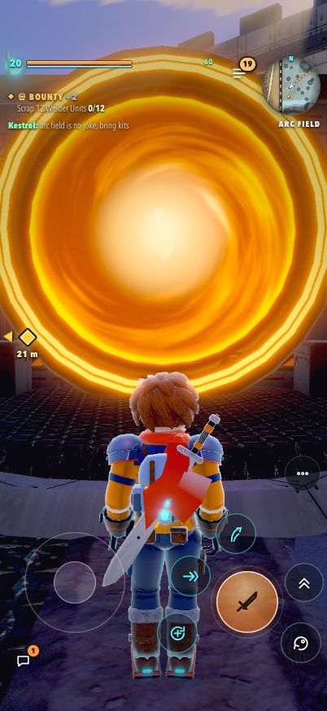

- **What:** Inside the Titan yard: the boss portal's orange ring filling the frame, the hero in front of it. The portal opens once the gauntlet is cleared.
- **Where:** Arc Field: the Titan yard at (24, -118), its portal ring on the inner wall at (20, -115). The yard's door opens after the first gauntlet clear.
- **Why:** A raid door: the arena is hidden, reached through this portal (ZONE-DESCRIPTION.md).

## The Crate Titan's arena

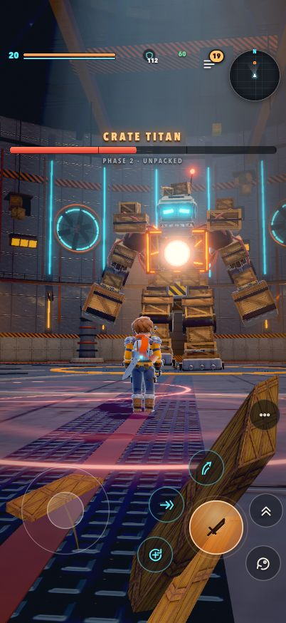

- **What:** The Crate Titan in its arena in phase 2 (Unpacked): a 15 m body of crates and girders with a glowing core, hanging crates, the boss bar at the top.
- **Where:** The arena interior at (80, -179, -120), phase 2 of the fight.
- **Why:** Golden frame 23: boss scale. A 15 m giant of crates in a vast hall (src/world/arena.ts).
- **Staged by:** `golden:crate-titan-phase2` in `tools/media/shots.js`.

## The zone map

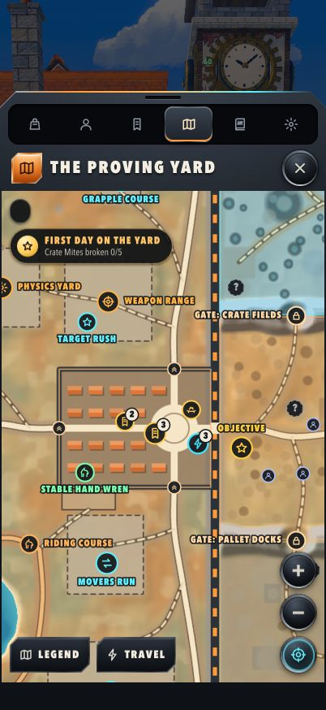

- **What:** The map panel as a bottom sheet in portrait: Brasswick with its gates, the west courses (physics yard, weapon range, riding course, movers run), the gates into Crate Fields and Pallet Docks, the tracked quest pinned top left. It opens on the player's surroundings; pinch or the +/- buttons show the whole zone.
- **Where:** Menu tray, Map (or M on a desktop).
- **Why:** The whole zone at a glance: bands with their levels, gates, camps, courses (src/ui/map.ts; docs/HUD.md, Panels).
- **Staged by:** `pn:map` in `tools/media/shots.js`.

## The zone map on a desktop

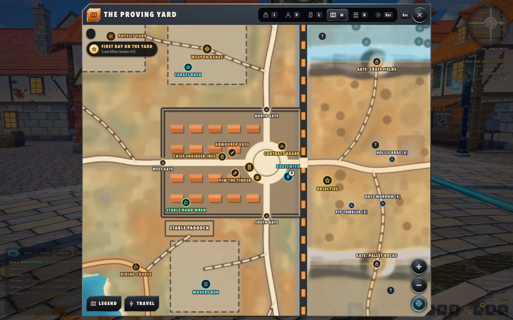

(desktop 1440x900)

- **What:** The same map in the desktop window: Brasswick with its named NPCs and gates, the stable paddock, the west courses, and simulated adventurers marked in the Crate Fields.
- **Where:** M on a desktop.
- **Why:** The same map in the desktop window frame (docs/HUD.md, Panels).
- **Staged by:** `pn:map` in `tools/media/shots.js`.
